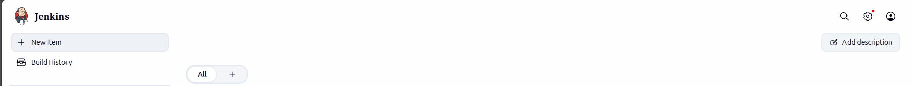
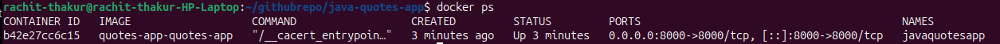
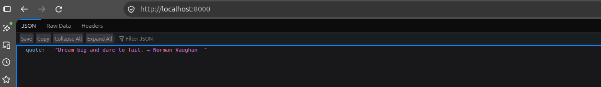

# Task 1: Create a Jenkins Pipeline Job for CI/CD

## Objective

Create an end-to-end CI/CD pipeline using Jenkins to automate the build, test, and deployment of the Java Quotes application using Docker and Docker Compose.

## Tools & Technologies Used

- Jenkins
- Git & GitHub
- Java
- Docker
- Docker Compose
- Linux

---

## 1. Set Up a Jenkins Pipeline Job

### Step 1: Open Jenkins Dashboard

- Open your Jenkins dashboard.
- Click on **New Item**.



### Step 2: Enter Item Name

- Enter the pipeline job name.
- Example: `java-quotes-app-pipeline`.


### Step 3: Select Pipeline

- Select the **Pipeline** option.
- Click **OK**.


### Step 4: Configure GitHub Project

- Select the **GitHub project** checkbox.
- Enter your GitHub repository URL.

Repository:

`https://github.com/Rachit-thakur/java-quotes-app`


### Step 5: Configure Pipeline Script

Add the following Jenkins pipeline script:

## 2. Jenkinsfile

```groovy
pipeline {
    agent any

    stages {

        stage("Code") {
            steps {
                git url: "https://github.com/Rachit-thakur/java-quotes-app.git",
                    branch: "main"
            }
        }

        stage("Build") {
            steps {
                echo "Building Docker image..."
                sh "docker build -t java-quotes-app ."
            }
        }

        stage("Test") {
            steps {
                echo "Running tests..."
            }
        }

        stage("Deploy") {
            steps {
                echo "Deploying application..."
                sh "docker compose up -d --build java-quotes-app"
            }
        }
    }
}
```

### Explanation of Pipeline Stages

**1. Code Stage**

- Jenkins fetches the source code from the GitHub repository.
- It checks out the `main` branch.
- The application source code becomes available in the Jenkins workspace.

**2. Build Stage**

- Jenkins executes the Docker build command.
- Docker reads the Dockerfile.
- A Docker image named `java-quotes-app` is created.

**3. Test Stage**

- This stage is used to test the application.
- Currently, it only prints a message using the `echo` command.
- Actual automated application tests can be added here later.

**4. Deploy Stage**

- Docker Compose starts the application.
- The `--build` option rebuilds the image if required.
- The `-d` option runs the container in detached mode.

---

## 3. Run and Verify the Pipeline

After configuring the pipeline:

1. Click **Save**.
2. Open the Jenkins pipeline job.
3. Click **Build Now**.
4. Wait for the pipeline execution.
5. Open **Console Output** to check the execution logs.


### Verify Docker Container

Run the following command on the Jenkins agent:

```bash
docker ps
```

This command displays running Docker containers.



### Verify Application

Open the application URL in your browser and check whether the Java Quotes application is running successfully.



---

## 4. Issues Faced and Solutions

### Issue: Docker Compose Service Name Mismatch

**Problem:**

During pipeline execution, I encountered an error because the application name used in my Jenkins pipeline did not match the service name defined in my `docker-compose.yml` file.

Error:

```text
no such service: java-quotes-app
```

**Reason:**

Docker Compose identifies applications using the service names defined under the `services` section of `docker-compose.yml`.

If the service name in Jenkins and Docker Compose does not match, Docker Compose cannot find the requested service.

**Solution:**

I checked the service name in my `docker-compose.yml` file and updated the Jenkins pipeline command to use the correct service name.

Example:

```yaml
services:
  java-quotes-app:
    build: .
```

Matching Jenkins command:

```bash
docker compose up -d --build java-quotes-app
```

After correcting the service name, the deployment stage executed successfully.

---

**Conclusion:**

This task helped me understand how Jenkins automates the software delivery process using CI/CD pipelines and how Docker and Docker Compose can be integrated with Jenkins for application deployment.

---