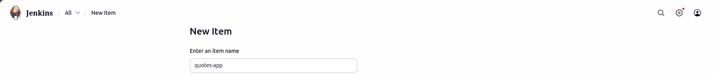
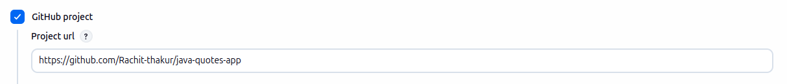
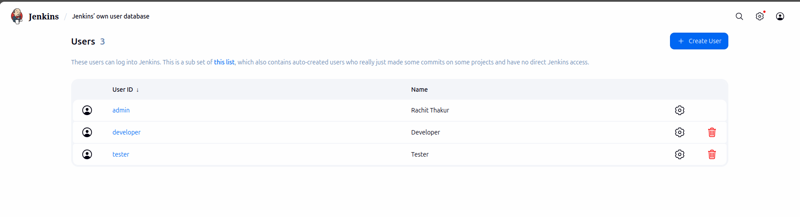
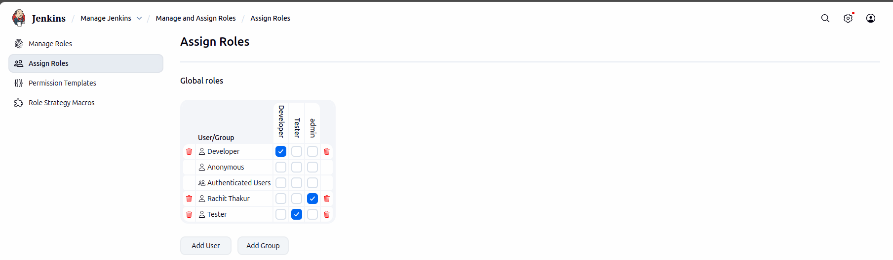
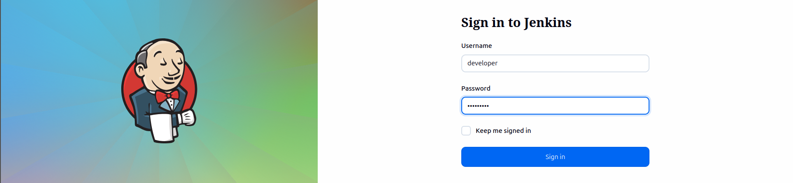
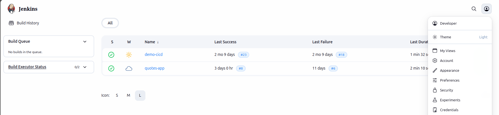

# Task 1: Create a Jenkins Pipeline Job for CI/CD

## Objective

Create an end-to-end CI/CD pipeline using Jenkins to automate the build, test, and deployment of the Java Quotes application using Docker and Docker Compose.

## Tools & Technologies Used

- Jenkins
- Git & GitHub
- Java
- Docker
- Docker Compose
- Linux

---

## 1. Set Up a Jenkins Pipeline Job

### Step 1: Open Jenkins Dashboard

- Open your Jenkins dashboard.
- Click on **New Item**.


### Step 2: Enter Item Name

- Enter the pipeline job name.
- Example: `java-quotes-app-pipeline`.



### Step 3: Select Pipeline

- Select the **Pipeline** option.
- Click **OK**.


### Step 4: Configure GitHub Project

- Select the **GitHub project** checkbox.
- Enter your GitHub repository URL.

Repository:

`https://github.com/Rachit-thakur/java-quotes-app`



### Step 5: Configure Pipeline Script

Add the following Jenkins pipeline script:

## 2. Jenkinsfile

```groovy
pipeline {
    agent any

    stages {

        stage("Code") {
            steps {
                git url: "https://github.com/Rachit-thakur/java-quotes-app.git",
                    branch: "main"
            }
        }

        stage("Build") {
            steps {
                echo "Building Docker image..."
                sh "docker build -t java-quotes-app ."
            }
        }

        stage("Test") {
            steps {
                echo "Running tests..."
            }
        }

        stage("Deploy") {
            steps {
                echo "Deploying application..."
                sh "docker compose up -d --build java-quotes-app"
            }
        }
    }
}
```

### Explanation of Pipeline Stages

**1. Code Stage**

- Jenkins fetches the source code from the GitHub repository.
- It checks out the `main` branch.
- The application source code becomes available in the Jenkins workspace.

**2. Build Stage**

- Jenkins executes the Docker build command.
- Docker reads the Dockerfile.
- A Docker image named `java-quotes-app` is created.

**3. Test Stage**

- This stage is used to test the application.
- Currently, it only prints a message using the `echo` command.
- Actual automated application tests can be added here later.

**4. Deploy Stage**

- Docker Compose starts the application.
- The `--build` option rebuilds the image if required.
- The `-d` option runs the container in detached mode.

---

## 3. Run and Verify the Pipeline

After configuring the pipeline:

1. Click **Save**.
2. Open the Jenkins pipeline job.
3. Click **Build Now**.
4. Wait for the pipeline execution.
5. Open **Console Output** to check the execution logs.


### Verify Docker Container

Run the following command on the Jenkins agent:

```bash
docker ps
```

This command displays running Docker containers.


### Verify Application

Open the application URL in your browser and check whether the Java Quotes application is running successfully.


---

## 4. Issues Faced and Solutions

### Issue: Docker Compose Service Name Mismatch

**Problem:**

During pipeline execution, I encountered an error because the application name used in my Jenkins pipeline did not match the service name defined in my `docker-compose.yml` file.

Error:

```text
no such service: java-quotes-app
```

**Reason:**

Docker Compose identifies applications using the service names defined under the `services` section of `docker-compose.yml`.

If the service name in Jenkins and Docker Compose does not match, Docker Compose cannot find the requested service.

**Solution:**

I checked the service name in my `docker-compose.yml` file and updated the Jenkins pipeline command to use the correct service name.

Example:

```yaml
services:
  java-quotes-app:
    build: .
```

Matching Jenkins command:

```bash
docker compose up -d --build java-quotes-app
```

After correcting the service name, the deployment stage executed successfully.

---

**Conclusion:**

This task helped me understand how Jenkins automates the software delivery process using CI/CD pipelines and how Docker and Docker Compose can be integrated with Jenkins for application deployment.

---

# Jenkins Pipeline – Interview Questions

## 1. How do Declarative Pipelines streamline the CI/CD process compared to Scripted Pipelines?

Declarative Pipelines streamline the CI/CD process by providing a predefined, structured, and easy-to-understand syntax.

They make pipeline creation, management, and maintenance easier compared to Scripted Pipelines.

### Key Benefits

1. **Simple Syntax:** Declarative Pipelines follow a predefined structure, making them easier to write and understand.

2. **Better Readability:** Developers can easily identify different stages like Build, Test, and Deploy.

3. **Easy Maintenance:** Because of their structured format, modifying and debugging pipelines becomes easier.

4. **Error Handling:** They provide built-in features like `post`, `success`, and `failure` to handle pipeline results.

5. **Consistency:** Teams can follow the same pipeline structure across different projects.

### Example

```groovy
pipeline {
    agent any

    stages {
        stage('Build') {
            steps {
                echo 'Building application'
            }
        }

        stage('Test') {
            steps {
                echo 'Testing application'
            }
        }

        stage('Deploy') {
            steps {
                echo 'Deploying application'
            }
        }
    }
}
```

**In Simple Words:** Declarative Pipeline makes CI/CD automation easier because it follows a fixed structure and requires less complex programming.

---

## 2. What are the benefits of breaking the pipeline into distinct stages?

Breaking a Jenkins Pipeline into distinct stages helps organize the CI/CD process into smaller, manageable steps.

For example, a pipeline can have the following stages:

- Code Checkout
- Build
- Test
- Deploy

### Key Benefits

1. **Easy Troubleshooting:** If a pipeline fails, we can quickly identify which stage caused the problem.

2. **Better Visibility:** Jenkins displays each stage separately, making pipeline progress easier to understand.

3. **Easy Debugging:** Developers can investigate and fix problems in a particular stage.

4. **Improved Organization:** Each stage performs a specific task, keeping the pipeline clean and structured.

5. **Time Saving:** Jenkins normally skips later stages when an earlier stage fails, depending on the pipeline configuration.

6. **Parallel Execution:** Independent tasks, such as different test suites, can run simultaneously to reduce execution time.

### Example: Jenkins Pipeline Flow

```text
        Jenkins Pipeline
               |
               v
        Code Checkout
               |
               v
          Build Stage
               |
               v
          Test Stage
               |
               v
         Deploy Stage
               |
               v
       Application Ready
```

### Practical Scenario

Suppose my Java application fails during the Test stage.

- Jenkins identifies the Test stage as failed.
- Jenkins marks the pipeline as failed.
- The normal pipeline execution stops.
- The Deploy stage does not execute.

This prevents an application with failing tests from being deployed.

---

## Quick Interview Revision

| Question | Short Answer |
|---|---|
| Why Declarative Pipeline? | Simple syntax, predefined structure, and easy maintenance. |
| Why separate stages? | Better organization, visibility, debugging, and troubleshooting. |
| What happens if Build fails? | Normally, subsequent stages do not execute. |
| Can stages run in parallel? | Yes, using the `parallel` directive. |

---

# Task 4: Implement and Test RBAC in a Multi-Team Environment

**Scenario:**  
In a large organization, different teams (developers, testers, and operations) require different levels of access to Jenkins. You need to configure RBAC to secure your CI/CD pipeline.

1. **Configure RBAC:**  
   - Use Matrix-based security or the Role Strategy Plugin to create roles (e.g., Admin, Developer, Tester).
   - Define permissions for each role.

   we will use Role Based Security

   First we will login to our Jenkins account with our credentials
Step 1: Install Role Strategy Plugin
1. Open Jenkins in your browser:
   http://localhost:8080
2. Log in using your Jenkins administrator account.
3. Navigate to:
4. Manage Jenkins → Plugins → Available plugins
5. Search for:
   Role-based Authorization Strategy
6. Select the plugin.


6. Click Install.
7. Restart Jenkins if required.

Step 2: Enable Role-Based Authorization
After installing the plugin:
1. Go to Manage Jenkins.
2. Open Security or Configure Global Security (depending on your Jenkins version).
3. Find the Authorization section.
4. Select:
   Role-Based Strategy


5. Click Save.

2. **Create Test Accounts:**  
   - Simulate real-world usage by creating user accounts for each role and verifying access.
   
Step 3: Create Roles
Navigate to:

Manage Jenkins → Manage and Assign Roles → Manage Roles

You should see a Global Roles section.

Below that find Role to Add Section.
Inside that typr the role which you want to create and click Add.
After this the role will be added to the Global Roles Section.
Now you can assign the permission that you need.

Create these three roles:
A. Admin
Admin should have all permissions.

Select:

- Overall → Administer
This gives the administrator complete control over Jenkins.
B. Developer
Developers need permission to view projects and execute builds.

Select:

Permission	Access
Overall → Read	Yes
Job → Read	Yes
Job → Build	Yes
Job → Cancel	Yes
Job → Workspace	Yes
View → Read	Yes


Do not give developers Overall → Administer.
C. Tester
Testers mainly need to view projects and check build results.

Select:

Permission	Access
Overall → Read	Yes
Job → Read	Yes
Job → Workspace	Yes
View → Read	Yes


After creating all three roles, Click Save.

Step 4: Create Test Accounts
Now we need to create separate Jenkins users to simulate different employees.

Navigate to:

Manage Jenkins → Users → Create User

Create the following accounts:
Username	Password	Role
admin	Your password	Admin
developer	Your password	Developer
tester	Your password	Tester


Use separate strong passwords for each account.

You should now have three test accounts.



Step 5: Assign Roles to Users
Navigate to:

Manage Jenkins → Manage and Assign Roles → Assign Roles

Under Global Roles, you should see your three roles.

Enter the usernames and assign permissions:
User	Admin	Developer	Tester
admin_user	✓		
developer_user		✓	
tester_user			✓



Click Save.

Your RBAC configuration is now ready.

verify by login as a Developer:



I am now logged in as a Developer and not able to see the Manage Jenkins settings:



