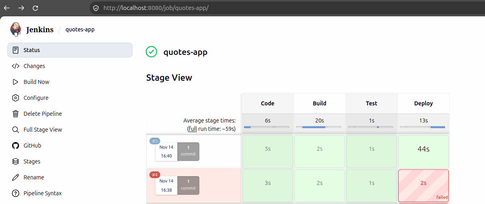
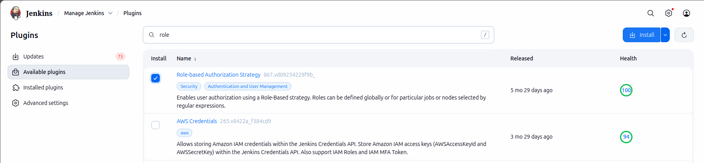
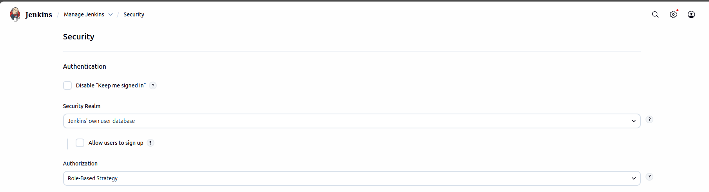
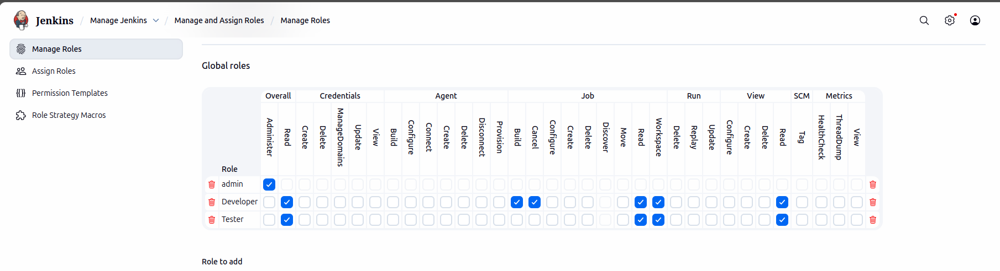

# Task 1: Create a Jenkins Pipeline Job for CI/CD

## Objective

Create an end-to-end CI/CD pipeline using Jenkins to automate the build, test, and deployment of the Java Quotes application using Docker and Docker Compose.

## Tools & Technologies Used

- Jenkins
- Git & GitHub
- Java
- Docker
- Docker Compose
- Linux

---

## 1. Set Up a Jenkins Pipeline Job

### Step 1: Open Jenkins Dashboard

- Open your Jenkins dashboard.
- Click on **New Item**.


### Step 2: Enter Item Name

- Enter the pipeline job name.
- Example: `java-quotes-app-pipeline`.


### Step 3: Select Pipeline

- Select the **Pipeline** option.
- Click **OK**.


### Step 4: Configure GitHub Project

- Select the **GitHub project** checkbox.
- Enter your GitHub repository URL.

Repository:

`https://github.com/Rachit-thakur/java-quotes-app`


### Step 5: Configure Pipeline Script

Add the following Jenkins pipeline script:

## 2. Jenkinsfile

```groovy
pipeline {
    agent any

    stages {

        stage("Code") {
            steps {
                git url: "https://github.com/Rachit-thakur/java-quotes-app.git",
                    branch: "main"
            }
        }

        stage("Build") {
            steps {
                echo "Building Docker image..."
                sh "docker build -t java-quotes-app ."
            }
        }

        stage("Test") {
            steps {
                echo "Running tests..."
            }
        }

        stage("Deploy") {
            steps {
                echo "Deploying application..."
                sh "docker compose up -d --build java-quotes-app"
            }
        }
    }
}
```

### Explanation of Pipeline Stages

**1. Code Stage**

- Jenkins fetches the source code from the GitHub repository.
- It checks out the `main` branch.
- The application source code becomes available in the Jenkins workspace.

**2. Build Stage**

- Jenkins executes the Docker build command.
- Docker reads the Dockerfile.
- A Docker image named `java-quotes-app` is created.

**3. Test Stage**

- This stage is used to test the application.
- Currently, it only prints a message using the `echo` command.
- Actual automated application tests can be added here later.

**4. Deploy Stage**

- Docker Compose starts the application.
- The `--build` option rebuilds the image if required.
- The `-d` option runs the container in detached mode.

---

## 3. Run and Verify the Pipeline

After configuring the pipeline:

1. Click **Save**.
2. Open the Jenkins pipeline job.
3. Click **Build Now**.
4. Wait for the pipeline execution.
5. Open **Console Output** to check the execution logs.



### Verify Docker Container

Run the following command on the Jenkins agent:

```bash
docker ps
```

This command displays running Docker containers.


### Verify Application

Open the application URL in your browser and check whether the Java Quotes application is running successfully.


---

## 4. Issues Faced and Solutions

### Issue: Docker Compose Service Name Mismatch

**Problem:**

During pipeline execution, I encountered an error because the application name used in my Jenkins pipeline did not match the service name defined in my `docker-compose.yml` file.

Error:

```text
no such service: java-quotes-app
```

**Reason:**

Docker Compose identifies applications using the service names defined under the `services` section of `docker-compose.yml`.

If the service name in Jenkins and Docker Compose does not match, Docker Compose cannot find the requested service.

**Solution:**

I checked the service name in my `docker-compose.yml` file and updated the Jenkins pipeline command to use the correct service name.

Example:

```yaml
services:
  java-quotes-app:
    build: .
```

Matching Jenkins command:

```bash
docker compose up -d --build java-quotes-app
```

After correcting the service name, the deployment stage executed successfully.

---

**Conclusion:**

This task helped me understand how Jenkins automates the software delivery process using CI/CD pipelines and how Docker and Docker Compose can be integrated with Jenkins for application deployment.

---

# Jenkins Pipeline – Interview Questions

## 1. How do Declarative Pipelines streamline the CI/CD process compared to Scripted Pipelines?

Declarative Pipelines streamline the CI/CD process by providing a predefined, structured, and easy-to-understand syntax.

They make pipeline creation, management, and maintenance easier compared to Scripted Pipelines.

### Key Benefits

1. **Simple Syntax:** Declarative Pipelines follow a predefined structure, making them easier to write and understand.

2. **Better Readability:** Developers can easily identify different stages like Build, Test, and Deploy.

3. **Easy Maintenance:** Because of their structured format, modifying and debugging pipelines becomes easier.

4. **Error Handling:** They provide built-in features like `post`, `success`, and `failure` to handle pipeline results.

5. **Consistency:** Teams can follow the same pipeline structure across different projects.

### Example

```groovy
pipeline {
    agent any

    stages {
        stage('Build') {
            steps {
                echo 'Building application'
            }
        }

        stage('Test') {
            steps {
                echo 'Testing application'
            }
        }

        stage('Deploy') {
            steps {
                echo 'Deploying application'
            }
        }
    }
}
```

**In Simple Words:** Declarative Pipeline makes CI/CD automation easier because it follows a fixed structure and requires less complex programming.

---

## 2. What are the benefits of breaking the pipeline into distinct stages?

Breaking a Jenkins Pipeline into distinct stages helps organize the CI/CD process into smaller, manageable steps.

For example, a pipeline can have the following stages:

- Code Checkout
- Build
- Test
- Deploy

### Key Benefits

1. **Easy Troubleshooting:** If a pipeline fails, we can quickly identify which stage caused the problem.

2. **Better Visibility:** Jenkins displays each stage separately, making pipeline progress easier to understand.

3. **Easy Debugging:** Developers can investigate and fix problems in a particular stage.

4. **Improved Organization:** Each stage performs a specific task, keeping the pipeline clean and structured.

5. **Time Saving:** Jenkins normally skips later stages when an earlier stage fails, depending on the pipeline configuration.

6. **Parallel Execution:** Independent tasks, such as different test suites, can run simultaneously to reduce execution time.

### Example: Jenkins Pipeline Flow

```text
        Jenkins Pipeline
               |
               v
        Code Checkout
               |
               v
          Build Stage
               |
               v
          Test Stage
               |
               v
         Deploy Stage
               |
               v
       Application Ready
```

### Practical Scenario

Suppose my Java application fails during the Test stage.

- Jenkins identifies the Test stage as failed.
- Jenkins marks the pipeline as failed.
- The normal pipeline execution stops.
- The Deploy stage does not execute.

This prevents an application with failing tests from being deployed.

---

## Quick Interview Revision

| Question | Short Answer |
|---|---|
| Why Declarative Pipeline? | Simple syntax, predefined structure, and easy maintenance. |
| Why separate stages? | Better organization, visibility, debugging, and troubleshooting. |
| What happens if Build fails? | Normally, subsequent stages do not execute. |
| Can stages run in parallel? | Yes, using the `parallel` directive. |

---

# Task 4: Implement and Test RBAC in a Multi-Team Environment

## Overview

In a large organization, different teams such as Developers, Testers, and Operations require different levels of access to Jenkins.

The objective of this task is to implement **Role-Based Access Control (RBAC)** in Jenkins using the Role Strategy Plugin.

RBAC ensures that users have access only to the resources and operations required for their respective roles.

### Objectives

- Install and configure the Role Strategy Plugin.
- Create Admin, Developer, and Tester roles.
- Assign appropriate permissions to each role.
- Create separate Jenkins user accounts.
- Assign roles to users.
- Verify access restrictions by logging in with different accounts.

---

## Step 1: Install Role Strategy Plugin

1. Open Jenkins in your browser:

   `http://localhost:8080`

2. Log in using your Jenkins administrator account.
3. Navigate to:

   **Manage Jenkins → Plugins → Available plugins**

4. Search for:

   `Role-based Authorization Strategy`

5. Select the plugin and click **Install**.
6. Restart Jenkins if required.

### Screenshot



---

## Step 2: Enable Role-Based Authorization

After installing the plugin:

1. Navigate to **Manage Jenkins**.
2. Open **Security / Configure Global Security**.
3. Find the Authorization section.
4. Select:

   `Role-Based Strategy`

5. Click **Save**.

### Screenshot



---

## Step 3: Create Roles and Assign Permissions

Navigate to:

**Manage Jenkins → Manage and Assign Roles → Manage Roles**

Under Global Roles, create the following three roles:

### 1. Admin Role

The Admin role should have complete control over Jenkins.

Permission:

| Permission | Access |
|---|---|
| Overall → Administer | Yes |

The Admin role can manage Jenkins configuration, users, security settings, jobs, and plugins.

### 2. Developer Role

Developers need permission to view projects, execute builds, and access workspaces.

Assign the following permissions:

| Permission | Access |
|---|---|
| Overall → Read | Yes |
| Job → Read | Yes |
| Job → Build | Yes |
| Job → Cancel | Yes |
| Job → Workspace | Yes |
| View → Read | Yes |
| Overall → Administer | No |

Developers cannot access administrative settings or manage Jenkins security configurations.

### 3. Tester Role

Testers mainly need read-only access to projects and build information.

Assign the following permissions:

| Permission | Access |
|---|---|
| Overall → Read | Yes |
| Job → Read | Yes |
| Job → Workspace | Yes |
| View → Read | Yes |
| Job → Build | No |
| Overall → Administer | No |

Testers can view projects and inspect workspaces but cannot execute builds or modify Jenkins configurations.

### Screenshot



After creating all three roles and configuring their permissions, click **Save**.

---

## Step 4: Create Test User Accounts

Now create separate Jenkins accounts to simulate different employees in an organization.

Navigate to:

**Manage Jenkins → Users → Create User**

Create the following accounts:

| Username | Role | Description |
|---|---|---|
| admin | Admin | Complete Jenkins access |
| developer | Developer | Build and workspace access |
| tester | Tester | Read-only access |

Use separate strong passwords for each account.

**Note:** Never upload actual passwords or credentials to GitHub.

### Screenshot


---

## Step 5: Assign Roles to Users

Navigate to:

**Manage Jenkins → Manage and Assign Roles → Assign Roles**

Under Global Roles, assign the previously created roles to their respective users.

| Username | Admin | Developer | Tester |
|---|---|---|---|
| admin | ✓ | | |
| developer | | ✓ | |
| tester | | | ✓ |

Click **Save** after assigning the roles.

### Screenshot


The RBAC configuration is now complete.

---

## Step 6: Verify RBAC Configuration

To verify that RBAC is working correctly, log out of the administrator account and log in using the Developer account.

### Developer Login

Log in using the Developer credentials.


### Access Verification

After logging in as a Developer, verify that the user cannot access administrative settings.

The Manage Jenkins option is not available to the Developer account because it does not have administrative permissions.


### Verification Results

| Test Case | Expected Result | Status |
|---|---|---|
| Admin can access Manage Jenkins | Allowed | Passed |
| Developer can view Jenkins jobs | Allowed | Passed |
| Developer can trigger builds | Allowed | Passed |
| Developer can access administrative settings | Denied | Passed |
| Tester can view Jenkins jobs | Allowed | Passed |
| Tester can trigger builds | Denied | Passed |

**Result:** RBAC was successfully implemented in Jenkins. Different users have different levels of access based on their assigned roles.

---

# Interview Questions and Answers

## 1. Why is RBAC essential in a CI/CD environment, and what are the consequences of weak access control?

RBAC (Role-Based Access Control) is essential in a CI/CD environment because it ensures that users have access only to the resources and operations required for their specific roles.

It follows the **Principle of Least Privilege**, meaning users should receive only the minimum permissions necessary to perform their tasks.

### Example

- **Developers:** Can access projects and trigger development builds.
- **Testers:** Can view projects and check build results.
- **DevOps Engineers:** Can manage CI/CD pipelines and deployment configurations.
- **Administrators:** Have complete control over Jenkins.
- **Auditors:** Have read-only access to logs and reports.

### Consequences of Weak Access Control

1. **Unauthorized Access:** Users may access sensitive environments or resources.
2. **Privilege Escalation:** A developer might gain administrative permissions.
3. **Secrets Exposure:** Unauthorized users could access passwords, API tokens, and SSH keys.
4. **Malicious Deployments:** Attackers could modify pipelines and deploy malicious code.
5. **Data Breaches:** Sensitive application and infrastructure data could be exposed.
6. **Compliance Issues:** Weak access controls can violate security standards and audit requirements.

Therefore, RBAC helps improve security, accountability, and access management in CI/CD environments.

## 2. Can you describe a scenario where inadequate RBAC could lead to security issues?

Yes. Consider a company using Jenkins for its CI/CD pipeline.

Suppose the company does not implement proper RBAC, and all developers have administrator-level permissions.

### Scenario

1. A developer has administrator privileges, even though they only need permission to build and test applications.
2. The developer's account gets compromised through a phishing attack.
3. The attacker logs into Jenkins using the compromised account.
4. Since the account has administrator permissions, the attacker can modify pipeline configurations.
5. The attacker injects a malicious script into the deployment pipeline.
6. When the pipeline runs, the malicious script can steal credentials or secrets stored in Jenkins.
7. The attacker may use those credentials to access production servers or cloud infrastructure.

### Security Impact

- Production environment compromise.
- Exposure of sensitive credentials.
- Unauthorized application deployments.
- Data leakage.
- Service disruption.

### How RBAC Could Prevent This

- Give developers build and test permissions only.
- Restrict pipeline configuration changes to authorized DevOps engineers.
- Limit production deployment permissions to approved personnel.
- Enforce multi-factor authentication.
- Enable audit logging.
- Regularly review and remove unnecessary permissions.

**Conclusion:** Proper RBAC reduces the risk of unauthorized access and prevents compromised user accounts from gaining unnecessary control over critical CI/CD infrastructure.

---


