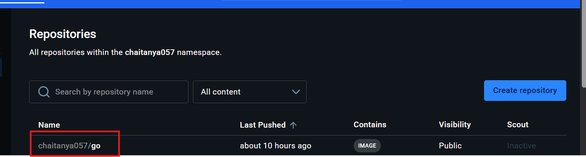
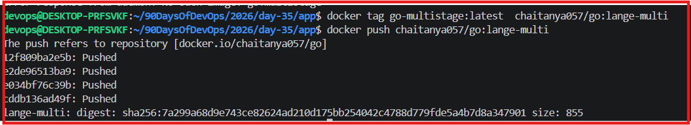
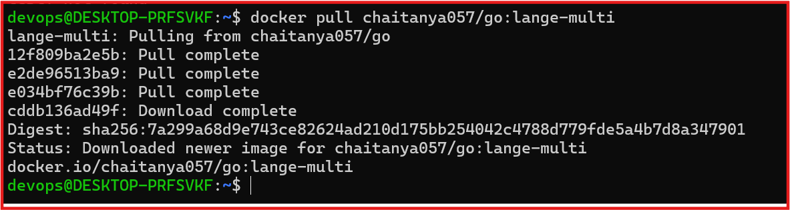
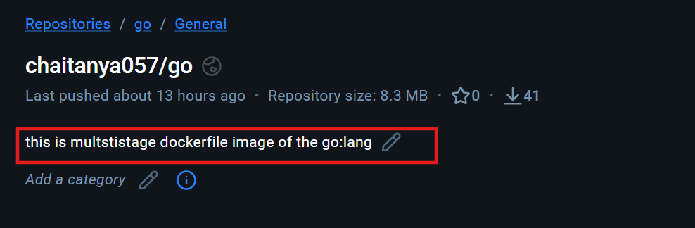
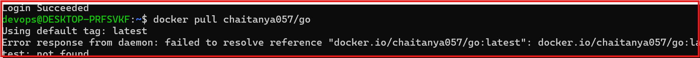
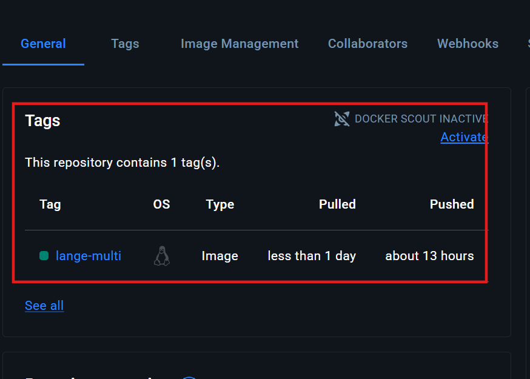
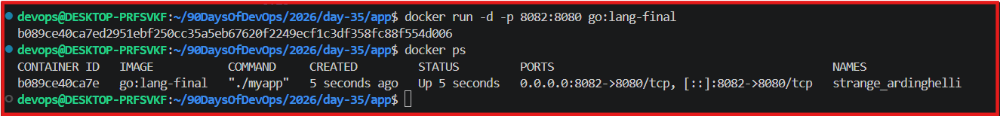
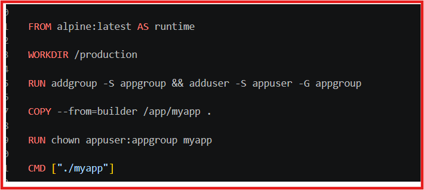
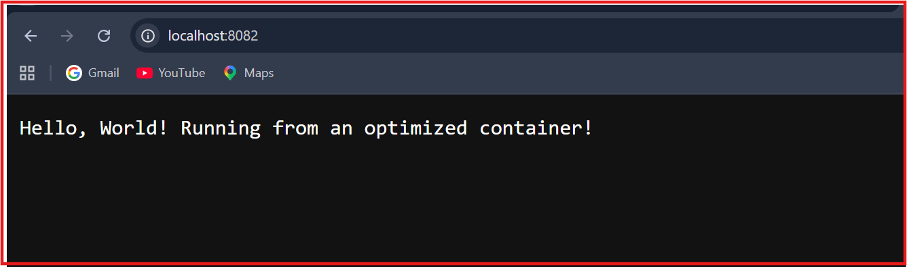

# Day 35 - Multi-Stage Build & Docker Hub

##  Objective 

- Understand teh problem with large Docker iamges.
- Build a Go application using a single-stage Dockerfile.
- Rebuild the application using a multi-stage Dockerfile.
- Compare image sizes before and after optimization.
- Apply Docker image best practices.
- Push the optimized image to Docker Hub.
- Understand Docker image tagging and versioning.

# TASK 1: Buidl a single stage Docker image

- Created a Dockerfile containing both the build and runtimeenvironment.
- Built the Docker image.
- Checked the initial image size..

**Purpose: Establish a baseline for comparison with the optimized image.

- intial Image Size: 986

# TASK 2: optimize the image using multistage Dockerfile

- Stage 1 – Builder: Compiles the Go application.

- Stage 2 – Runtime: Uses a minimal Alpine image.

- Copied only the compiled application from the builder stage.

- Removed unnecessary build tools and source files from the final image.

Optimized Image Size: 8.75

| Build | size |
------- |------|
| single-stage | 986 |
| multistage | 8.75 |

# TASK 3 - Publish the Image to Docker Hub

- Published the optimized Docker image to Docker Hub for centralized image storage and distribution.

- Activities Performed
- Logged in to Docker Hub.
- Tagged the optimized image.
- Pushed the image to Docker Hub.
- Verified successful upload.
- Pulled the image from Docker Hub.
- Validated image portability.

**Observation**

- The optimized image was successfully stored in Docker Hub and could be downloaded and executed on any Docker-enabled environment without rebuilding the application.

# TASK 4 - Repository Management

Configured the Docker Hub repository for better version management.

- Activities Performed
- Verified repository creation.
- Added a repository description.
- Published version tags.

# TASK 5 -  Dockerfile Best Practices

- Created a production-ready Dockerfile by applying Docker best practices.

### Improvements Implemented
- Multi-stage build architecture
- Lightweight Alpine runtime image
- Non-root application user
- Reduced attack surface
- Optimized image layers
- Production-ready image structure

**Observation**

## 📚 Key Learnings

- Multi-stage builds separate the build environment from the runtime environment.

- Build-time dependencies do not need to be included in the final image.

- Smaller images improve deployment speed and storage efficiency.

- Minimal images help reduce the container attack surface.

- Docker tags provide a simple method for image version management.

- Docker Hub enables teams to store, share and distribute container images.

## 🚀 Benefits

- Reduced Image Size – Removes unnecessary build tools and dependencies.

- Improved Security – Minimizes the number of components available inside the runtime image.

- Faster Deployment – Smaller images transfer faster between environments.

- Better Version Control – Tags make different application versions easy to identify.

- Easy Distribution – Docker Hub provides a central location for sharing container images.

- Production Ready – Encourages clean and optimized containerization practices.

## 🧠 DevOps Takeaway

- Build with everything you need, but run with only what you need.

- Multi-stage builds help create smaller, secure and production-ready Docker images, while Docker Hub provides a practical way to version and distribute those images.

## ✅ Result

- Successfully completed Day 35 by building, optimizing, comparing, versioning and publishing a Dockerized Go application using multi-stage builds and Docker Hub.