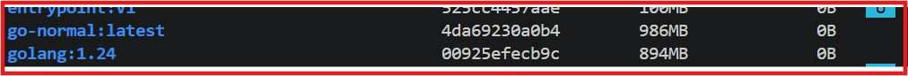

# Day 35 - Multi-Stage Build & Docker Hub

##  Objective 

- Understand teh problem with large Docker iamges.
- Build a Go application using a single-stage Dockerfile.
- Rebuild the application using a multi-stage Dockerfile.
- Compare image sizes before and after optimization.
- Apply Docker image best practices.
- Push the optimized image to Docker Hub.
- Understand Docker image tagging and versioning.

# TASK 1: Buidl a single stage Docker image

- Created a Dockerfile containing both the build and runtimeenvironment.
- Built the Docker image.
- Checked the initial image size..

**Purpose: Establish a baseline for comparison with the optimized image.

- intial Image Size: 986

