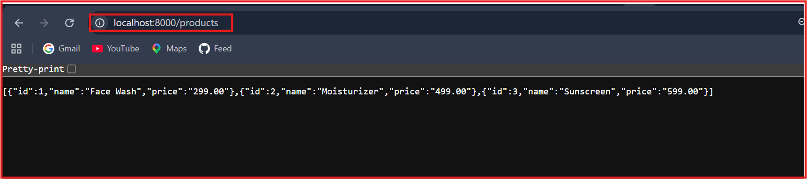
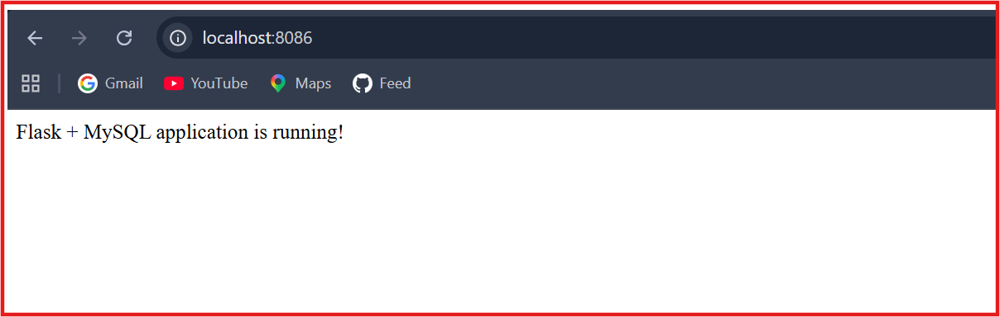
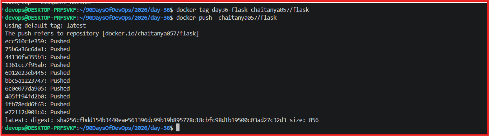
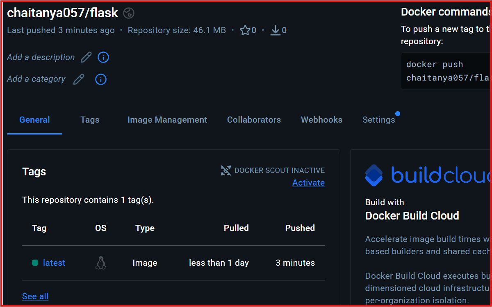

# Day 36 – Dockerize a Full Application

*90 Days of DevOps | Train With Shubham*

📌 Project


# Task 1: Flask + MySQL Application


## For Day 36, I Dockerized a complete Flask application with a MySQL database using Docker and Docker Compose.

- Tech Stack
- Python / Flask
- MySQL 8.0
- Docker
- Docker Compose
- Docker Hub

1️⃣ Pick the App
Selected Application

Flask + MySQL Product API

- What I Implemented
- Built a Flask REST API for product management.
- Connected the Flask application to MySQL using PyMySQL.
- Implemented GET /products to retrieve products from the database.
- Implemented POST /products to add new products.
- Created the MySQL schema and initial product records.
- Verified application-to-database connectivity before containerization.
API






# Task 2: Dockerfile

*Implementation*

### Created a multi-stage Dockerfile for the Flask application with:

- python:3.11-slim base image
- Multi-stage build
- Python virtual environment
- Dependency installation
- Non-root application user
- .dockerignore
- Port 5000

- Dockerfile: [`Dockerfile`](app/Dockerfile)

# Task 3: Docker Compose

## Implementation

### Created a Docker Compose environment containing:

- Flask application service
- MySQL database service
- Named volume for persistent database data
- Environment variables
- MySQL healthcheck
- Service dependency using condition: service_healthy
- Docker service-to-service networking

Run the project using

```bash

docker compose up 

```

Docker-compose : [`docker-compose`](docker-compose.yml)

# Task : 4️⃣ Ship It

** Image Tagging**

## Tagged the application image with the Docker Hub repository:


## Docker Image
```bash

docker tag flask:v2 chaitanya057/flask:v2

```
## Docker push

```bash

docker push chaitanya057/flask:v2

```



## Docker Hub Repository

https://hub.docker.com/repository/docker/chaitanya057/flask/general


## Task 5: Test the Whole Flow

To verify that the image works independently of the local build

1. Removed local application image.
2. Pulled the image from the Docker hub
3. Modified the Docker Compose configuration to pull the image directly from Docker Hub instead of building it locally.

4. Started containers using Docker Compose.
5. Verified the application and MYSQL were running successfully.
6. Tested PRODUCT API sucessfully.

## Verification Image


## Docker Hub push




# 🧠 Key Learnings

- Containerized a complete Flask + MySQL application.
- Designed a multi-stage Dockerfile with a non-root runtime.
- Used Docker Compose for multi-container orchestration.
- Implemented database persistence using a named volume.
- Added healthchecks for database readiness.
- Used Docker networking for application-to-database communication.
- Published the application image to Docker Hub.
- Verified the application using the published image in a clean deployment flow.   


