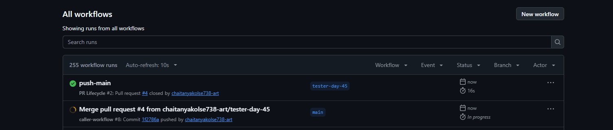
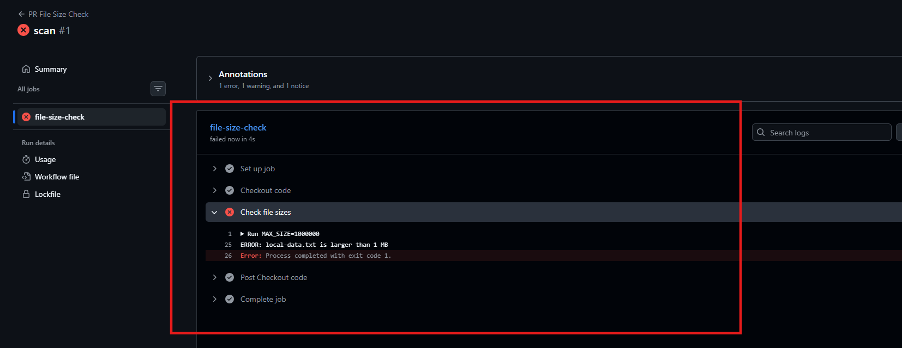
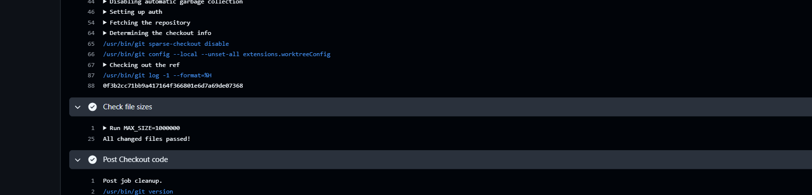
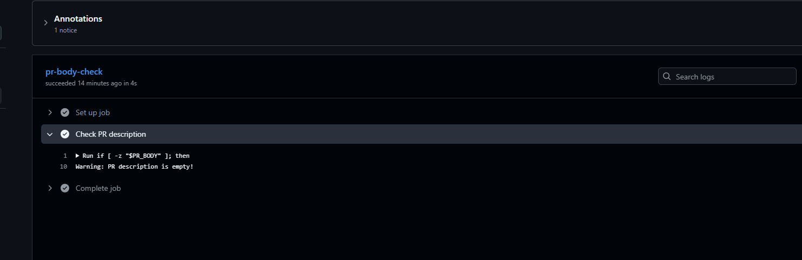
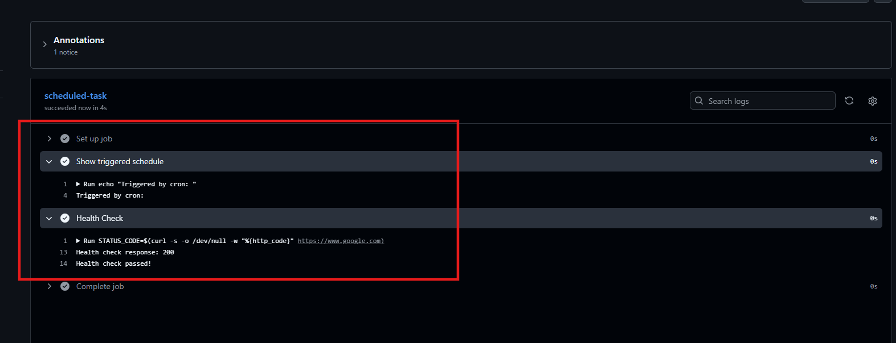
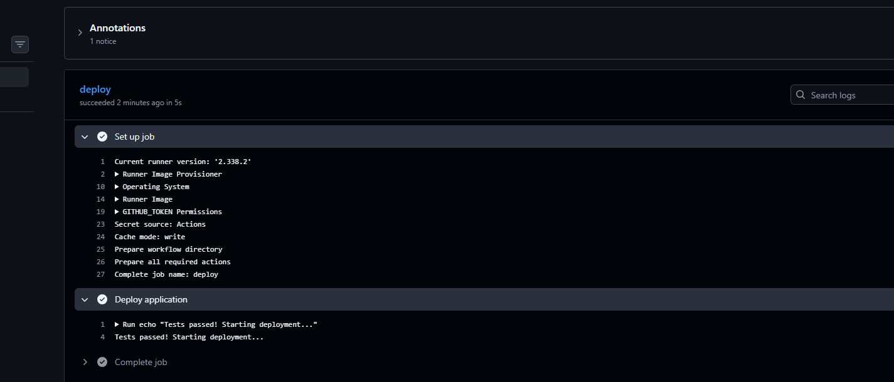
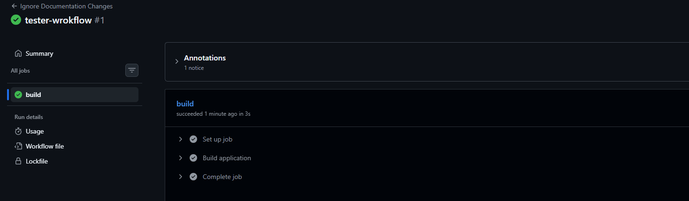

# Day 47 – Advanced Triggers: PR Events, Cron Schedules & Event-Driven Pipelines

## Objective

Learn advanced GitHub Actions triggers to automate pull request validation, scheduled tasks, path-based execution, workflow chaining, and external event-driven pipelines.

## Task 1: Pull Request Event Types

* Configured triggers for `opened`, `synchronize`, `reopened`, and `closed` events.
* Captured the PR action, title, author, source branch, and target branch.
* Added a conditional step to identify successfully merged pull requests.

## Task 2: PR Validation Workflow

* Created automated PR checks for file sizes, branch names, and PR descriptions.
* Added a 1 MB file-size limit.
* Validated branch names against `feature/*`, `fix/*`, and `docs/*` patterns.
* Added a warning for empty PR descriptions without failing the job.

## Task 3: Scheduled Workflows

* Configured cron schedules for Monday at 2:30 AM UTC and every six hours.
* Added `workflow_dispatch` for manual execution.
* Displayed the schedule that triggered the workflow.
* Implemented an HTTP health check using `curl`.

**Cron Expressions:**

* Every weekday at 9 AM IST: `30 3 * * 1-5`
* First day of every month at midnight UTC: `0 0 1 * *`

**Important Notes:**

* Scheduled workflows run only from the default branch.
* GitHub may delay scheduled runs during high server load.
* Scheduled workflows in public repositories can be automatically disabled after 60 days without repository activity.

## Task 4: Path & Branch Filters

* Configured `paths` to trigger workflows only when files in `src/` or `app/` change.
* Used `paths-ignore` to skip workflows when only Markdown or documentation files change.
* Restricted workflow execution to `main` and `release/*` branches.

**Key Learning:**

* `paths`: Runs a workflow only when matching files change.
* `paths-ignore`: Skips a workflow when all changed files match the ignored patterns.

## Task 5: Workflow Chaining

* Created separate test and deployment workflows.
* Used `workflow_run` to trigger deployment after the test workflow completes.
* Checked the triggering workflow's conclusion before allowing deployment.
* Added a warning when tests fail.

**Key Learning:**

* `workflow_run` starts another workflow after a separate workflow completes.
* `workflow_call` allows one workflow to be called and reused by another workflow.

## Task 6: Repository Dispatch

* Created an external event-triggered workflow using `repository_dispatch`.
* Configured the custom event type `deploy-request`.
* Read deployment environment details from `github.event.client_payload.environment`.
* Triggered the workflow using GitHub CLI with a production environment payload.

**Real-World Use Case:**
External systems such as Slack bots, monitoring tools, or deployment platforms can send events to GitHub to start automated workflows.

## Outcome

* Learned six advanced GitHub Actions trigger methods.
* Practised PR lifecycle automation and automated validation.
* Explored cron schedules, path filters, and branch filters.
* Understood workflow chaining and external event-driven automation.
* Improved knowledge of building controlled and automated CI/CD pipelines.

