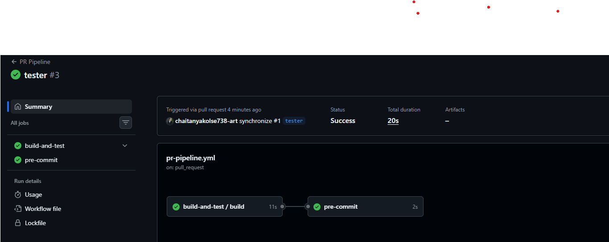
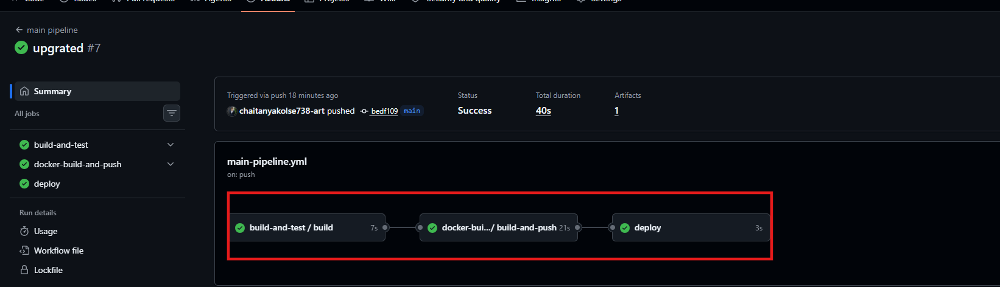
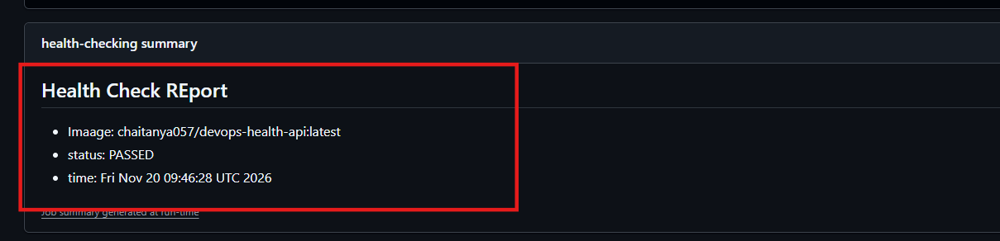
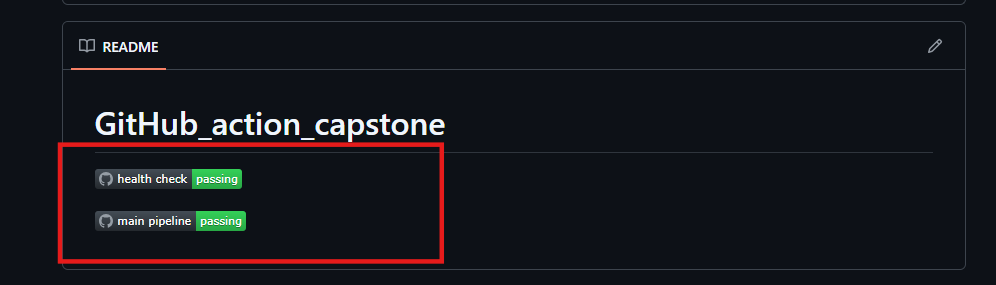
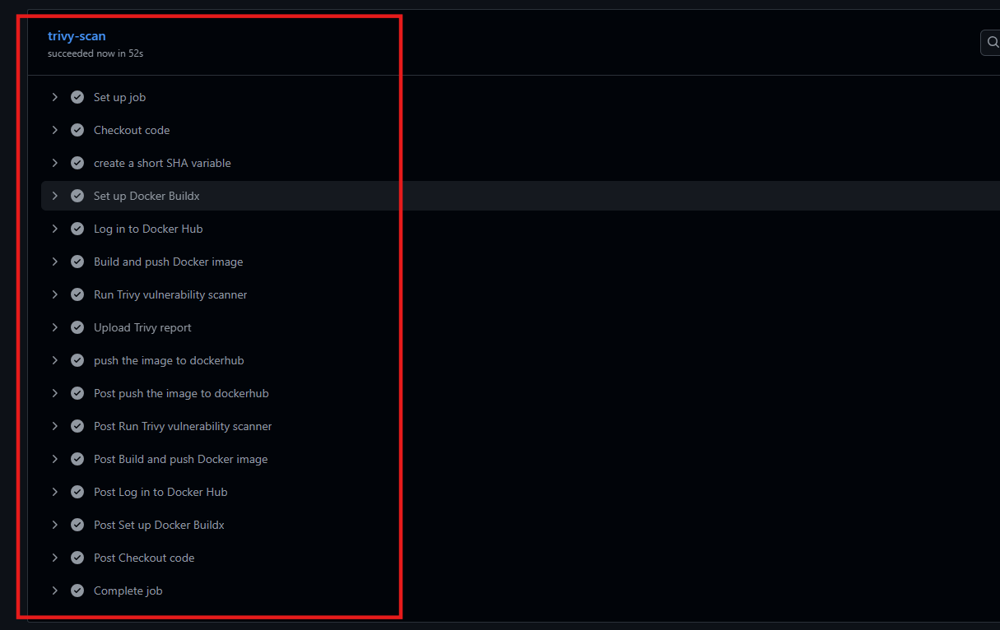

# Day 48 – GitHub Actions Capstone
## End-to-End CI/CD Pipeline

### Project Objective
To build an automated CI/CD pipeline using GitHub Actions by integrating reusable workflows, application testing, Docker image publishing, security scanning, and deployment automation.

**Tech Stack:** Node.js, Express.js, Docker, Docker Buildx, GitHub Actions, Docker Hub, Trivy.

**Repository:** [GitHub Actions Capstone](https://github.com/chaitanyakolse738-art/GitHub_action_capstone)

---

### Task 1 – Project Setup
**Objective:** Prepare a containerized Node.js application for CI/CD automation.

**Implementation:**
- Configured a Node.js Express application with a health endpoint.
- Created a Dockerfile and installed application dependencies.
- Organized the project and GitHub Actions workflow files.

**Result:** Application is ready for automated testing and containerization.


---

### Task 2 – Reusable Build & Test Workflow
**Workflow:** `reusable-build-test.yml`

**Objective:** Create a reusable workflow for application validation.

**Implementation:**
- Configured `workflow_call` with Node.js version and test inputs.
- Added checkout, runtime setup, dependency installation, and test execution.
- Exposed the test result through workflow outputs.

**Result:** Application validation can be reused by multiple workflows.


---

### Task 3 – Reusable Docker Build & Push
**Workflow:** `reusable-docker.yml`

**Objective:** Automate Docker image building and publishing.

**Implementation:**
- Configured reusable inputs for image name and tag.
- Used GitHub Secrets for Docker Hub authentication.
- Built and pushed the image using Docker Buildx.
- Exposed the image reference as a workflow output.

**Result:** Docker image publishing is handled through a reusable workflow.

**Docker Hub:** [devops-health-api](https://hub.docker.com/r/chaitanya057/devops-health-api)


---

### Task 4 – Pull Request Pipeline
**Workflow:** `pr-pipeline.yml`

**Objective:** Validate code changes before merging into `main`.

**Implementation:**
- Triggered on pull request creation and updates.
- Called the reusable Build & Test workflow.
- Added a PR summary job after successful validation.
- Excluded Docker image publishing.

**Result:** Pull requests are tested without pushing Docker images.


---

### Task 5 – Main Branch CI/CD Pipeline
**Workflow:** `main-pipeline.yml`

**Objective:** Automate the application delivery process after changes reach `main`.

**Implementation:**
- Executed reusable application testing.
- Generated a short commit SHA for image tagging.
- Built and published Docker images with `latest` and commit-specific tags.
- Integrated Trivy security scanning.
- Added a deployment job using the `production` environment.

**Result:** Main branch changes pass through automated validation, image publishing, security checks, and the deployment stage.




---

### Task 6 – Scheduled Health Check
**Workflow:** `health-check.yml`

**Objective:** Periodically verify the availability of the published application image.

**Implementation:**
- Configured a 12-hour schedule and manual trigger.
- Pulled and started the Docker container.
- Checked the health endpoint using `curl`.
- Generated a GitHub Actions summary.
- Stopped and removed the test container.

**Result:** Automated health validation is available for the published application.


---

### Task 7 – Documentation & Status Badges

**Objective:** Document the pipeline architecture and provide workflow execution visibility.

**Implementation:**
- Added workflow status badges to the repository README.
- Documented the PR, main branch, and scheduled health-check execution flows.
- Identified future improvements, including notifications, rollback, and multi-environment deployment.




**Pipeline Architecture:**

```text
Pull Request → Build & Test → PR Validation

Merge to Main → Build & Test → Docker Build
             → Trivy Scan → Docker Push → Deploy

Every 12 Hours → Pull Image → Run Container
               → Health Check → Report
```

## Bonus – DevSecOps Integration with Trivy
Objective: Identify critical vulnerabilities in Docker images before deployment.

Implementation:
- Integrated Trivy image vulnerability scanning.
- Configured the pipeline to fail on CRITICAL vulnerabilities.
- Generated a JSON scan report.
- Uploaded the report as a GitHub Actions artifact.
Result: Added automated container security validation and downloadable scan reports.


