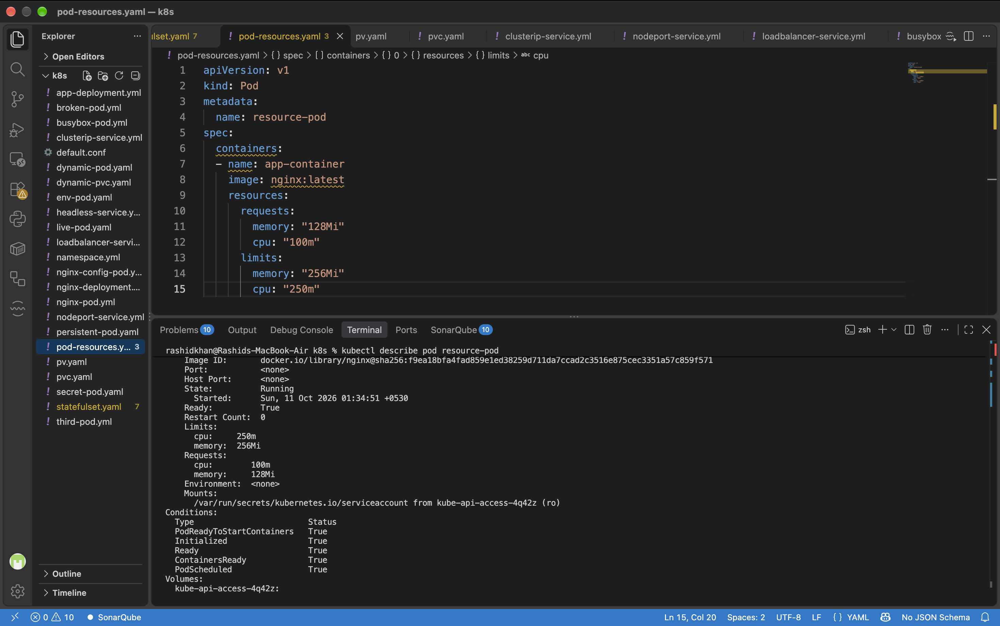
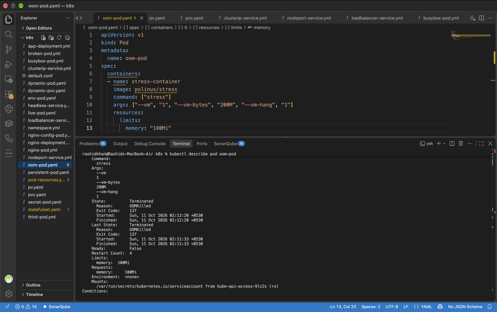
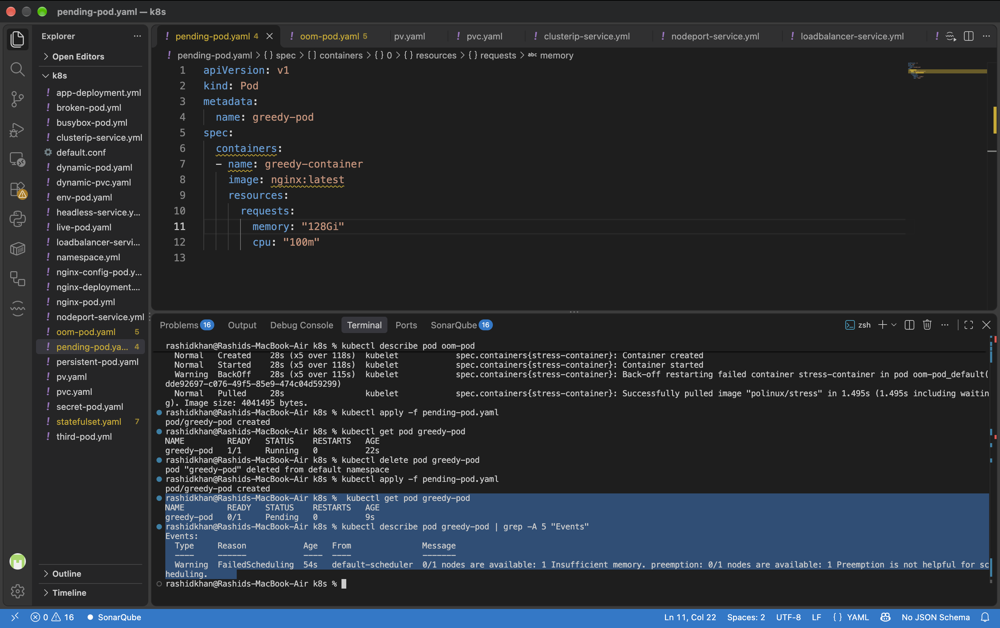
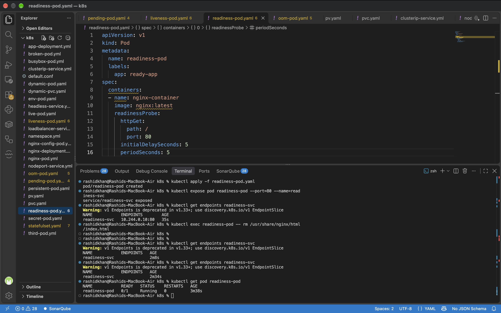
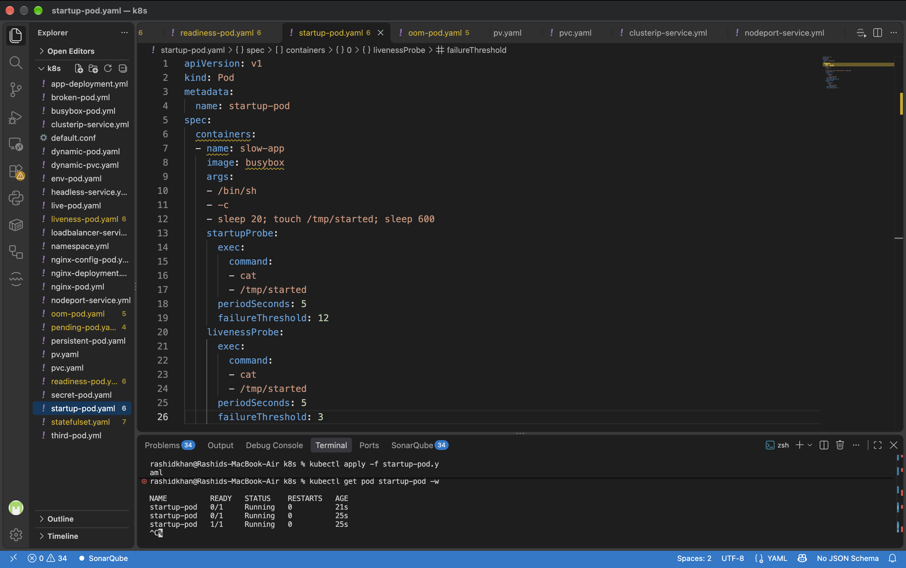

# Day 57: Resource Requests, Limits, and Probes

## Challenge Tasks

### Task 1: Resource Requests and Limits
**Verify: What QoS class does your Pod have?**
The QoS class is Burstable because the memory and CPU requests are lower than the configured limits.

**Terminal Output:**
```text
    Limits:
      cpu:     250m
      memory:  256Mi
    Requests:
      cpu:     100m
      memory:  128Mi
QoS Class:                   Burstable
```


### Task 2: OOMKilled — Exceeding Memory Limits
**Verify: What exit code does an OOMKilled container have?**
The exit code is 137. This occurs because the container requested 200M of memory, exceeding its hard limit of 100Mi. The system sends a SIGKILL (9), resulting in an exit code of 137 (128 + 9).

**Terminal Output:**
```text
    State:          Terminated
      Reason:       OOMKilled
      Exit Code:    137
    Limits:
      memory:  100Mi
```


### Task 3: Pending Pod — Requesting Too Much
**Verify: What event message does the scheduler produce?**
The scheduler produces a "FailedScheduling" warning, explicitly stating "Insufficient memory".

**Terminal Output:**
```text
Events:
  Type     Reason            Age   From               Message
  ----     ------            ----  ----               -------
  Warning  FailedScheduling  54s   default-scheduler  0/1 nodes are available: 1 Insufficient memory. preemption: 0/1 nodes are available: 1 Preemption is not helpful for scheduling.
```


### Task 4: Liveness Probe
**Verify: How many times has the container restarted?**
The container restarted 4 times. Once the liveness probe repeatedly failed to locate the `/tmp/healthy` file, the kubelet killed and restarted the container to attempt recovery.

**Terminal Output:**
```text
  Warning  Unhealthy  32s (x12 over 4m27s)  kubelet  spec.containers{liveness-container}: Liveness probe failed: cat: can'topen '/tmp/healthy': No such file or directory
  Normal   Killing    32s (x4 over 4m17s)   kubelet  spec.containers{liveness-container}: Container liveness-container failed liveness probe, will be restarted
```

### Task 5: Readiness Probe
**Verify: When readiness failed, was the container restarted?**
No, the container was not restarted. The restart count remained at 0 and the status remained Running. However, the READY state transitioned to 0/1, and the IP was removed from the Service endpoints to stop traffic routing.

**Terminal Output:**
```text
NAME            ENDPOINTS   AGE
readiness-svc               2m34s

NAME            READY   STATUS    RESTARTS   AGE
readiness-pod   0/1     Running   0          3m38s
```


### Task 6: Startup Probe
**Verify: What would happen if failureThreshold were 2 instead of 12?**
If the threshold were 2, the probe budget would only be 10 seconds (2 attempts * 5 seconds period). Because the application requires 20 seconds to start, the startup probe would fail prematurely, and the kubelet would kill the container before initialization completes, causing a CrashLoopBackOff.

**Terminal Output:**
```text
NAME          READY   STATUS    RESTARTS   AGE
startup-pod   0/1     Running   0          21s
startup-pod   0/1     Running   0          25s
startup-pod   1/1     Running   0          25s
```


### Task 7: Clean Up
All test pods (resource-pod, oom-pod, greedy-pod, liveness-pod, readiness-pod, startup-pod) and the readiness service were successfully deleted from the cluster.

---

## Documentation

**Requests vs limits (scheduling vs enforcement)**
*   **Requests:** Act as a guaranteed minimum for scheduling. The kube-scheduler uses this value to determine if a node has enough unallocated resources to host the pod.
*   **Limits:** Act as a hard cap enforced at runtime. The kubelet uses this value to ensure the container never consumes more resources than permitted on the node.

**What happens when CPU or memory limits are exceeded**
*   **CPU Limit Exceeded:** CPU is a compressible resource. The container is throttled (slowed down) but is not killed.
*   **Memory Limit Exceeded:** Memory is an incompressible resource. The Linux kernel invokes the OOM (Out of Memory) killer and terminates the container immediately, resulting in an OOMKilled status and an exit code of 137.

**Liveness vs readiness vs startup probes**
*   **Liveness Probe:** Checks if the application is running and healthy. If it fails, the container is restarted. Used to break out of deadlocks.
*   **Readiness Probe:** Checks if the application is ready to process user traffic. If it fails, the pod's IP is removed from the Service endpoints. The container is not restarted.
*   **Startup Probe:** Protects slow-starting applications. It disables liveness and readiness probes until the application successfully starts, granting it a dedicated time budget for initialization.