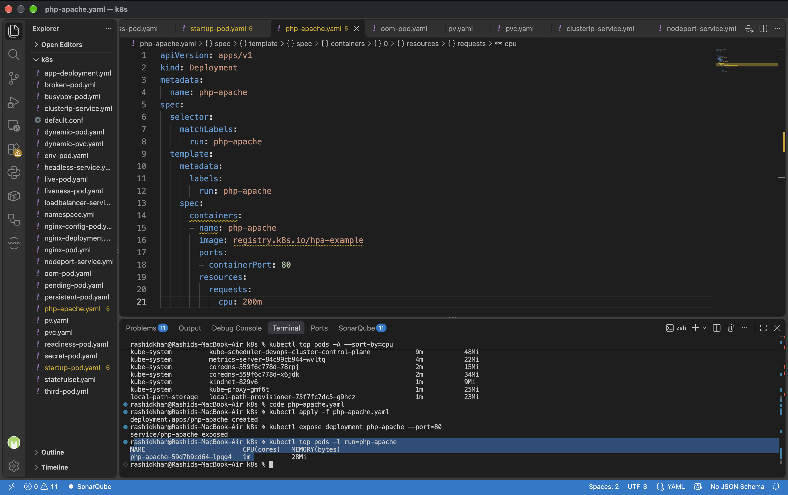
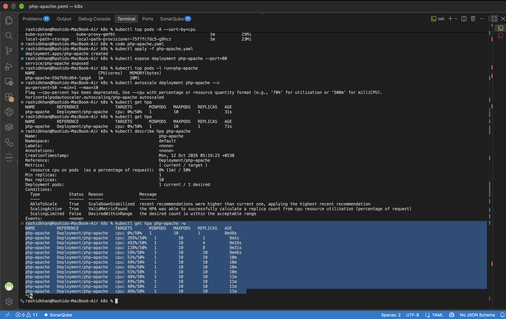
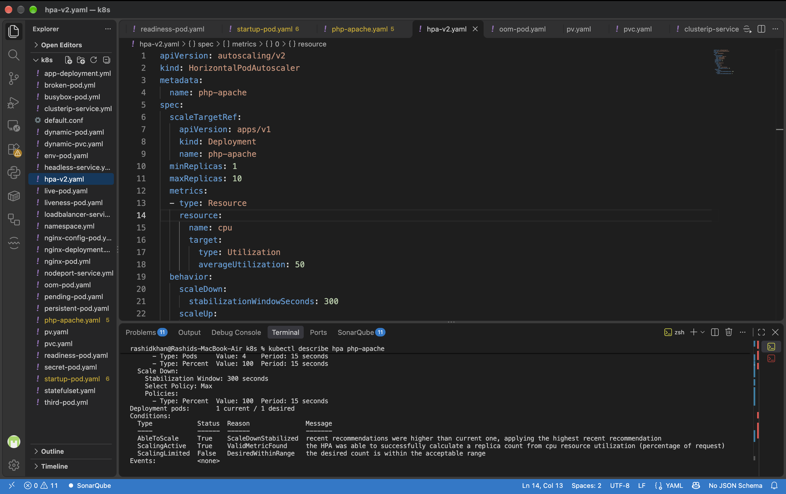

# Day 58: Metrics Server and Horizontal Pod Autoscaler (HPA)

## Challenge Tasks

### Task 1: Install the Metrics Server
**Verify: What is the current CPU and memory usage of your node?**
The current usage of the `devops-cluster-control-plane` node is 164m (2%) CPU and 771Mi (19%) Memory.

**Terminal Output:**
```text
NAME                           CPU(cores)   CPU(%)   MEMORY(bytes)   MEMORY(%)   
devops-cluster-control-plane   164m         2%       771Mi           19%         
```

### Task 2: Explore kubectl top
**Verify: Which pod is using the most CPU right now?**
The `kube-apiserver-devops-cluster-control-plane` pod in the kube-system namespace is using the most CPU at 37m.

**Terminal Output:**
```text
NAMESPACE            NAME                                                   CPU(cores)   MEMORY(bytes) 
kube-system          kube-apiserver-devops-cluster-control-plane            37m          238Mi 
kube-system          etcd-devops-cluster-control-plane                      20m          60Mi 
kube-system          kube-controller-manager-devops-cluster-control-plane   14m          57Mi 
```

### Task 3: Create a Deployment with CPU Requests
**Verify: What is the current CPU usage of the Pod?**
The current CPU usage of the `php-apache` pod is 1m.

**Terminal Output:**
```text
NAME                          CPU(cores)   MEMORY(bytes)   
php-apache-59d7b9cd64-lpqg4   1m           28Mi   
```


### Task 4: Create an HPA (Imperative)
**Verify: What does the TARGETS column show?**
The TARGETS column shows `cpu: 0%/50%`, indicating that the current utilization is 0% against a target threshold of 50%.

**Terminal Output:**
```text
NAME         REFERENCE               TARGETS       MINPODS   MAXPODS   REPLICAS   AGE
php-apache   Deployment/php-apache   cpu: 0%/50%   1         10        1          71s
```

### Task 5: Generate Load and Watch Autoscaling
**Verify: How many replicas did HPA scale to under load?**
The HPA successfully scaled the deployment to the maximum limit of 10 replicas as the CPU load spiked to 492%.

**Terminal Output:**
```text
NAME         REFERENCE               TARGETS         MINPODS   MAXPODS   REPLICAS   AGE
php-apache   Deployment/php-apache   cpu: 0%/50%     1         10        1          8m48s
php-apache   Deployment/php-apache   cpu: 395%/50%   1         10        1          9m1s
php-apache   Deployment/php-apache   cpu: 492%/50%   1         10        4          9m16s
php-apache   Deployment/php-apache   cpu: 128%/50%   1         10        8          9m31s
php-apache   Deployment/php-apache   cpu: 59%/50%    1         10        10         9m46s
php-apache   Deployment/php-apache   cpu: 49%/50%    1         10        10         10m
```


### Task 6: Create an HPA from YAML (Declarative)
**Verify: What does the behavior section control?**
The behavior section controls the rate of scaling (scale-up and scale-down speed). `scaleUp.stabilizationWindowSeconds: 0` ensures immediate scale-up under load, while `scaleDown.stabilizationWindowSeconds: 300` enforces a 5-minute delay before scaling down to prevent thrashing.

**Terminal Output:**
```text
Metrics:                                               ( current / target )
  resource cpu on pods  (as a percentage of request):  0% (1m) / 50%
Min replicas:                                          1
Max replicas:                                          10
Behavior:
  Scale Up:
    Stabilization Window: 0 seconds
    Select Policy: Max
    Policies:
      - Type: Pods     Value: 4    Period: 15 seconds
      - Type: Percent  Value: 100  Period: 15 seconds
  Scale Down:
    Stabilization Window: 300 seconds
    Select Policy: Max
    Policies:
      - Type: Percent  Value: 100  Period: 15 seconds
```


### Task 7: Clean Up
The HPA, Service, Deployment, and load-generator pod were successfully deleted. The Metrics Server was left running for future resource monitoring.

---

## Documentation

**What the Metrics Server is and why HPA needs it**
The Metrics Server is a cluster-wide aggregator of resource usage data. It continuously collects CPU and memory metrics from the kubelets on each node. The Horizontal Pod Autoscaler (HPA) is entirely dependent on the Metrics Server because it requires real-time utilization metrics to determine if a pod has crossed its scaling threshold.

**How HPA calculates desired replicas**
HPA calculates the desired number of replicas using this standard formula:
`desiredReplicas = ceil(currentReplicas * (currentUsage / targetUsage))`
It compares the actual metric (currentUsage) against the configured threshold (targetUsage, derived from the container's resource requests) and scales proportionally.

**The difference between autoscaling/v1 and v2**
*   **autoscaling/v1:** An older API version that only supports CPU utilization as a metric for autoscaling.
*   **autoscaling/v2:** The modern API version that supports CPU, memory, and custom/external metrics. Crucially, it introduces the `behavior` block, allowing fine-grained control over scale-up and scale-down speeds (stabilization windows).