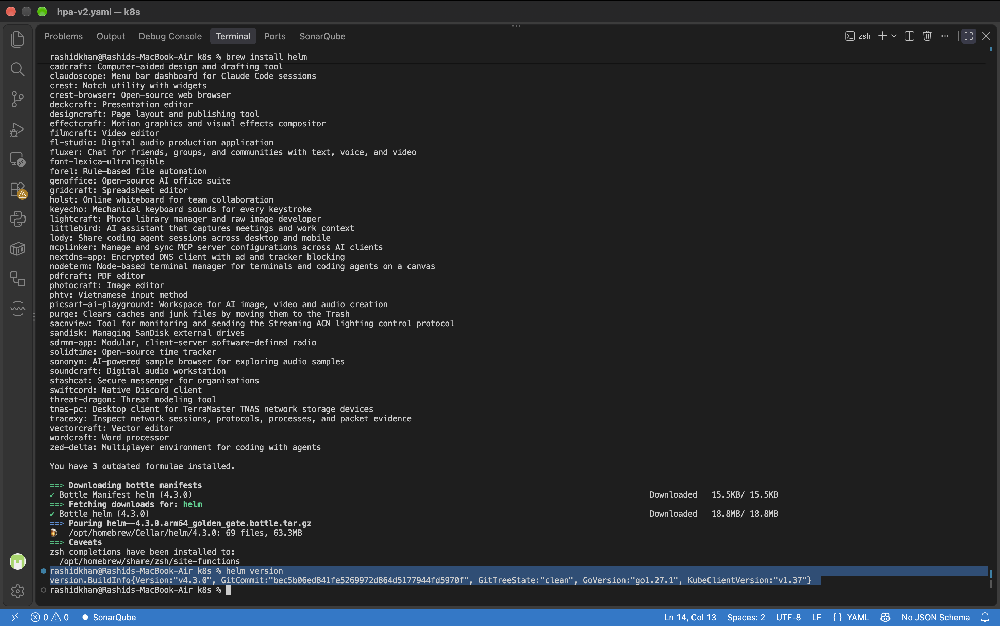
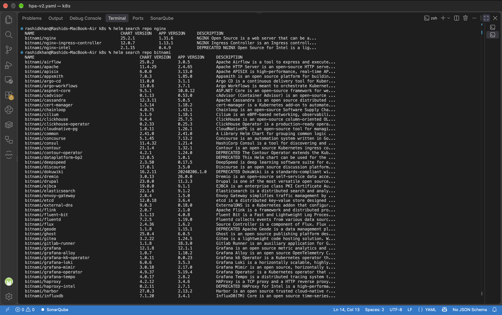
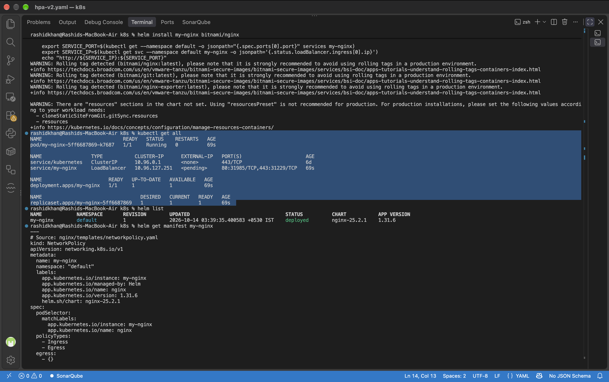
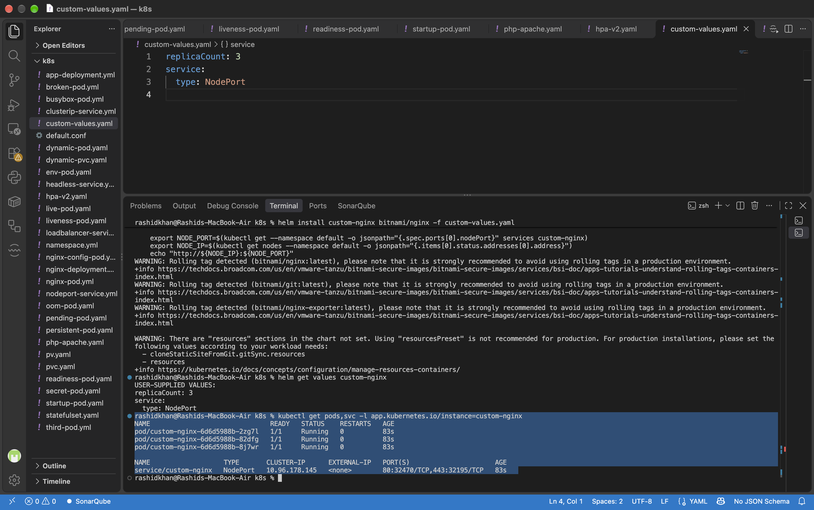
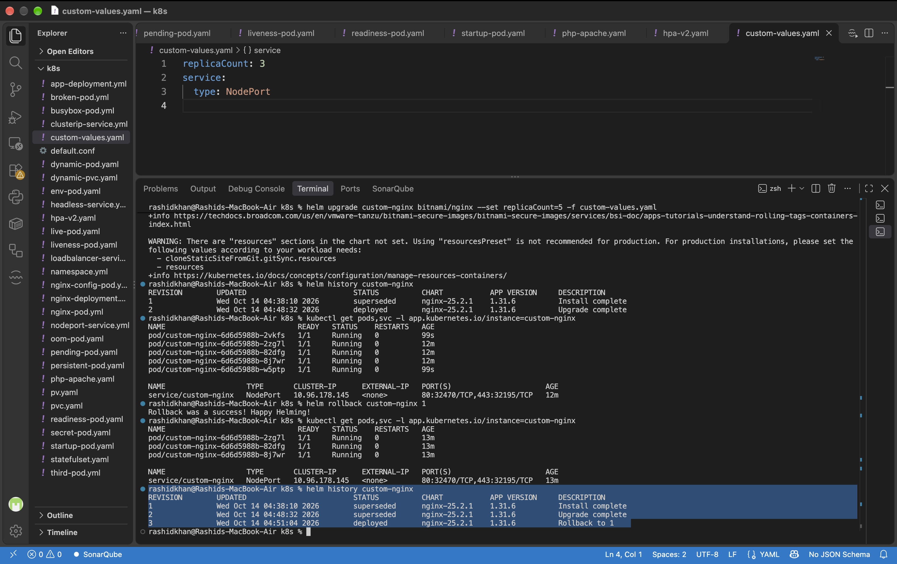
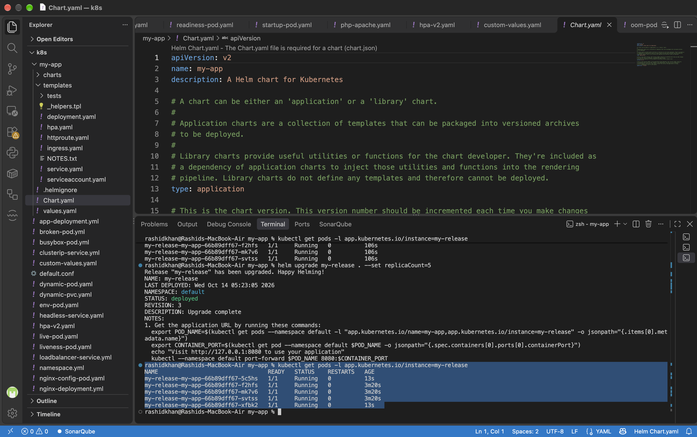

# Day 59: Helm — Kubernetes Package Manager

## Challenge Tasks

### Task 1: Install Helm
**Verify: What version of Helm is installed?**
The installed version of Helm is `v4.3.0`.

**Terminal Output:**
```text
version.BuildInfo{Version:"v4.3.0", GitCommit:"bec5b06ed841fe5269972d864d5177944fd5970f", GitTreeState:"clean", GoVersion:"go1.27.1", KubeClientVersion:"v1.37"}
```


### Task 2: Add a Repository and Search
**Verify: How many charts does Bitnami have?**
The Bitnami repository hosts an extensive list of production-ready charts (over 100+ applications), including popular tools like Airflow, Nginx, Redis, Kafka, and PostgreSQL.

**Terminal Output:**
```text
NAME                                    CHART VERSION   APP VERSION     DESCRIPTION                                       
bitnami/nginx                           25.2.1          1.31.6          NGINX Open Source is a web server that can be a...
bitnami/nginx-ingress-controller        12.0.7          1.13.1          NGINX Ingress Controller is an Ingress controll...
```


### Task 3: Install a Chart
**Verify: How many Pods are running? What Service type was created?**
After installing the default Bitnami Nginx chart, **1 Pod** is running, and a Service of type **LoadBalancer** was automatically created.

**Terminal Output:**
```text
NAME                                READY   STATUS    RESTARTS   AGE
pod/my-nginx-5ff6687869-k7687       1/1     Running   0          69s

NAME                 TYPE           CLUSTER-IP      EXTERNAL-IP   PORT(S)                      AGE
service/my-nginx     LoadBalancer   10.96.127.251   <pending>     80:31985/TCP,443:31229/TCP   69s
```


### Task 4: Customize with Values
**Verify: Does the values file release have the correct replicas and service type?**
Yes. By providing a `custom-values.yaml` file, we successfully overrode the defaults. The release was deployed with **3 Pods** and the Service type was changed to **NodePort**.

**Terminal Output:**
```text
USER-SUPPLIED VALUES:
replicaCount: 3
service:
  type: NodePort

NAME                                   READY   STATUS    RESTARTS   AGE
pod/custom-nginx-6d6d5988b-2zg7l       1/1     Running   0          83s
pod/custom-nginx-6d6d5988b-82dfg       1/1     Running   0          83s
pod/custom-nginx-6d6d5988b-8j7wr       1/1     Running   0          83s

NAME                   TYPE       CLUSTER-IP      EXTERNAL-IP   PORT(S)                      AGE
service/custom-nginx   NodePort   10.96.178.145   <none>        80:32470/TCP,443:32195/TCP   83s
```


### Task 5: Upgrade and Rollback
**Verify: How many revisions after the rollback?**
There are **3 Revisions** in the history. Helm does not delete or overwrite previous revisions; instead, a rollback creates a brand new revision (Revision 3) mapping back to the state of Revision 1, preserving full auditability.

**Terminal Output:**
```text
REVISION        UPDATED                         STATUS          CHART           APP VERSION     DESCRIPTION
1               Wed Oct 14 04:38:10 2026        superseded      nginx-25.2.1    1.31.6          Install complete
2               Wed Oct 14 04:48:32 2026        superseded      nginx-25.2.1    1.31.6          Upgrade complete
3               Wed Oct 14 04:51:04 2026        deployed        nginx-25.2.1    1.31.6          Rollback to 1
```


### Task 6: Create Your Own Chart
**Verify: After installing, 3 replicas? After upgrading, 5?**
Yes. Initially, the custom-built chart was deployed with 3 replicas (as modified in the `values.yaml`). Upon running `helm upgrade --set replicaCount=5`, Helm instantly spun up 2 additional replicas, resulting in 5 running pods.

**Terminal Output:**
```text
NAME                                 READY   STATUS    RESTARTS   AGE
my-release-my-app-66b89dff67-5c5hs   1/1     Running   0          13s
my-release-my-app-66b89dff67-f2hfs   1/1     Running   0          3m20s
my-release-my-app-66b89dff67-mk7v6   1/1     Running   0          3m20s
my-release-my-app-66b89dff67-svtss   1/1     Running   0          3m20s
my-release-my-app-66b89dff67-xfbk2   1/1     Running   0          13s
```


### Task 7: Clean Up
All test releases (`custom-nginx` and `my-release`), custom files, and the scaffolded chart directory were successfully uninstalled and removed from the cluster.

---

## Documentation

**What Helm is and the three core concepts**
Helm is the package manager for Kubernetes (analogous to `apt` for Ubuntu or `npm` for Node.js). It simplifies deploying complex applications by bundling multiple Kubernetes resource definitions into a single, reusable package.
1.  **Chart:** A bundle of Kubernetes manifest templates and default configurations.
2.  **Release:** A running instance of a Chart deployed in a Kubernetes cluster.
3.  **Repository:** A hosted location where Charts can be stored, searched, and shared (e.g., Bitnami).

**How to install, customize, upgrade, and rollback**
*   **Install:** `helm install <release-name> <chart-name>` deploys the application with default values.
*   **Customize:** Use `-f values.yaml` to pass a custom configuration file or `--set key=value` to override specific defaults during installation.
*   **Upgrade:** `helm upgrade <release-name> <chart-name>` applies new configurations or updates the application version seamlessly.
*   **Rollback:** `helm rollback <release-name> <revision-number>` reverts the application to a previous stable state, generating a new revision entry in the history.

**The structure of a Helm chart and how Go templating works**
Running `helm create` generates a standard structure:
*   `Chart.yaml`: Contains metadata about the chart (name, version, description).
*   `values.yaml`: Contains the default configuration values.
*   `templates/`: Contains Kubernetes manifest templates (e.g., `deployment.yaml`, `service.yaml`).
Helm uses **Go template syntax** (e.g., `{{ .Values.replicaCount }}`) inside the `templates/` folder. During deployment, the Helm engine reads the `values.yaml` file and injects those values into the Go templates to generate standard Kubernetes YAML manifests, which are then applied to the cluster.

**My `custom-values.yaml` with explanations**
```yaml
replicaCount: 3
service:
  type: NodePort
```
*   `replicaCount: 3`: Overrides the default of 1 replica, instructing Kubernetes to maintain 3 running pods for high availability.
*   `service.type: NodePort`: Changes the default Service type (LoadBalancer) to NodePort, allowing external access to the application via a specific port on the Kubernetes Node IPs.