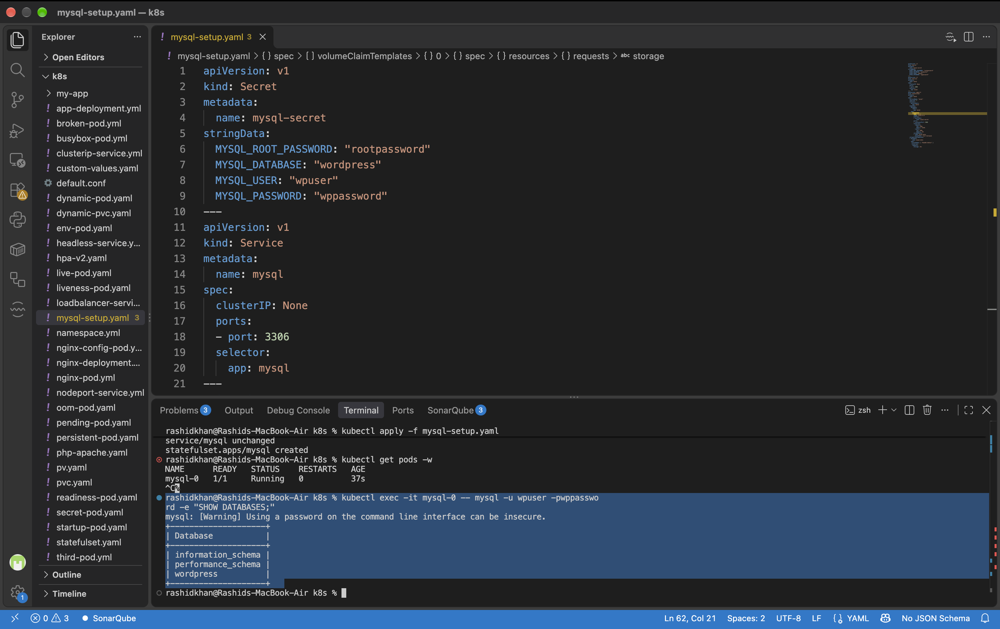
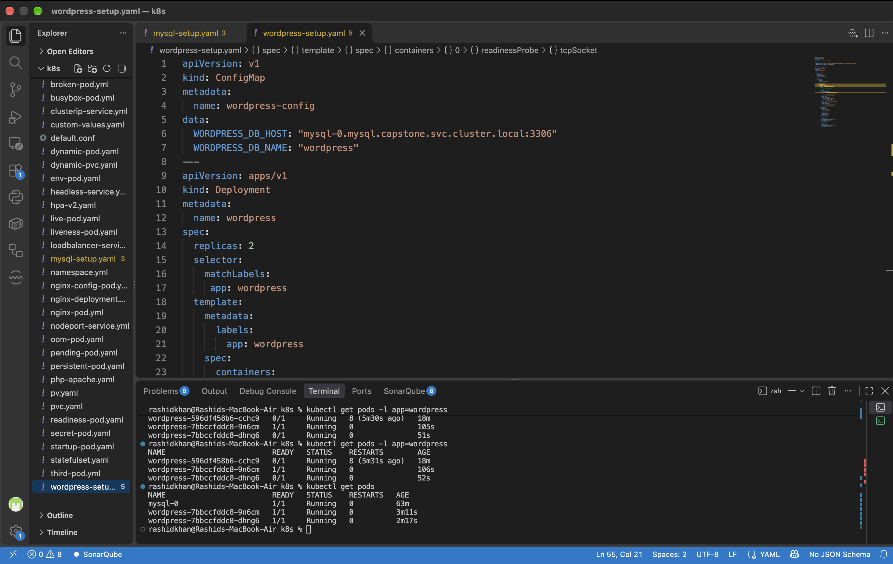
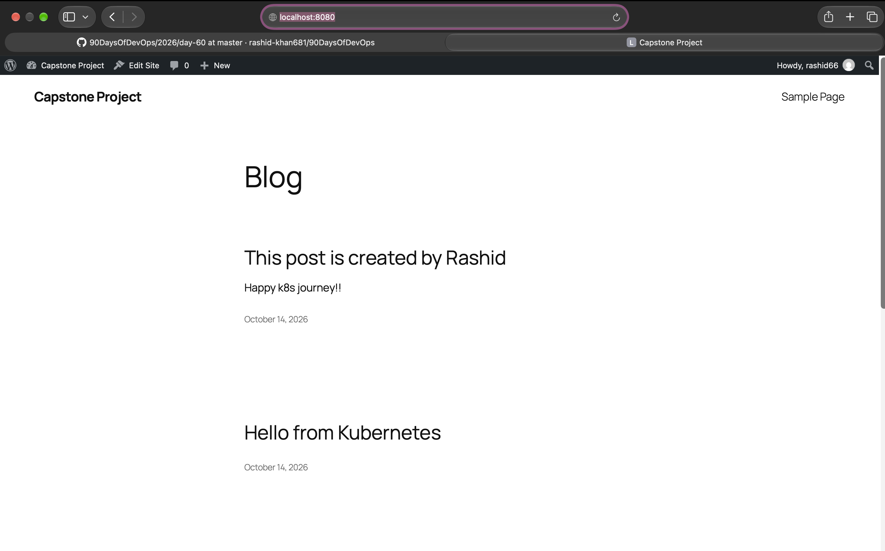
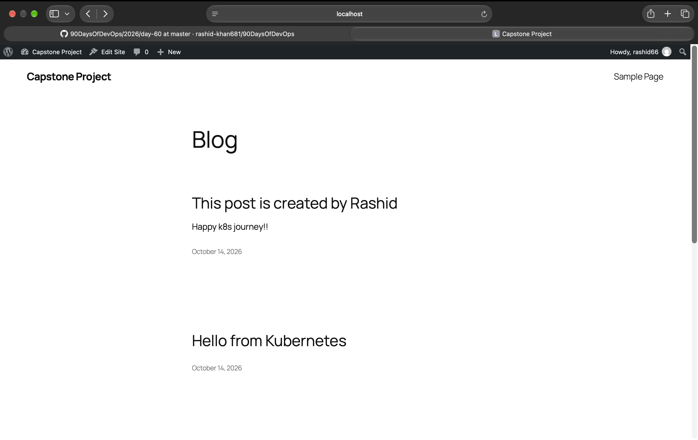
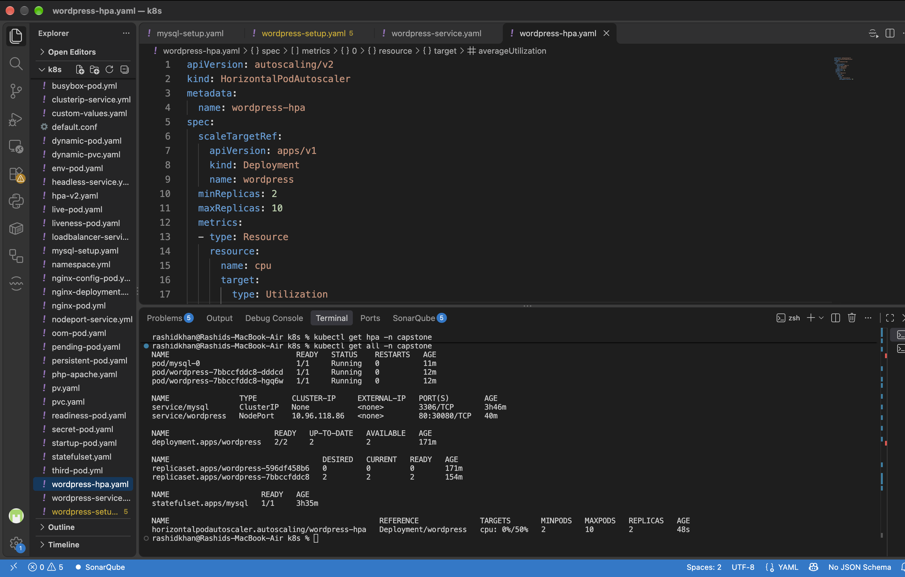
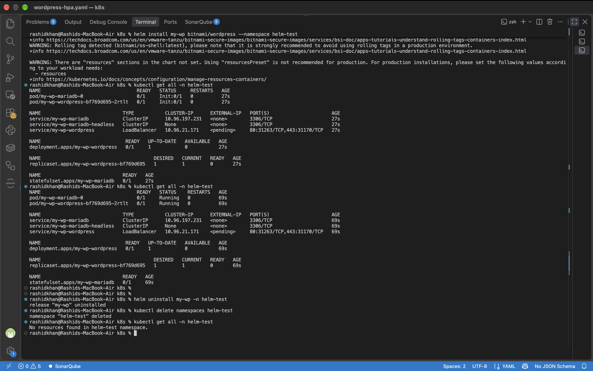

# Day 60 - Capstone: Deploy WordPress + MySQL on Kubernetes

## Task Overview
Ten days of Kubernetes — clusters, Pods, Deployments, Services, ConfigMaps, Secrets, storage, StatefulSets, resource management, autoscaling, and Helm. Today we put it all together. Deploy a real WordPress + MySQL application using every major concept learned.

## Expected Output
- A complete WordPress + MySQL stack in a capstone namespace
- Self-healing and data persistence verified
- A markdown file: day-60-capstone.md
- Screenshot of the running WordPress site and kubectl get all -n capstone

---

## Challenge Tasks

### Task 1: Create the Namespace (Day 52)
Created an isolated namespace for the project and set it as the default context to streamline subsequent commands.
```bash
kubectl create namespace capstone
kubectl config set-context --current --namespace=capstone
```
**Verify:** The context was successfully modified and `capstone` is active.

### Task 2: Deploy MySQL (Days 54-56)
Deployed the database backend using a StatefulSet for network identity, a Headless Service for internal DNS resolution, and a PersistentVolumeClaim for storage. Passwords were securely stored in a Kubernetes Secret using `stringData`.
**Verify:** Accessed the `mysql-0` pod via `kubectl exec` and confirmed the existence of the `wordpress` database.


### Task 3: Deploy WordPress (Days 52, 54, 57)
Deployed the WordPress frontend using a Deployment with 2 replicas. Database connection details were injected via a ConfigMap, and credentials via `secretKeyRef`. Configured resource limits and `tcpSocket` Liveness/Readiness probes to monitor port 80 with an initial delay.
**Verify:** Both WordPress pods successfully reached the `1/1 Running` state.


### Task 4: Expose WordPress (Day 53)
Created a NodePort Service on port 30080 to route external traffic to the WordPress pods. Used port-forwarding to access the application locally.
**Verify:** Successfully accessed the WordPress setup wizard via `localhost:8080`, completed the installation, and published a test blog post.


### Task 5: Test Self-Healing and Persistence
Executed intentional deletion of all WordPress pods and the MySQL pod to observe cluster behavior. 
**Verify:** The ReplicaSet and StatefulSet controllers immediately recreated the terminated pods. Upon refreshing the browser, the blog post was still present, confirming successful data persistence via the PVC.


### Task 6: Set Up HPA (Day 58)
Configured a HorizontalPodAutoscaler targeting the WordPress Deployment to maintain 50% CPU utilization, with a minimum of 2 and maximum of 10 replicas.
**Verify:** The HPA successfully registered the targets (`0%/50%`) and the `kubectl get all -n capstone` output displayed the complete, running architecture.


### Task 7: (Bonus) Compare with Helm (Day 59)
Installed the Bitnami WordPress chart in a separate `helm-test` namespace to observe automated resource provisioning.
**Verify:** Helm provisioned an entire stack (including MariaDB, Deployments, Services, and Secrets) automatically. While Helm provides convenience and speed, the manual manifest approach provides granular control over individual K8s components.


### Task 8: Clean Up and Reflect
Deleted the isolated namespace, which automatically cascaded the deletion to all associated resources (Pods, Services, PVCs, Deployments).
**Verify:** Executing `kubectl get all -n capstone` returned "No resources found", confirming complete environment cleanup.

---

## Documentation

### Architecture of your deployment
The deployment architecture is isolated within the `capstone` namespace and consists of two primary tiers:
1. **Database Tier:** Powered by MySQL running as a `StatefulSet` (1 replica) to maintain stable network identity. Data persistence is handled by a `PersistentVolumeClaim` (1Gi, ReadWriteOnce) mounted at `/var/lib/mysql`. Internal network routing is managed by a Headless Service (`clusterIP: None`). Authentication credentials are provided via a `Secret`.
2. **Application Tier:** Powered by WordPress running as a `Deployment` (2 replicas for High Availability). It receives database host configurations via a `ConfigMap` and credentials via specific `secretKeyRef` injections. External traffic is routed through a `NodePort` Service (Port 30080). Pod lifecycle is monitored by `tcpSocket` probes, and automatic scaling is governed by a `HorizontalPodAutoscaler` targeting 50% CPU utilization.

### Results of self-healing and persistence tests
Terminating the pods resulted in immediate intervention by the Kubernetes control plane. The `ReplicaSet` recreated the stateless WordPress pods, while the `StatefulSet` recreated the MySQL pod maintaining the exact `mysql-0` identifier. The `PersistentVolumeClaim` successfully retained the underlying storage block. Consequently, upon application recovery, the WordPress database and all associated posts remained completely intact with zero data loss.

### Concept Mapping Table

| Kubernetes Concept | Day Learned | Application in Capstone Project |
| :--- | :---: | :--- |
| **Namespaces** | Day 52 | Provided logical isolation and resource grouping (`capstone`). |
| **Deployments** | Day 52 | Managed the stateless frontend WordPress replicas. |
| **Services (NodePort)** | Day 53 | Exposed the WordPress application externally on port 30080. |
| **ConfigMaps** | Day 54 | Decoupled configuration data (e.g., `WORDPRESS_DB_HOST`). |
| **Secrets** | Day 54 | Encrypted and injected database passwords securely. |
| **PVCs** | Day 55 | Provisioned persistent storage independent of pod lifecycle. |
| **StatefulSets** | Day 56 | Managed stateful MySQL pod identity and volume attachment. |
| **Headless Service** | Day 56 | Enabled direct DNS resolution for the StatefulSet pods. |
| **Resource Limits** | Day 57 | Constrained CPU/Memory allocation to prevent node exhaustion. |
| **Probes** | Day 57 | Monitored container health to dictate traffic routing readiness. |
| **HPA** | Day 58 | Automated scaling based on CPU utilization metrics. |
| **Helm** | Day 59 | Demonstrated automated, packaged application deployment. |

### Reflection
* **What was hardest:** Configuring the K8s Probes. During initial boot, WordPress returns an HTTP 302 Redirect to its installation script. Kubernetes HTTP GET probes classify HTTP 302 responses as failures, which triggers a continuous `CrashLoopBackOff` state. Resolving this required migrating from HTTP probes to `tcpSocket` probes on port 80.
* **What clicked:** Kubernetes Service Discovery and internal DNS mechanisms. The frontend deployment successfully resolved the database backend using only the Fully Qualified Domain Name (`mysql-0.mysql.capstone.svc.cluster.local`), entirely abstracting the underlying, ephemeral pod IP addresses.
* **What I would add for production:** For a production-grade environment, the NodePort service should be replaced with an Ingress Controller (e.g., NGINX) for robust Layer 7 HTTP/HTTPS routing. Additionally, I would implement `cert-manager` for automated TLS certificate provisioning and integrate a volume backup solution like Velero for disaster recovery.