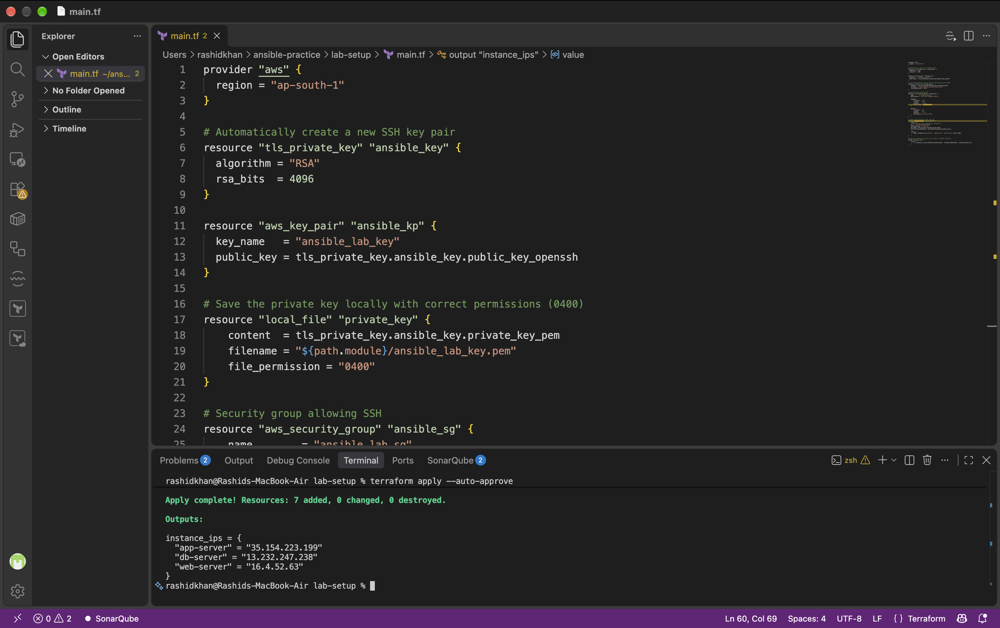
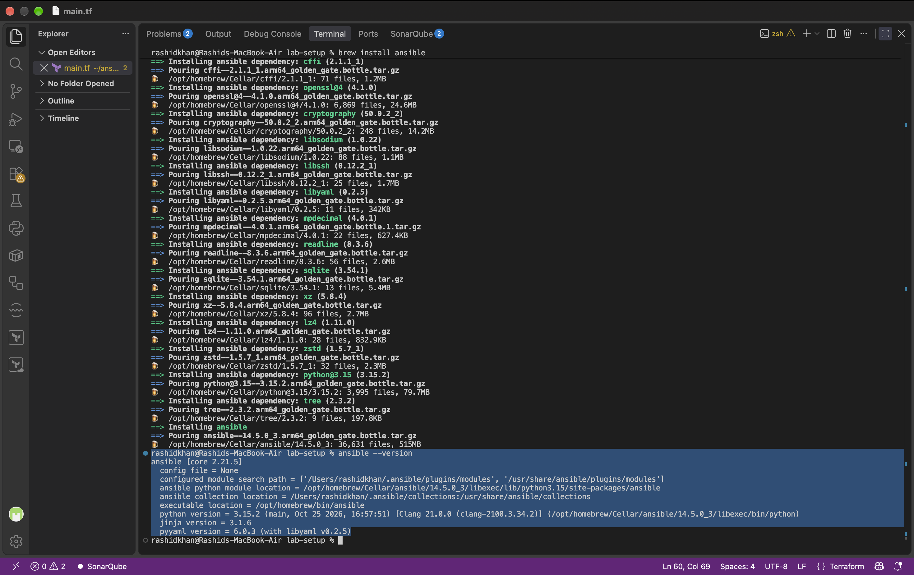
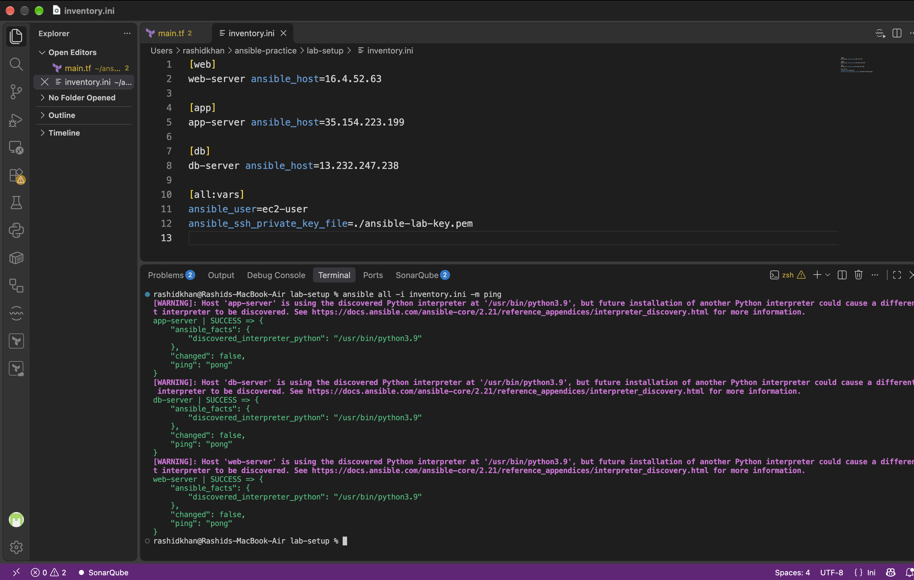
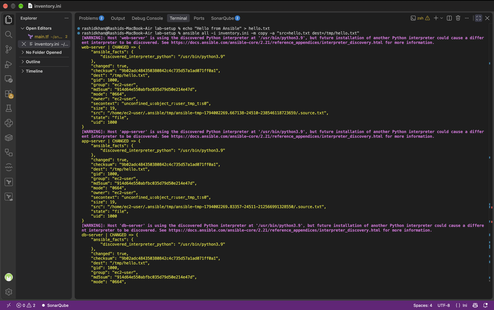

# Day 68: Introduction to Ansible and Inventory Setup

## Task 1: Understand Ansible

**1. What is configuration management? Why do we need it?**
Configuration management is a systems engineering process for establishing and maintaining consistency of a product's (or server's) performance, functional, and physical attributes. As infrastructure scales, configuring servers manually leads to undocumented "snowflake servers." We need it to automate provisioning, ensure idempotent deployments, and maintain infrastructure consistency across hundreds of nodes seamlessly.

**2. How is Ansible different from Chef, Puppet, and Salt?**
Ansible uses an agentless, push-based architecture by default and relies on standard SSH, requiring no background daemons on managed nodes. In contrast, Chef and Puppet typically require installing proprietary agent software on every target node (pull-based model). Additionally, Ansible playbooks use human-readable YAML, whereas Chef uses Ruby and Puppet uses its own Domain Specific Language (DSL).

**3. What does "agentless" mean? How does Ansible connect to managed nodes?**
"Agentless" means there is no proprietary background service or daemon required to be installed and running on target machines. Ansible connects to managed Linux nodes using standard OpenSSH. It pushes small programs called "modules" over SSH, executes them using the target node's native Python environment, and then cleans them up.

**4. Describe the Ansible architecture:**
* **Control Node:** The central management machine (Linux/macOS) with Ansible installed, from which tasks and playbooks are executed.
* **Managed Nodes:** The target servers (e.g., EC2 instances) that Ansible configures.
* **Inventory:** A configuration file (e.g., `inventory.ini`) listing managed nodes, IP addresses, and group assignments.
* **Modules:** Small, discrete units of code executed by Ansible on managed nodes to perform specific tasks (e.g., `yum`, `copy`).
* **Playbooks:** Written in YAML, these are ordered lists of tasks executed on managed nodes to achieve a desired configuration state.

## Task 2 & 3: Lab Setup and Ansible Installation
* **Installation Machine:** I installed Ansible on my Control Node (local macOS workstation). Ansible uses an agentless architecture, so it only needs to be installed on the control node.
* **Lab Setup:** Provisioned 3 Amazon Linux 2023 EC2 instances (t2.micro) strictly using Infrastructure as Code (Terraform) to maintain a DevOps approach. 
  



## Task 4: Inventory Setup
My `inventory.ini` file structure targeting the AWS public IPs:

```ini
[web]
web-server ansible_host=16.4.52.63

[app]
app-server ansible_host=35.154.223.199

[db]
db-server ansible_host=13.232.247.238

[all:vars]
ansible_user=ec2-user
ansible_ssh_private_key_file=./ansible-lab-key.pem
```
## Task 5: Run Ad-Hoc Commands

**What does `--become` do?**
The `--become` flag tells Ansible to escalate privileges on the managed node, operating as the `root` user (similar to `sudo`). It is strictly required for administrative tasks like installing packages or managing system services.

**Difference between command and shell modules:**
The `command` module executes commands safely without passing them through a shell, meaning it does not support shell variables (like `$HOME`) or pipeline operators (`|`, `>`, `<`). The `shell` module executes commands through `/bin/sh`, allowing pipeline operations and shell variables, but is more vulnerable to injection.

**Ad-hoc command executions:**

```bash
# 1. Check uptime on all servers
ansible all -i inventory.ini -m command -a "uptime"

# 2. Check free memory on web servers
ansible web -i inventory.ini -m command -a "free -h"

# 3. Check disk space on all servers
ansible all -i inventory.ini -m command -a "df -h"

# 4. Install package on web group
ansible web -i inventory.ini -m yum -a "name=git state=present" --become

# 5. Copy a file to all servers
ansible all -i inventory.ini -m copy -a "src=hello.txt dest=/tmp/hello.txt"

# 6. Verify file copy
ansible all -i inventory.ini -m command -a "cat /tmp/hello.txt"
```
## Day 68: Documentation

## 1. Ansible Architecture (In My Own Words)
Ansible operates on a powerful, agentless architecture that relies on a push-based model. Here are the core components:
*   **Control Node:** The central management machine (my local macOS workstation) where Ansible is installed. It drives the entire automation process.
*   **Managed Nodes:** The target servers (e.g., EC2 instances) that Ansible configures. No proprietary agents or background daemons are installed on them.
*   **Inventory:** A configuration file (like `inventory.ini`) that lists the IP addresses of the managed nodes and groups them logically.
*   **Modules:** Small, discrete units of code (like `yum`, `copy`, or `command`) that the control node pushes to the managed nodes over standard OpenSSH, executes using the target's native Python environment, and then removes.
*   **Playbooks:** YAML-based instruction manuals that define a series of tasks to be executed on the managed nodes to achieve a desired state.

## 2. How I Set Up My Lab
To maintain a strict Infrastructure as Code (IaC) and DevOps methodology, I avoided manual console clicks and provisioned my lab using **Terraform**.
*   **Instances:** Provisioned 3 EC2 instances running Amazon Linux 2023.
*   **Instance Type:** `t2.micro` (AWS ap-south-1 region).
*   **Security:** Configured a Security Group allowing inbound SSH (Port 22) and automatically generated a fresh RSA key pair (`ansible-lab-key.pem`) for secure access.
*   **Categorization:** Mentally and via Terraform tags, assigned them as `web-server`, `app-server`, and `db-server`.


## 3. My `inventory.ini` File
*(Note: Public IPs have been redacted for security before sharing publicly)*

```ini
[web]
web-server ansible_host=<REDACTED_IP_1>

[app]
app-server ansible_host=<REDACTED_IP_2>

[db]
db-server ansible_host=<REDACTED_IP_3>

[all:vars]
ansible_user=ec2-user
ansible_ssh_private_key_file=./ansible-lab-key.pem
```

## 4. Ansible Ping Verification (All Green)
Successfully verified SSH connectivity and Python interpreter discovery across all nodes using the native ping module without any agent installation.



## 5. Ad-Hoc Commands and Outputs
I executed the following ad-hoc commands to manage the servers directly from the control node:

```bash
# 1. Check uptime on all servers
ansible all -i inventory.ini -m command -a "uptime"

# 2. Check free memory on web servers only
ansible web -i inventory.ini -m command -a "free -h"

# 3. Check disk space on all servers
ansible all -i inventory.ini -m command -a "df -h"

# 4. Install 'git' on the web group (requires --become for root privileges)
ansible web -i inventory.ini -m yum -a "name=git state=present" --become

# 5. Copy a file to all servers
ansible all -i inventory.ini -m copy -a "src=hello.txt dest=/tmp/hello.txt"

# 6. Verify the file was copied on all servers
ansible all -i inventory.ini -m command -a "cat /tmp/hello.txt"
```



## 6. Difference Between `command` and `shell` Modules
*   **`command` Module:** Executes commands safely and directly without passing them through a shell. Because it bypasses the shell, it is more secure against injection attacks but **cannot** use shell variables (like `$HOME`) or pipeline operators (like `|`, `>`, `<`).
*   **`shell` Module:** Executes commands by passing them through the node's shell (typically `/bin/sh`). This allows for complex pipeline operations, redirections, and the use of environment variables, but it requires careful handling to prevent shell injection vulnerabilities.
