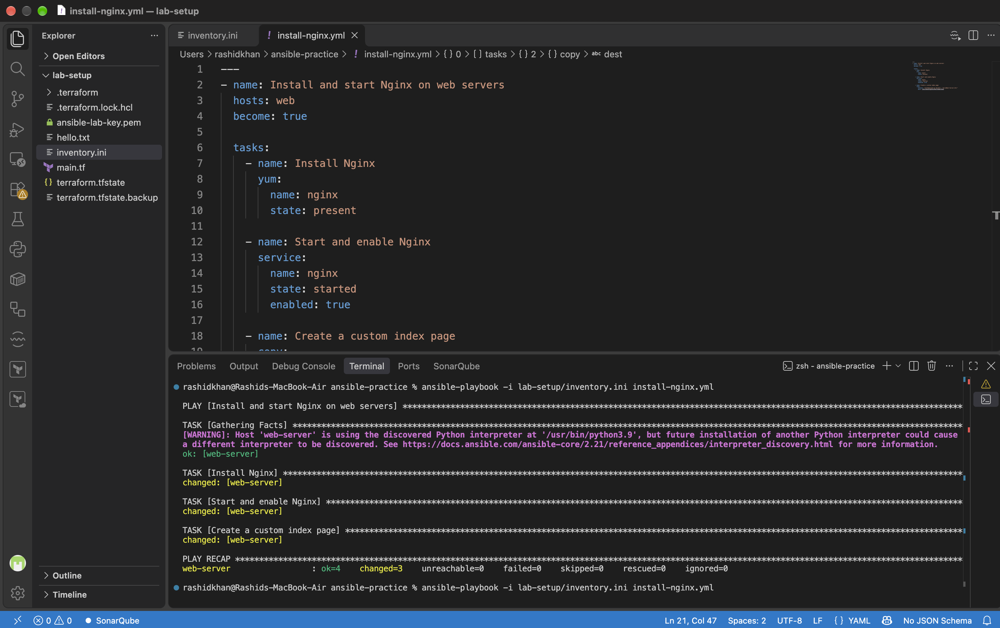
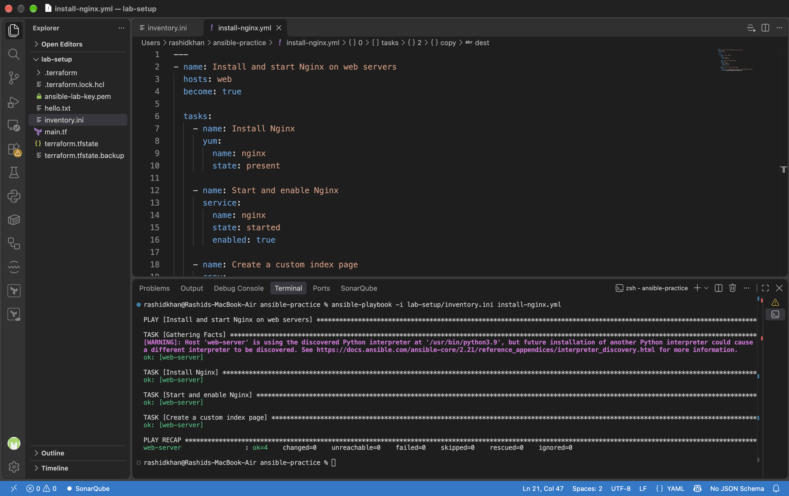
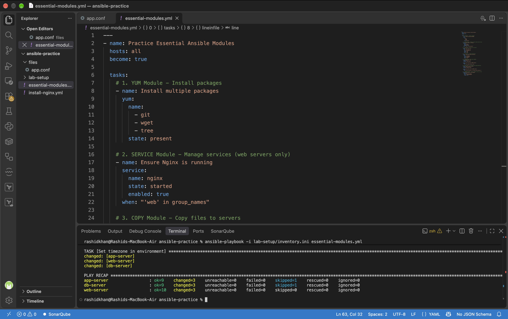
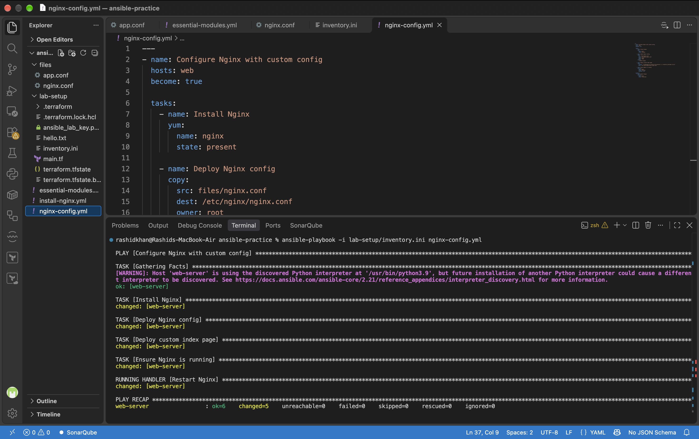
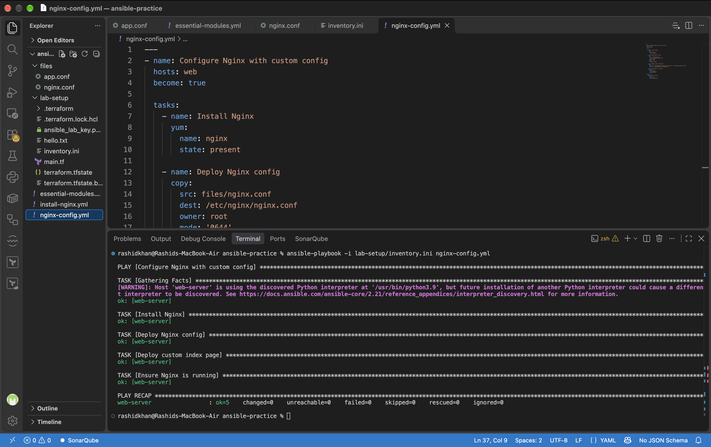
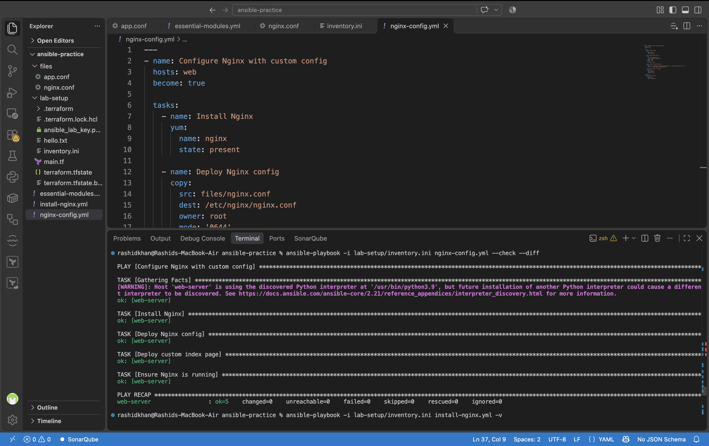
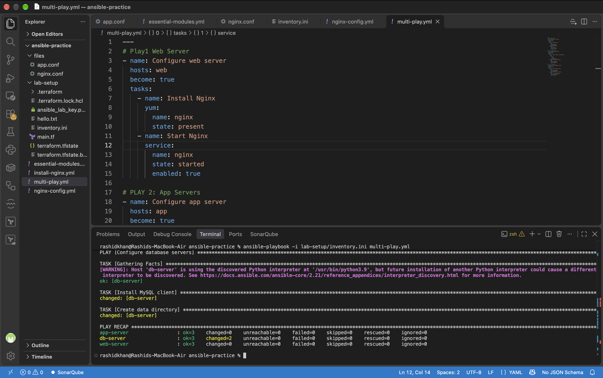

# Day 69: Ansible Playbooks & Essential Modules

## Task 1: First Playbook and Idempotency
Executed a basic playbook to install and start Nginx on web servers. The first execution resulted in a `changed=3` state as the package was installed, the service started, and the file created. The second execution resulted in `changed=0`, successfully proving Ansible's idempotency paradigm where no redundant actions are taken if the desired state is already met.

**Proof of Work: First Run & Idempotency**

## Task 2: Understand the Playbook Structure
Based on official Ansible documentation, here are the core structural concepts:

**1. What is the difference between a play and a task?**
A Play is the top-level mapping between a group of hosts (e.g., `web` servers from the inventory) and the tasks that should run on them. A Task is a single, specific unit of work executed within that play (e.g., installing a package) using an Ansible module.

**2. Can you have multiple plays in one playbook?**
Yes. A single playbook can contain multiple plays. This allows you to orchestrate complex environments where one play targets web servers, and the subsequent play targets database servers within the same YAML file.

**3. What does `become: true` do at the play level vs the task level?**
When `become: true` is set at the play level, privilege escalation (sudo/root) is automatically applied to all tasks within that play. When set at the task level, only that specific individual task runs with elevated privileges, while the rest of the play runs as the standard SSH user.

**4. What happens if a task fails -- do remaining tasks still run?**
By default, Ansible follows a "fail-fast" behavior. If a task fails on a specific host, Ansible immediately stops executing any further tasks in that play for that particular host. However, it will continue executing tasks on other hosts where the task did not fail.

## Task 3: Learn the Essential Modules
Executed a playbook utilizing seven core modules: `yum`, `service`, `copy`, `file`, `command`, `shell`, and `lineinfile`. Variables were stored using `register` and printed using the `debug` module.

**What is the difference between command and shell? When should you use each?**
The `command` module is the default and safest way to run commands because it executes them directly, bypassing the node's shell environment. This prevents injection attacks but cannot use shell features like pipes (`|`), redirects (`>`), or environment variables. The `shell` module runs commands through `/bin/sh`, allowing full access to shell operators. Always use `command` unless you explicitly require shell operators like pipes or redirects.

**Proof of Work: Essential Modules Execution**

## Task 4: Handlers - Restart Services Only When Needed
Configured a custom Nginx file using the `copy` module with a `notify: Restart Nginx` trigger. The handler was defined under the `handlers:` block.
*   **First Run:** The configuration file was copied, triggering the handler which successfully restarted Nginx (`RUNNING HANDLER [Restart Nginx]`).
*   **Second Run:** No changes were made to the configuration file, so the handler was entirely bypassed, demonstrating safe service management without unnecessary downtime.

**Proof of Work: Handler Triggered vs Bypassed**

## Task 5: Dry Run, Diff, and Verbosity
Tested operational safety flags including `--check`, `--diff`, `-v`, `--limit`, and `--list-tasks`.

**Why is `--check --diff` the most important flag combination for production use?**
`--check` simulates the playbook execution to see which tasks would report as "changed" without actually modifying the system. Adding `--diff` shows the exact line-by-line differences in configuration files that Ansible plans to make. This combination is crucial in production because it prevents catastrophic misconfigurations and unexpected overrides, acting as a mandatory safety net before applying changes.

**Proof of Work: Check Mode with Diff**

## Task 6: Multiple Plays in One Playbook
Successfully engineered `multi-play.yml` containing three distinct plays targeting different host groups concurrently:
*   **Play 1:** Configured `[web]` servers with Nginx.
*   **Play 2:** Configured `[app]` servers with Node.js build dependencies (gcc, make).
*   **Play 3:** Configured `[db]` servers with MariaDB client.

**Proof of Work: Multi-Play Execution Recap**

## Troubleshooting Log
Encountered and resolved multiple real-world execution errors during the lab:

1.  **SSH Host Key Verification Failure:** After re-applying Terraform, the new AWS instances received the same IPs but different SSH fingerprints. Fixed by exporting `ANSIBLE_HOST_KEY_CHECKING=False`.
2.  **Key Pair Discrepancy:** Terraform generated a new key `ansible_lab_key.pem` which conflicted with the old `ansible-lab-key.pem` referenced in the inventory. Fixed by removing the old key, assigning `chmod 400` to the new key, and updating `inventory.ini` via `sed`.
3.  **AL2023 Curl Depsolve Conflict:** Amazon Linux 2023 ships with `curl-minimal`. Instructing Ansible to install `curl` via the `yum` module caused a strict dependency conflict. Fixed by removing `curl` from the package list as the base binary already exists.
4.  **YAML Indentation Error:** The `lineinfile` module threw a `line is required with state=present` error. Fixed by correcting the strict 2-space YAML indentation under the module definition.
5.  **AL2023 MySQL Package Missing:** The DB server playbook failed with `No package mysql available`. AL2023 utilizes MariaDB as the default MySQL drop-in replacement. Fixed by changing the package name from `mysql` to `mariadb105`.
