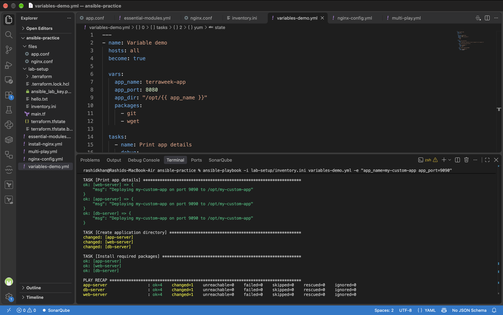
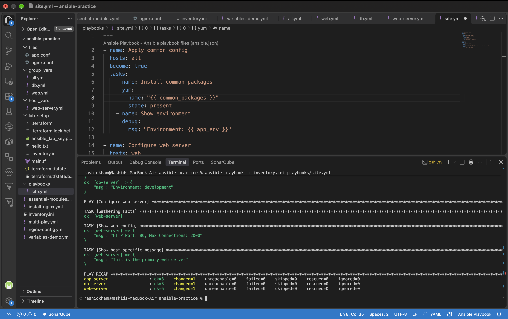
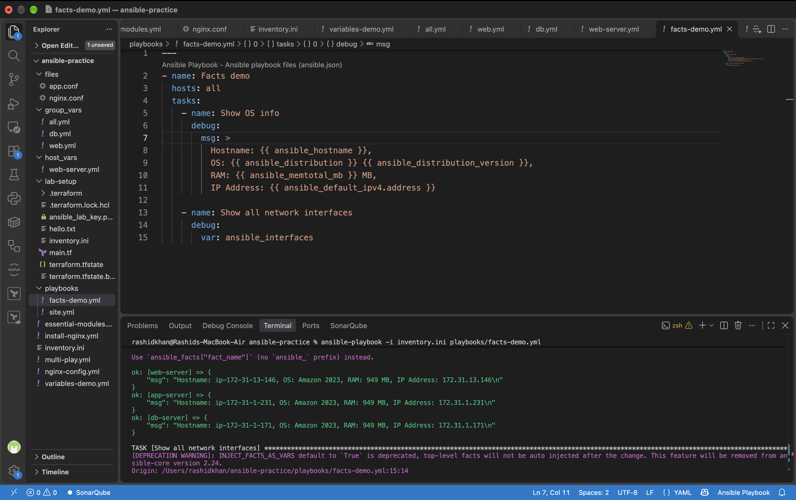
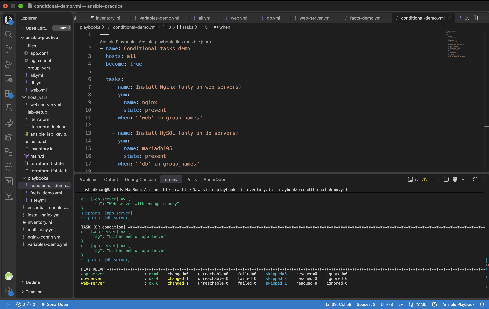
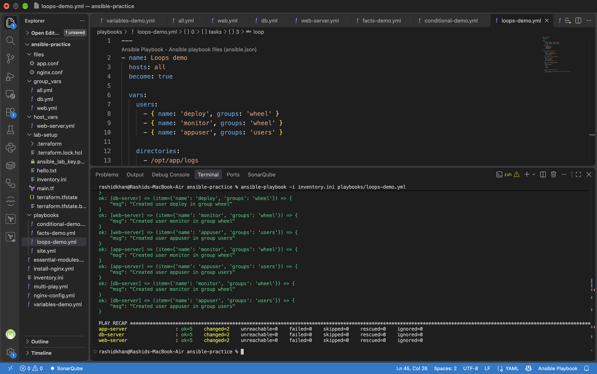
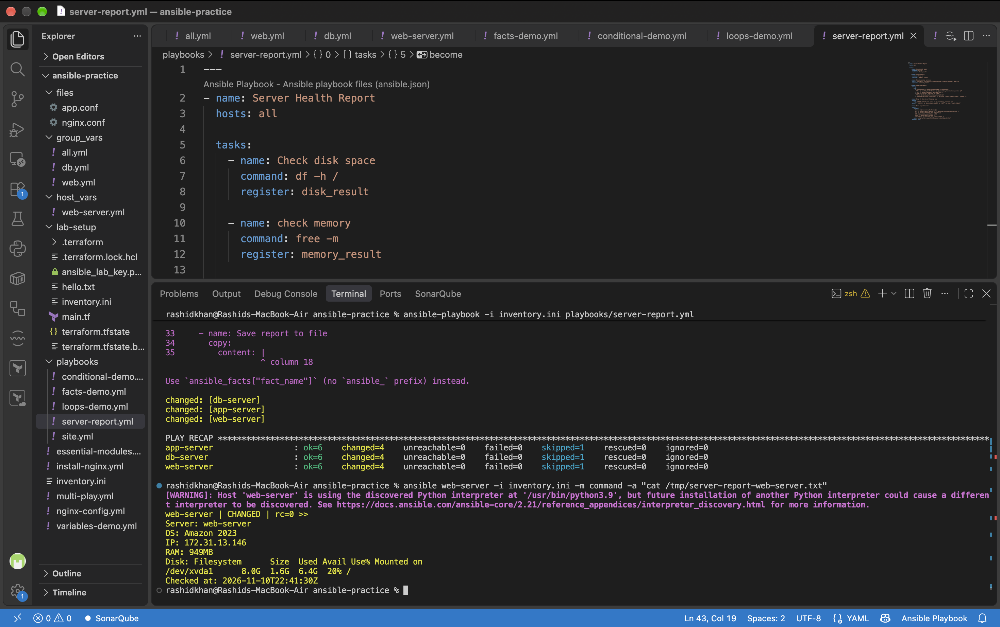

# Day 70: Variables, Facts, Conditionals, and Loops in Ansible

## Task 1: Variables in Playbooks & CLI Overrides
Created a playbook using inline variables to define application details (app_name, app_port). We verified that Ansible's variable precedence allows command-line variables (-e or --extra-vars) to strictly override playbook variables.

**Proof of Work:**

---

## Task 2: group_vars and host_vars Structure
Variables should not be hardcoded inside playbooks. We decoupled variables by establishing the official Ansible directory structure:

ansible-practice/
  inventory.ini
  group_vars/
    all.yml
    web.yml
    db.yml
  host_vars/
    web-server.yml
  playbooks/
    site.yml

**Variable Precedence Validation:**
The group_vars/web.yml defined max_connections: 1000, but host_vars/web-server.yml defined max_connections: 2000. Upon execution, the host variable successfully overrode the group variable, confirming that specific scopes override broader scopes.

**Proof of Work:**

---

## Task 3: Ansible Facts
Ansible automatically gathers system properties via the setup module. 
Here are 5 critical facts used in real-world automation:
1. ansible_distribution: To write conditional tasks based on OS (e.g., Ubuntu vs. Amazon Linux).
2. ansible_memtotal_mb: To allocate JVM heap sizes dynamically based on total RAM.
3. ansible_default_ipv4.address: To correctly bind applications to the primary network interface.
4. ansible_processor_vcpus: To calculate threading or parallel worker limits.
5. ansible_hostname: To automatically generate server configuration files or naming conventions.

**Proof of Work:**

---

## Task 4: Conditionals with when
Executed a playbook utilizing the when keyword to enforce boolean logic. The Nginx installation task successfully executed on web-server while correctly reporting a skipped state for the app-server and db-server.

**Proof of Work:**

---

## Task 5: Loops
Utilized the loop keyword (the modern replacement for with_items) to execute bulk operations dynamically. A single YAML block successfully iterated over a list to create multiple users, deploy multiple directory structures, and install an array of packages.

**Proof of Work:**

---

## Task 6: Server Health Report (Register & Debug)
Engineered a complex playbook utilizing the register keyword to capture standard outputs from shell commands (df -h, free -m). We synthesized this registered data with Ansible Facts to generate a dynamically formatted Server Health Report, and copied it directly to the target node's /tmp directory.

**Proof of Work (Final Report Readout):**

