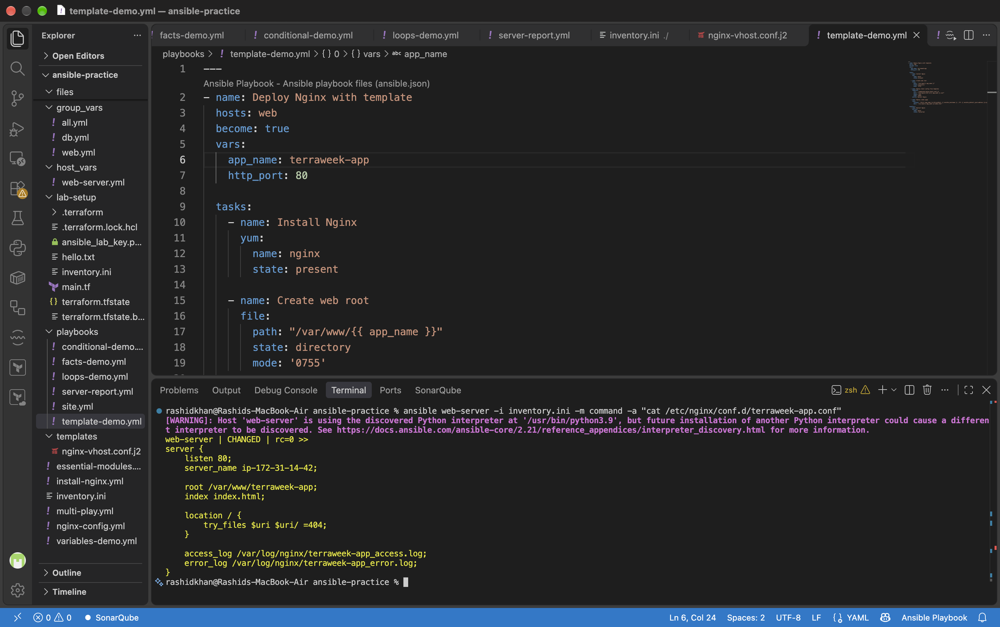
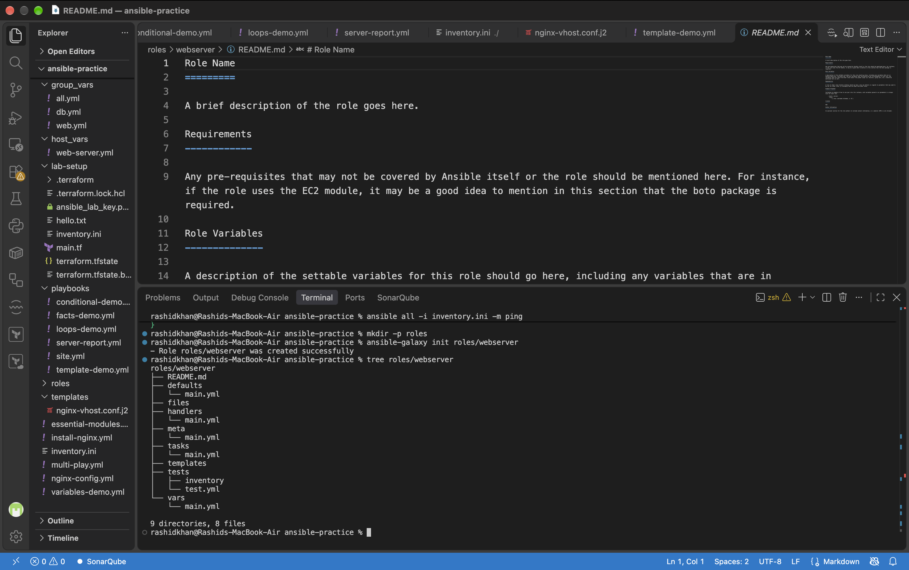
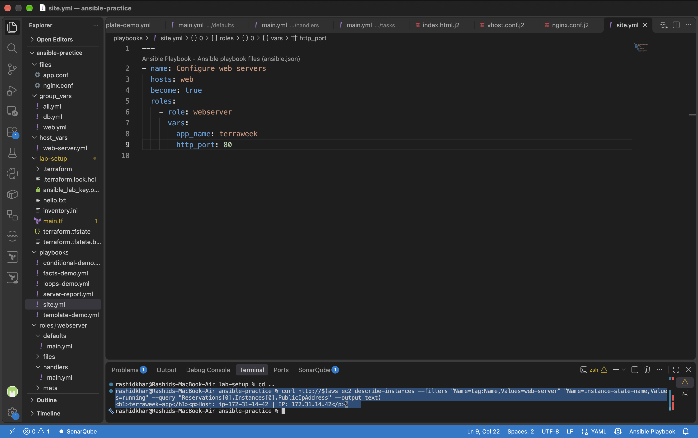
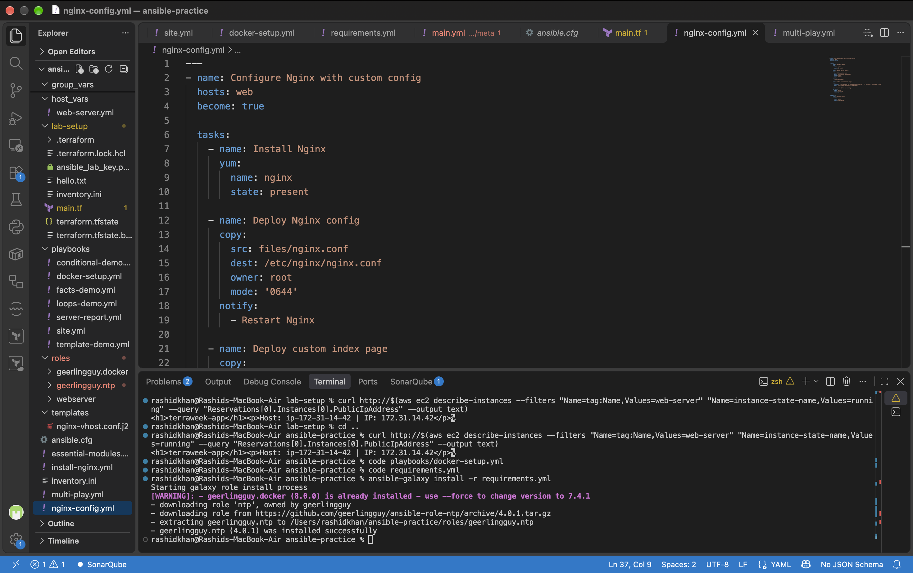
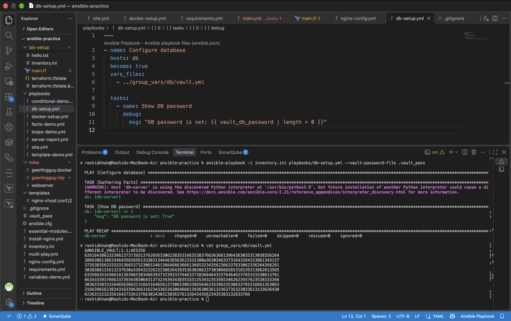
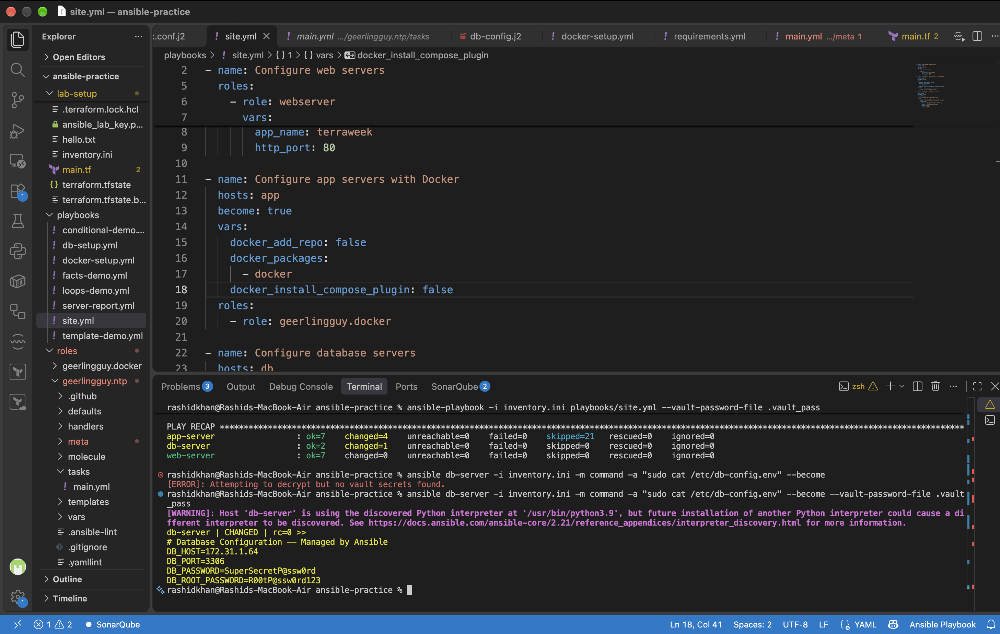

# Day 71 -- Roles, Galaxy, Templates and Vault

## Task 1: Jinja2 Templates

Templates let you generate config files dynamically using variables and facts. I created a Jinja2 template `templates/nginx-vhost.conf.j2` and a playbook `template-demo.yml` to deploy it. The playbook was run with the `--diff` flag to observe the exact changes applied to the configuration file before execution.

**Verification:** SSH into the web server and read the generated config. Are the variables replaced with actual values?
Yes. The output of the `cat /etc/nginx/conf.d/terraweek-app.conf` command showed that variables were successfully replaced. `{{ http_port | default(80) }}` rendered as `80`, `{{ ansible_hostname }}` rendered as the actual AWS internal hostname `ip-172-31-14-42`, and `{{ app_name }}` rendered as `terraweek-app`.

## Task 2: Understand the Role Structure

An Ansible role has a fixed directory structure. I generated a skeleton role named `webserver` using the `ansible-galaxy init roles/webserver` command and inspected the directory tree.

**Document: What is the difference between vars/main.yml and defaults/main.yml?**
According to Ansible documentation on variable precedence:
*   **`defaults/main.yml`**: Contains default variables for the role. These have the lowest precedence of any variables available and are meant to be easily overridden by inventory variables, playbook variables, or command-line arguments.
*   **`vars/main.yml`**: Contains variables intended for internal use by the role. These have very high precedence and are not meant to be overridden. They are used for values that should remain constant for the role to function correctly.

## Task 3: Build a Custom Webserver Role

I built a complete custom webserver role from scratch by populating the `defaults/main.yml`, `tasks/main.yml`, `handlers/main.yml`, and `templates/` directories. The tasks included installing Nginx, deploying the configuration and vhost templates, creating the web root, deploying an `index.html` template, and starting the service. I then called this role from a master playbook `site.yml`. A Terraform security group update was required to open port 80 to allow HTTP traffic.

**Verification:** Curl the web server. Does the custom page load?
Yes. Executing `curl http://<web-server-public-ip>` successfully returned the rendered HTML content: `<h1>terraweek-app</h1>
Host: ip-172-31-14-42 | IP: 172.31.14.42
`, confirming the custom role deployed and started the Nginx service correctly.

## Task 4: Ansible Galaxy -- Use Community Roles

I utilized Ansible Galaxy to manage community-built roles. I searched for available roles, installed `geerlingguy.docker`, and verified its installation using `ansible-galaxy list`. Finally, I created a `requirements.yml` file to define required roles and versions, and installed them in a single batch.

**Document: Why use a requirements.yml instead of installing roles manually?**
Using a `requirements.yml` file is standard practice for Infrastructure as Code (IaC). It acts as a manifest that tracks external dependencies. Instead of remembering or manually typing out multiple `ansible-galaxy install` commands across different environments, a single `ansible-galaxy install -r requirements.yml` command ensures that all required roles, pinned to specific versions, are consistently downloaded. This is critical for reproducibility, especially in CI/CD pipelines and when sharing code with other team members.

## Task 5: Ansible Vault -- Encrypt Secrets

To prevent sensitive data like database passwords and API keys from being exposed in plain text within version control, I used Ansible Vault. I created an encrypted file `group_vars/db/vault.yml`, viewed its encrypted state, and created a playbook to utilize the decrypted variables at runtime.

**Document: Why is --vault-password-file better than --ask-vault-pass for automated pipelines?**
`--ask-vault-pass` forces Ansible to prompt the user interactively in the terminal to type the password. This blocks execution until human input is provided, which makes it impossible to use in automated CI/CD pipelines (like Jenkins or GitHub Actions) where no human is present to type the password. `--vault-password-file` allows Ansible to read the password directly from a secure file automatically, enabling non-interactive, fully automated deployments while keeping the vault data encrypted at rest.

## Task 6: Combine Roles, Templates, and Vault

I wrote a comprehensive `site.yml` master playbook that combined all concepts. It configured the `web` group using the custom `webserver` role, the `app` group using the Galaxy `geerlingguy.docker` role (customized for Amazon Linux 2023 by overriding variables), and the `db` group using a Jinja2 template that injected Vault-encrypted secrets.

**Verification:** SSH into the db server and check /etc/db-config.env. Are the secrets rendered correctly? Is the file permission 600?
Yes. The `sudo cat /etc/db-config.env` command on the database server revealed that the `vault_db_password` and `vault_db_root_password` variables were successfully decrypted and injected into the file. The `template` task specifically set the mode to `0600`, ensuring only the root user has read and write access to these secrets.

## Documentation Summary

*   **Your webserver role directory structure:** Shown in Task 2. It contains `defaults`, `files`, `handlers`, `meta`, `tasks`, `templates`, `tests`, and `vars` directories.
*   **The Jinja2 templates you created and the rendered output:** Created `nginx-vhost.conf.j2`, `index.html.j2`, and `db-config.j2`. Rendered output verification is documented in Task 1 and Task 6.
*   **Screenshot of the role running successfully:** Shown in Task 3.
*   **How you installed and used a Galaxy role:** Documented in Task 4. Installed via `requirements.yml` and utilized in the master `site.yml` by calling `- role: geerlingguy.docker` under the app hosts block.
*   **Vault workflow: create, edit, view, encrypt, decrypt:** Documented in Task 5. Used `ansible-vault create` to initialize, viewed the encrypted string via `cat`, and decrypted at runtime using `--vault-password-file`.
*   **Screenshot of the encrypted vault file contents:** Shown in Task 5.
*   **When to use roles vs playbooks vs ad-hoc commands:**
    *   **Ad-hoc commands:** Used for quick, one-off tasks, immediate troubleshooting, or verifying system states (e.g., checking if a file exists, restarting a single service) without writing a file.
    *   **Playbooks:** Used for orchestrating multiple tasks across different hosts. Best for single-purpose deployments or connecting multiple roles together.
    *   **Roles:** Used for packaging related tasks, variables, files, templates, and handlers into a reusable, modular, and shareable structure. Best when configuring a specific service (like a web server or database) that you want to deploy consistently across multiple projects or environments.
