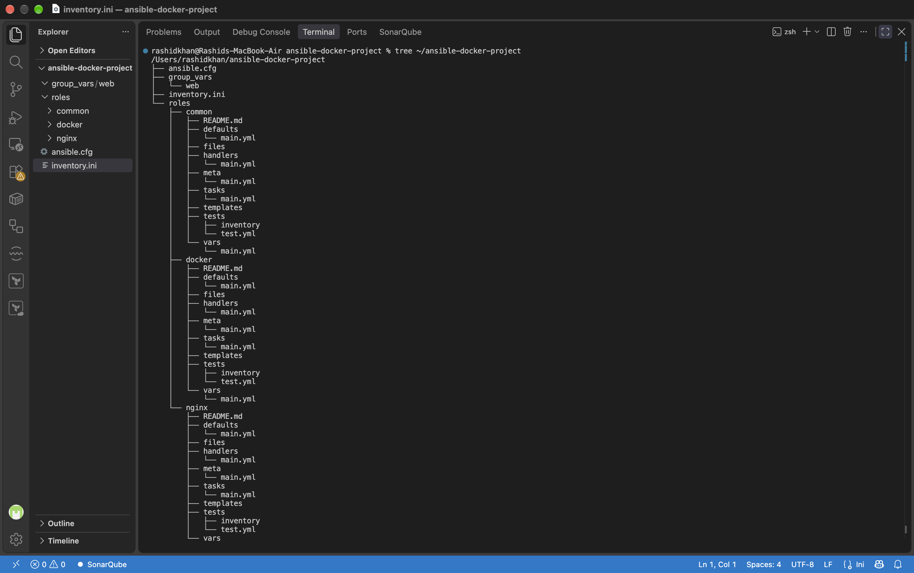
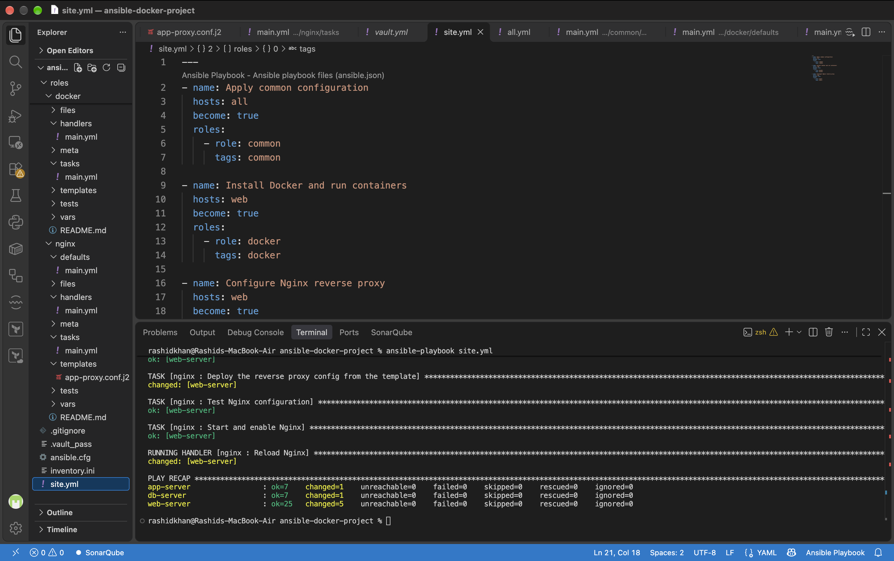
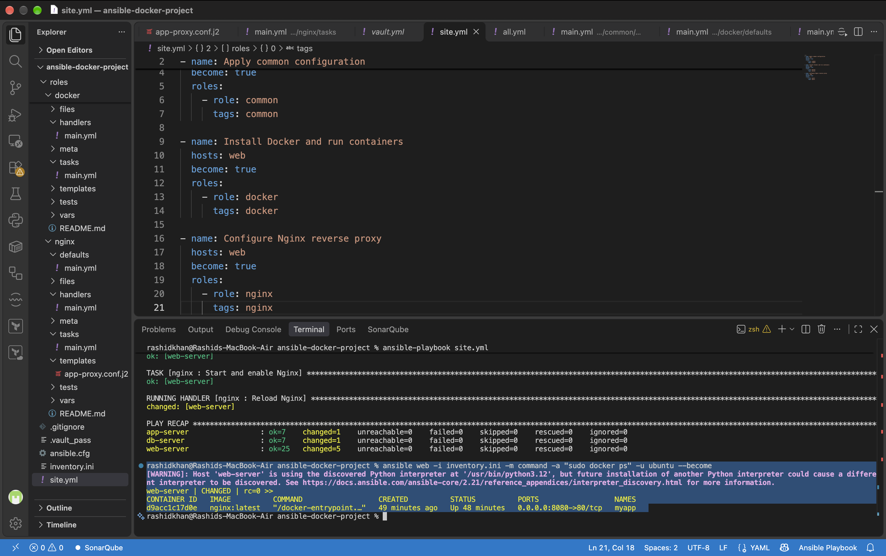
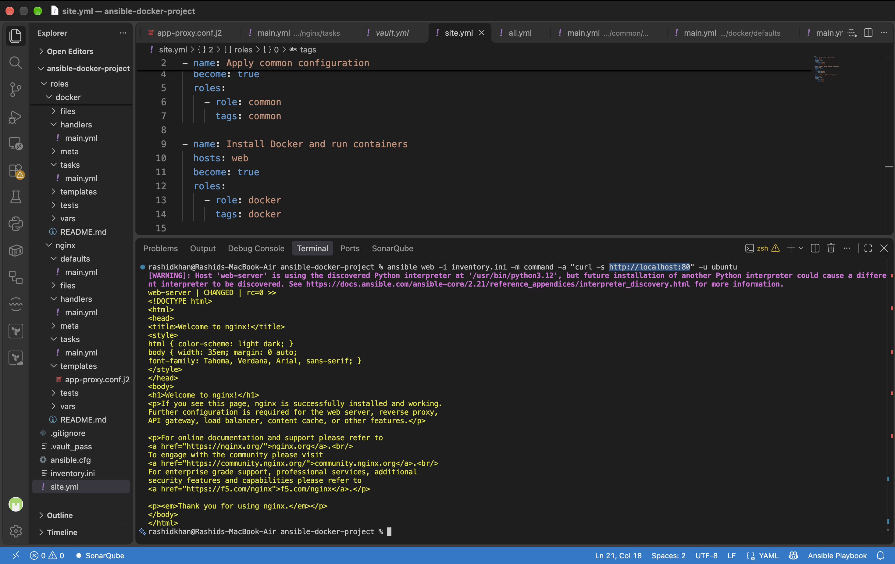
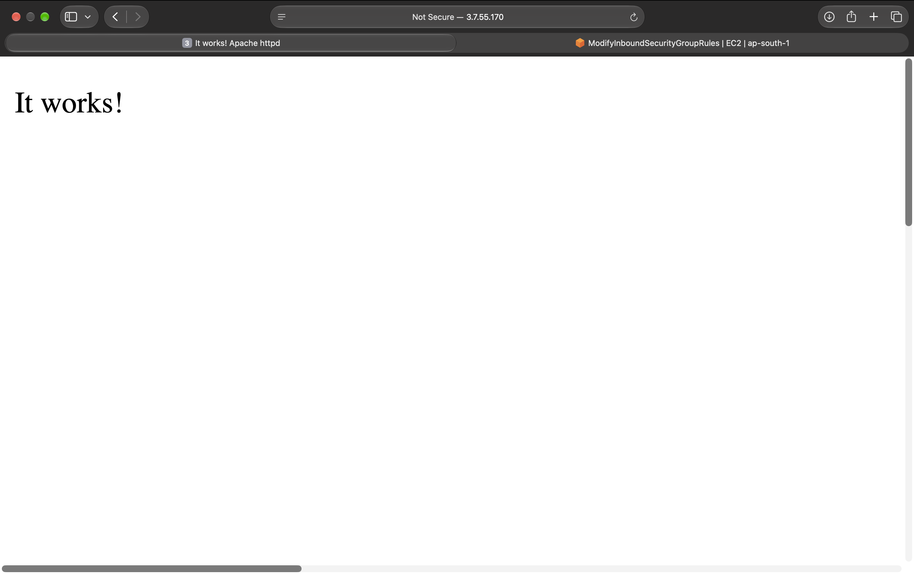

# Day 72: Ansible Project - Automate Docker and Nginx Deployment

This document outlines my complete execution of the Day 72 Ansible project. Today, I put together all the Ansible concepts I learned over the last five days to build a production-grade infrastructure deployment. My goal was to automate the installation of Docker, deploy a containerized application, set up Nginx as a reverse proxy, and secure secrets using Ansible Vault.

## Task 1: Plan the Project Structure
I started by creating a modular directory structure. Instead of writing one massive playbook, I separated the logic into three dedicated roles: common, docker, and nginx. This makes the code reusable and clean.

Proof of Project Structure:

## Task 2: Build the Common Role
I built the common role to establish a baseline configuration across all my servers (web-server, app-server, and db-server). 

What I did:
- Configured the universe repository.
- Updated the apt package cache.
- Installed baseline packages like curl, vim, git, and tree.
- Set the hostname and configured the timezone.
- Created a dedicated deploy user.

My terminal output confirmed that these common tasks executed successfully across all three EC2 instances.

## Task 3: Build the Docker Role
I created the docker role specifically for the web-server to handle the container lifecycle. 

What I did:
- Installed necessary Docker dependencies for Ubuntu.
- Added the Docker GPG key and official repository.
- Installed Docker CE and started the service.
- Added my deploy user to the docker group.
- Pulled the application image and executed the container with a port mapping of 8080:80.
- Implemented a health check task using the uri module to wait until the container returned a 200 OK status on localhost:8080.

## Task 4: Build the Nginx Role
I configured the nginx role to act as a reverse proxy so that users can access the application on standard port 80 without knowing the internal container port.

What I did:
- Installed Nginx and removed the default Ubuntu site configuration.
- Deployed a custom reverse proxy configuration using a Jinja2 template (app-proxy.conf.j2).
- Added a syntax test command (nginx -t) to validate the configuration before applying it, which saved me from pushing broken configs.
- Used a handler to reload the Nginx service only when the template was updated.

## Task 5: Encrypt Docker Hub Credentials with Vault
To keep my infrastructure secure, I used Ansible Vault. I created a group_vars/web/vault.yml file and encrypted my vault_docker_username and vault_docker_password. I successfully passed these credentials to the docker_login task without exposing them in plaintext.

## Task 6: Write the Master Playbook and Deploy
I tied everything together in my site.yml master playbook. I mapped the common role to all hosts, and the docker and nginx roles strictly to the web group. 

When I executed the playbook, my terminal recap showed exactly 25 successful tasks for the web-server, and 7 tasks for the app-server and db-server. 

Master Playbook Full Deployment Proof:

After the deployment, I verified the container was running and correctly mapped to port 8080:

I then verified that Nginx was successfully routing traffic from port 80 to the backend container via a local curl request:

## Task 7: Bonus Task - Deploy a Different App and Re-Run
To prove the flexibility of my automation, I completed the challenge task by dynamically changing the backend application from Nginx to Apache (httpd) without editing any role files. 

What I did:
I passed extra-vars through the command line to override the default variables:
ansible-playbook site.yml --tags docker -e "docker_app_image=httpd docker_app_tag=latest docker_app_name=apache-app"

My terminal showed that the container task registered a "changed" state, and the health check successfully validated the new Apache container on port 8080. Nginx continued to proxy the traffic perfectly.

Browser Verification showing the Apache application proxied via Nginx:

## Reflection and Learning

Through this project, I mapped the theoretical concepts of the last five days into a practical architecture:

Day 68: I utilized inventory files and SSH connections to communicate with multiple EC2 instances simultaneously.
Day 69: I wrote playbooks using various modules (apt, service, command) and triggered handlers.
Day 70: I used variables to make my configurations dynamic and utilized Ansible facts to target Ubuntu-specific package managers.
Day 71: I structured my code into Roles, used Jinja2 templates for Nginx configs, and secured my data with Ansible Vault.
Day 72: I combined everything to achieve a zero-touch, automated deployment.

What I would add for production:
For a real-world production environment, I would add Certbot for automated SSL/TLS certificates, implement Prometheus for monitoring, and use Docker Compose for managing multi-container setups.