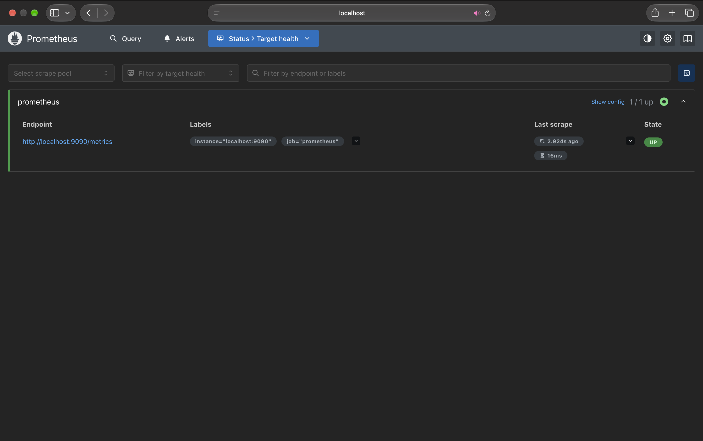
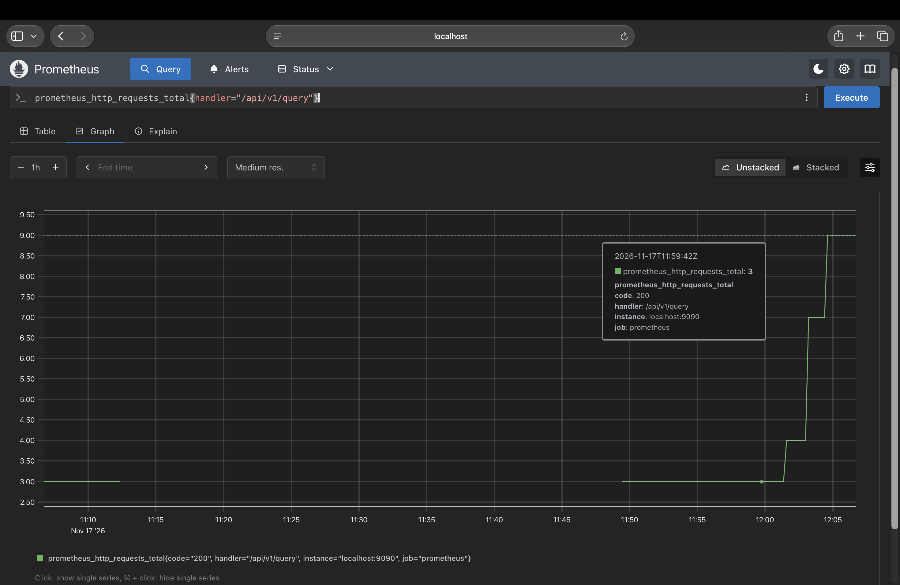
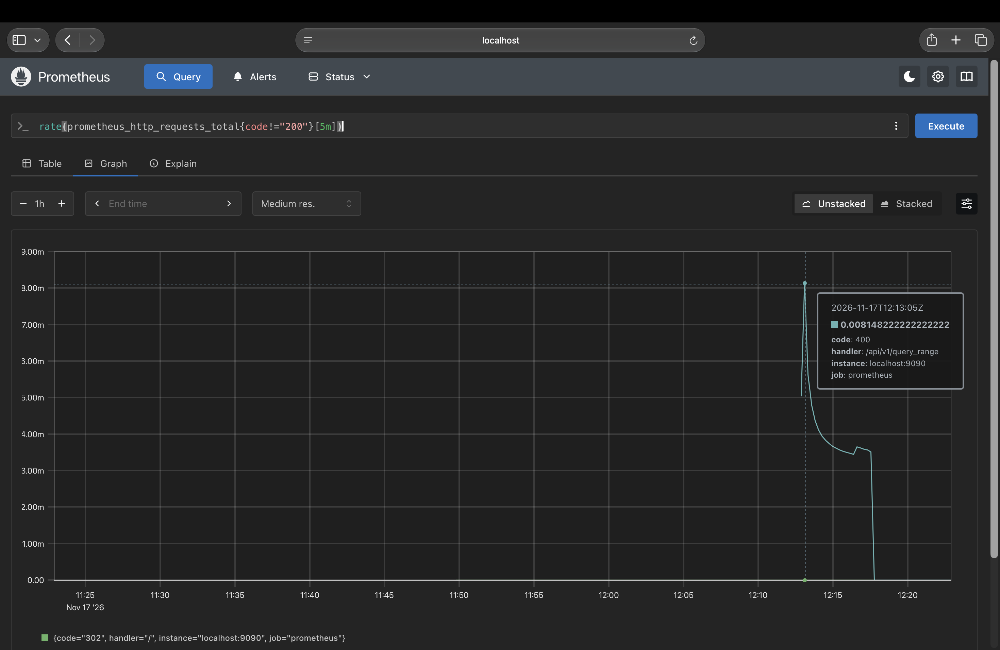
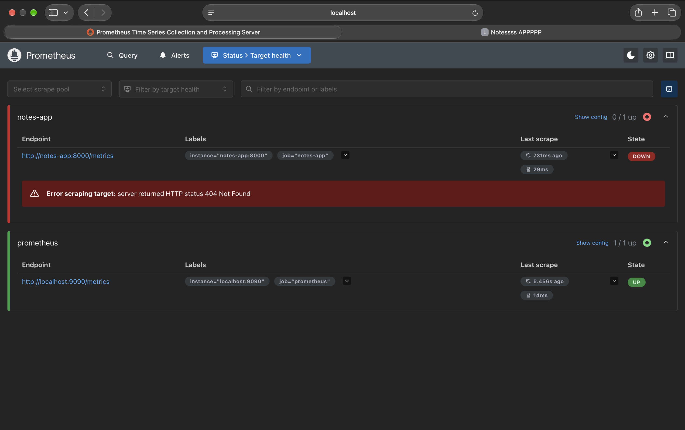

# Day 73: Introduction to Observability and Prometheus

This document outlines my complete execution of Day 73 of the #90DaysOfDevOps challenge. Today, I transitioned from traditional monitoring to Observability by setting up Prometheus via Docker, understanding the core metric types, executing PromQL queries, and scraping targets.

## Task 1: Understand Observability

**Observability vs Traditional Monitoring:**
* **Monitoring** tells you *when* a system is broken (e.g., alert on CPU > 90%). It relies on predefined thresholds.
* **Observability** tells you *why* the system is broken. It allows querying and exploring the internal state of a system from the outside to find the root cause of unknown issues.

**The Three Pillars of Observability:**
1. **Metrics:** Numerical representations of data measured over time (e.g., memory usage, request rates). Best handled by **Prometheus**.
2. **Logs:** Immutable, timestamped records of discrete events (e.g., stack traces, DB connection errors). Handled by **Loki/Promtail**.
3. **Traces:** A representation of a single request's journey across a distributed system/microservices. Handled by **OpenTelemetry/Jaeger**.

**Target Architecture (Days 73-77):**
```text
[Your App] --> metrics --> [Prometheus] --> [Grafana Dashboards]
[Your App] --> logs    --> [Promtail]   --> [Loki] --> [Grafana]
[Your App] --> traces  --> [OTEL Collector] --> [Grafana/Debug]
[Host]     --> metrics --> [Node Exporter] --> [Prometheus]
[Docker]   --> metrics --> [cAdvisor] --> [Prometheus]
```

## Task 2: Set Up Prometheus with Docker

I initialized my `observability-stack` workspace and deployed Prometheus to scrape its own metrics by default.

**docker-compose.yml:**
```yaml
services:
  prometheus:
    image: prom/prometheus:latest
    container_name: prometheus
    ports:
      - "9090:9090"
    volumes:
      - ./prometheus.yml:/etc/prometheus/prometheus.yml
      - prometheus_data:/prometheus
    command:
      - '--config.file=/etc/prometheus/prometheus.yml'
    restart: unless-stopped
volumes:
  prometheus_data:
```

**prometheus.yml:**
```yaml
global:
  scrape_interval: 15s
  evaluation_interval: 15s
scrape_configs:
  - job_name: "prometheus"
    static_configs:
      - targets: ["localhost:9090"]
```

**Task 2 Proof (Prometheus Targets UP):**


## Task 3 & 4: Prometheus Concepts & PromQL Basics

**Metrics: Counter vs Gauge**
* **Counter:** A metric that only goes up (monotonically increasing) or resets to zero on restart. 
    * *Example:* Total HTTP requests served (`prometheus_http_requests_total`).
* **Gauge:** A metric that can arbitrarily go up and down.
    * *Example:* Current RAM usage (`process_resident_memory_bytes`).

**Executed PromQL Queries:**
1. `count({__name__=~".+"})`: Returned the total number of unique metrics Prometheus is tracking (~800+).
2. `process_resident_memory_bytes / 1024 / 1024`: Returned the current memory consumption of the Prometheus server in Megabytes.
3. `prometheus_http_requests_total`: Returned an instant vector of all HTTP requests broken down by labels.
4. `rate(prometheus_http_requests_total[5m])`: Converted the counter into a per-second rate over a 5-minute time window.

**Challenge Task:** Write a PromQL query that shows the per-second rate of non-200 HTTP requests over the last 5 minutes.
*Query:* 
```promql
rate(prometheus_http_requests_total{code!="200"}[5m])
```

**Task 3 & 4 Proof (Challenge Query Execution):**




## Task 5: Add a Sample Application as a Scrape Target

I deployed the `notes-app` alongside Prometheus to monitor an external application and updated the `prometheus.yml` config file to include it.

**Updated prometheus.yml (Snippet):**
```yaml
  - job_name: "notes-app"
    static_configs:
      - targets: ["notes-app:8000"]
```

*Note on Execution:* The target state showed as `DOWN` with an `HTTP status 404 Not Found` error. This is expected behavior because the sample application does not natively expose a `/metrics` endpoint. This practically demonstrates the necessity of external metric exporters (like Node Exporter or cAdvisor) for unsupported applications, which will be integrated in subsequent days.

**Task 5 Proof (Target Status with Expected 404 Error):**


## Task 6: Explore Data Retention and Storage

I verified the local disk footprint of the Time-Series Database (TSDB):
```bash
docker exec prometheus du -sh /prometheus
# Output: 3.2M    /prometheus
```

**Data Retention Mechanics:**
* **What happens when retention is exceeded?** By default, Prometheus retains data for 15 days. Once this limit (or a specified size limit) is exceeded, Prometheus automatically prunes the oldest data blocks from the TSDB to free up disk space for new metrics.
* **Why is a volume mount important?** Prometheus stores TSDB data locally. If a Docker volume (e.g., `prometheus_data`) is not mounted, the data resides in the container's ephemeral writable layer. If the container crashes, stops, or gets recreated, all historical metrics data is permanently lost. Mounting a volume ensures data persistence across container lifecycles.
