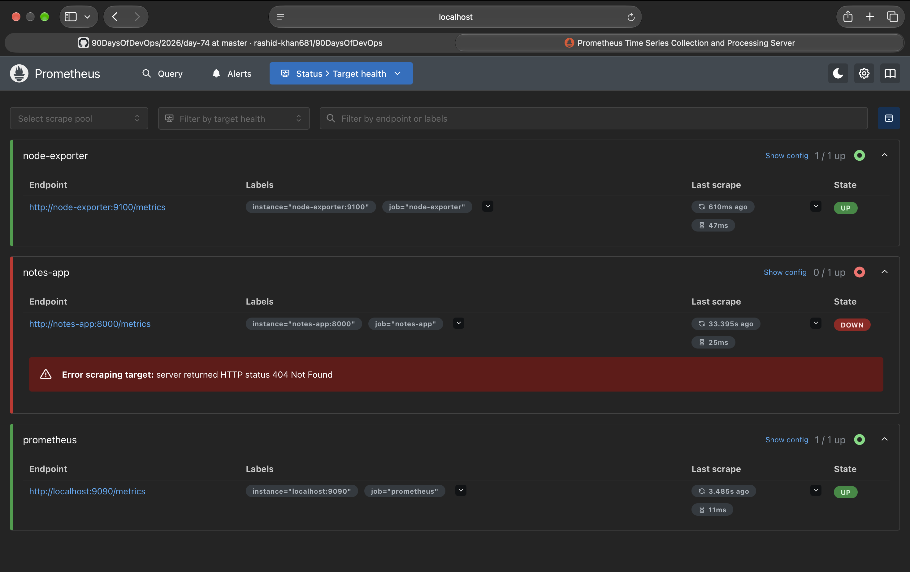
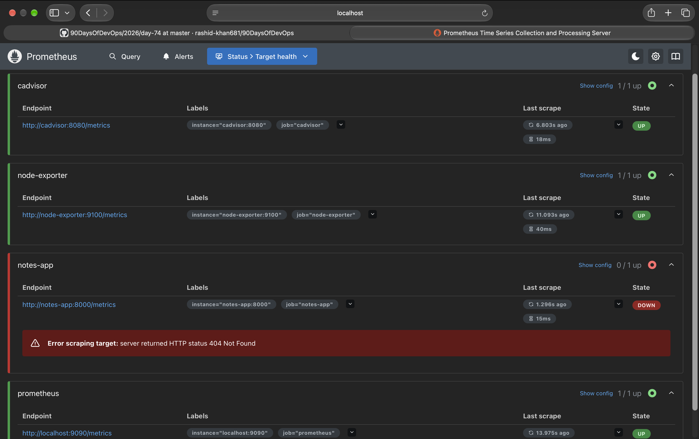
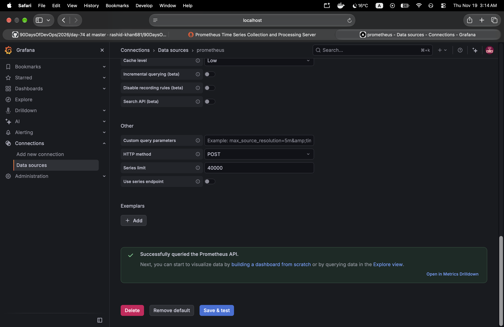
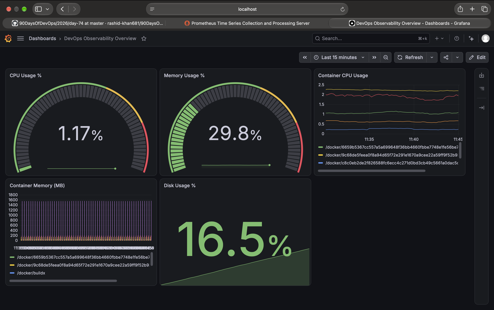
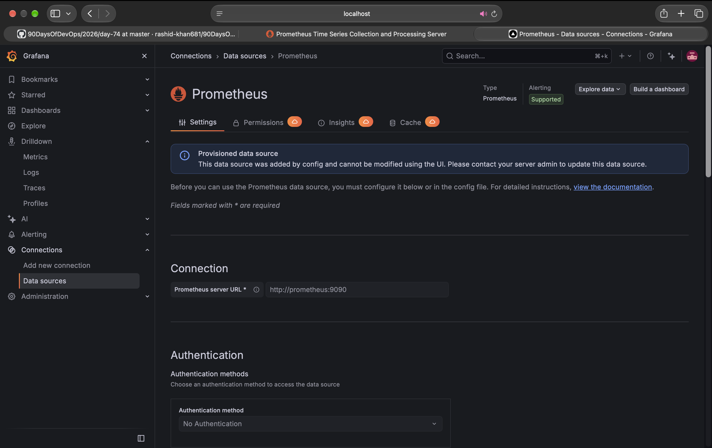
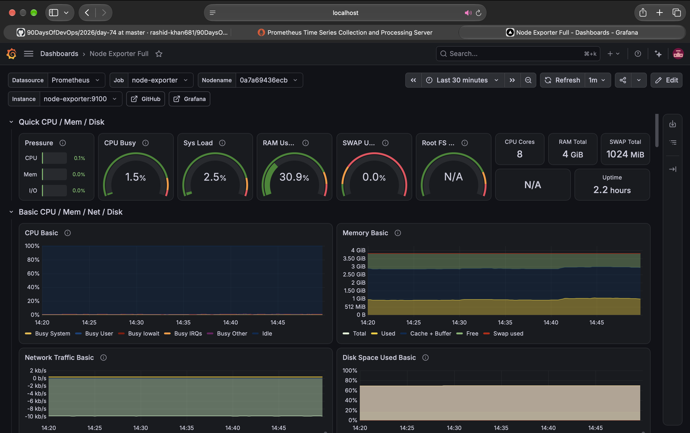

# Day 74: Node Exporter, cAdvisor, and Grafana Dashboards

This document covers my complete hands-on execution of Day 74 of the #90DaysOfDevOps challenge. Today, I expanded my local observability stack by adding **Node Exporter** for host-level metrics, **cAdvisor** for container-level metrics, and **Grafana** for custom dashboards, YAML datasource provisioning, and community dashboard imports.

---

## Final Stack Architecture & Configurations

All 5 services (`prometheus`, `node-exporter`, `cadvisor`, `grafana`, and `notes-app`) run on the same Docker Compose bridge network.

### Updated `docker-compose.yml`
```yaml
services:
  prometheus:
    image: prom/prometheus:latest
    container_name: prometheus
    ports:
      - "9090:9090"
    volumes:
      - ./prometheus.yml:/etc/prometheus/prometheus.yml
      - prometheus_data:/prometheus
    command:
      - '--config.file=/etc/prometheus/prometheus.yml'
    restart: unless-stopped

  notes-app:
    image: trainwithshubham/notes-app:latest
    container_name: notes-app
    ports:
      - "8000:8000"
    restart: unless-stopped

  node-exporter:
    image: prom/node-exporter:latest
    container_name: node-exporter
    ports:
      - "9100:9100"
    volumes:
      - /proc:/host/proc:ro
      - /sys:/host/sys:ro
      - /:/rootfs:ro
    command:
      - '--path.procfs=/host/proc'
      - '--path.sysfs=/host/sys'
      - '--path.rootfs=/rootfs'
      - '--collector.filesystem.mount-points-exclude=^/(sys|proc|dev|host|etc)($$|/)'
    restart: unless-stopped

  cadvisor:
    image: gcr.io/cadvisor/cadvisor:latest
    container_name: cadvisor
    ports:
      - "8080:8080"
    volumes:
      - /var/run/docker.sock:/var/run/docker.sock:ro
      - /sys:/sys:ro
      - /var/lib/docker/:/var/lib/docker:ro
    restart: unless-stopped

  grafana:
    image: grafana/grafana-enterprise:latest
    container_name: grafana
    ports:
      - "3000:3000"
    volumes:
      - grafana_data:/var/lib/grafana
      - ./grafana/provisioning:/etc/grafana/provisioning
    environment:
      - GF_SECURITY_ADMIN_USER=admin
      - GF_SECURITY_ADMIN_PASSWORD=admin123
    restart: unless-stopped

volumes:
  prometheus_data:
  grafana_data:
```

### Updated `prometheus.yml`
```yaml
global:
  scrape_interval: 15s
  evaluation_interval: 15s

scrape_configs:
  - job_name: "prometheus"
    static_configs:
      - targets: ["localhost:9090"]

  - job_name: "notes-app"
    static_configs:
      - targets: ["notes-app:8000"]

  - job_name: "node-exporter"
    static_configs:
      - targets: ["node-exporter:9100"]

  - job_name: "cadvisor"
    static_configs:
      - targets: ["cadvisor:8080"]
```

---

## Task 1: Add Node Exporter for Host Metrics

Deployed `prom/node-exporter:latest` on port `9100` to expose Linux system metrics (CPU, memory, disk, filesystem, and network) in Prometheus format.

**Read-Only Volume Mounts (`:ro`):**
* `/proc:/host/proc:ro` — Kernel and process statistics (CPU and memory stats).
* `/sys:/host/sys:ro` — Hardware and system device details.
* `/:/rootfs:ro` — Host filesystem and disk usage metrics.

**Host PromQL Queries Executed:**
```promql
# CPU idle time per core
node_cpu_seconds_total{mode="idle"}

# Memory usage percentage
(1 - node_memory_MemAvailable_bytes / node_memory_MemTotal_bytes) * 100

# Disk usage percentage (macOS Docker Desktop Linux VM ext4 partition)
(1 - node_filesystem_avail_bytes{mountpoint="/var/lib/docker"} / node_filesystem_size_bytes{mountpoint="/var/lib/docker"}) * 100

# Network bytes received per second
rate(node_network_receive_bytes_total[5m])
```

**Task 1 Proof (Node Exporter UP in Prometheus Targets):**


---

## Task 2: Add cAdvisor for Container Metrics

Deployed `gcr.io/cadvisor/cadvisor:latest` on port `8080` to monitor resource consumption across running Docker containers without modifying application source code.

**Read-Only Volume Mounts (`:ro`):**
* `/var/run/docker.sock:/var/run/docker.sock:ro` — Allows cAdvisor to discover and inspect running Docker containers.
* `/sys:/sys:ro` — Reads kernel-level container cgroup statistics.
* `/var/lib/docker/:/var/lib/docker:ro` — Reads container filesystem usage details.

**Container PromQL Queries:**
```promql
# Standard Linux query (filters named containers)
rate(container_cpu_usage_seconds_total{name!=""}[5m])
container_memory_usage_bytes{name!=""}

# macOS Docker Desktop adapted queries (using container ID regex matcher)
rate(container_cpu_usage_seconds_total{id=~"/docker/.+"}[5m]) * 100
container_memory_usage_bytes{id=~"/docker/.+"} / 1024 / 1024
```

**Node Exporter vs cAdvisor (When to Use Which):**

| Aspect | Node Exporter | cAdvisor (Container Advisor) |
| :--- | :--- | :--- |
| **Monitoring Scope** | Host machine / VM / Linux OS level | Individual Docker containers (cgroups) |
| **Metric Prefix** | `node_*` | `container_*` |
| **Key Metrics** | Host CPU, RAM, disk I/O, filesystem, host network | Per-container CPU, memory, network, container FS |
| **When to Use** | To check overall server health (e.g., is the EC2 host running out of disk or RAM?) | To isolate which specific container is spiking CPU or leaking memory on a shared host |

*Note:* Both are used together in production—Node Exporter alerts on host-level bottlenecks, while cAdvisor pinpoints the exact container causing the load.

**Task 2 Proof (Prometheus Targets with `prometheus`, `node-exporter`, and `cadvisor` UP):**


---

## Task 3: Set Up Grafana

Deployed `grafana/grafana-enterprise:latest` on port `3000` with a persistent `grafana_data` volume (`/var/lib/grafana`) and configured Prometheus as a datasource using Docker's internal DNS (`http://prometheus:9090` instead of `localhost:9090`).

**Task 3 Proof (Prometheus Datasource Connected):**


---

## Task 4: Build Your First Custom Dashboard

Built a 5-panel custom dashboard named **"DevOps Observability Overview"** in Grafana covering host and container metrics:

1. **CPU Usage % (Gauge — Thresholds: Green `< 60`, Yellow `< 80`, Red `>= 80`):**
   ```promql
   100 - (avg(rate(node_cpu_seconds_total{mode="idle"}[5m])) * 100)
   ```
2. **Memory Usage % (Gauge):**
   ```promql
   (1 - node_memory_MemAvailable_bytes / node_memory_MemTotal_bytes) * 100
   ```
3. **Container CPU Usage (Time Series, Legend `{{id}}`):**
   ```promql
   rate(container_cpu_usage_seconds_total{id=~"/docker/.+"}[5m]) * 100
   ```
4. **Container Memory (MB) (Bar Chart, Legend `{{id}}`):**
   ```promql
   container_memory_usage_bytes{id=~"/docker/.+"} / 1024 / 1024
   ```
5. **Disk Usage % (Stat):**
   ```promql
   (1 - node_filesystem_avail_bytes{mountpoint="/var/lib/docker"} / node_filesystem_size_bytes{mountpoint="/var/lib/docker"}) * 100
   ```

**Real Troubleshooting on macOS Docker Desktop:**
* **cAdvisor `No data` Fix:** Inspecting raw metrics via `curl -s http://localhost:8080/metrics | grep "^container_cpu_usage_seconds_total"` showed that cAdvisor exposed `id="/docker/<container-id>"` without a `name` label on Docker Desktop's Linux VM. Replacing `{name!=""}` with the PromQL regex matcher `{id=~"/docker/.+"}` filtered out host aggregates (`/`, `/docker`, `/restricted`) and rendered all 5 containers accurately.
* **Disk Usage `No data` Fix:** Inspecting `curl -s http://localhost:9100/metrics | grep "^node_filesystem_size_bytes"` confirmed `mountpoint="/"` was not exposed as a standard block device in the Docker Desktop VM; the actual `ext4` disk (`/dev/vda1`) was mounted at `/var/lib/docker`. Updating the query to `{mountpoint="/var/lib/docker"}` resolved the panel immediately.

**Task 4 Proof (Custom Grafana Dashboard — DevOps Observability Overview):**


---

## Task 5: Auto-Provision Datasources with YAML

Configured Grafana to automatically provision the Prometheus datasource on startup via YAML mounted to `/etc/grafana/provisioning`.

**`grafana/provisioning/datasources/datasources.yml`:**
```yaml
apiVersion: 1

datasources:
  - name: Prometheus
    type: prometheus
    access: proxy
    url: http://prometheus:9090
    isDefault: true
    editable: false
```

**Why YAML Provisioning Is Better Than Manual UI Configuration:**
* **Repeatable & Automated:** Eliminates manual "ClickOps". Spinning up a new environment with `docker compose up -d` automatically registers all datasources on boot.
* **Version Controlled (GitOps):** Configuration changes live in Git with full commit history, code reviews, and easy rollbacks.
* **Protected Against Accidental Edits:** Setting `editable: false` locks the datasource in the Grafana UI so no one can accidentally alter URLs or break production dashboards.

**Task 5 Proof (YAML Auto-Provisioned Prometheus Datasource):**


---

## Task 6: Import Community Dashboards & Final Stack Verification

Imported two pre-built Grafana community dashboards using their official `grafana.com` IDs:
1. **Dashboard ID `1860` (Node Exporter Full):** Comprehensive host overview including CPU Busy, Sys Load, RAM Used, Disk Space, and Network Traffic.
2. **Dashboard ID `193` (Docker Monitoring via cAdvisor):** Container-level monitoring template.

**Final Stack Verification (`docker compose ps`):**
```bash
$ docker compose ps
NAME            IMAGE                               COMMAND                  SERVICE         CREATED          STATUS                 PORTS
cadvisor        gcr.io/cadvisor/cadvisor:latest     "/usr/bin/cadvisor -…"   cadvisor        4 hours ago      Up 4 hours (healthy)   0.0.0.0:8080->8080/tcp, [::]:8080->8080/tcp
grafana         grafana/grafana-enterprise:latest   "/run/sh"                grafana         31 minutes ago   Up 31 minutes          0.0.0.0:3000->3000/tcp, [::]:3000->3000/tcp
node-exporter   prom/node-exporter:latest           "/bin/node_exporter …"   node-exporter   4 hours ago      Up 4 hours             0.0.0.0:9100->9100/tcp, [::]:9100->9100/tcp
notes-app       trainwithshubham/notes-app:latest   "/bin/sh -c 'python …"   notes-app       4 hours ago      Up 4 hours             0.0.0.0:8000->8000/tcp, [::]:8000->8000/tcp
prometheus      prom/prometheus:latest              "/bin/prometheus --c…"   prometheus      4 hours ago      Up 4 hours             0.0.0.0:9090->9090/tcp, [::]:9090->9090/tcp
```

**Task 6 Proof (Imported Node Exporter Full Dashboard — ID 1860):**
