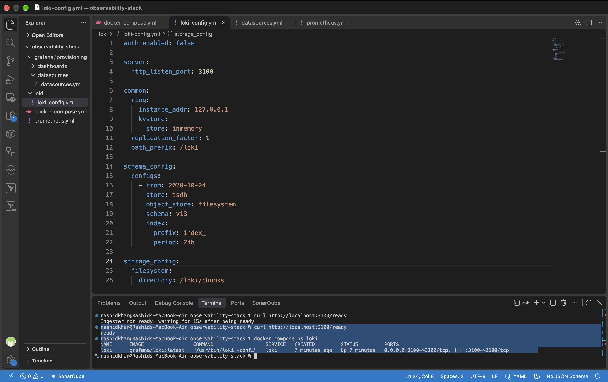
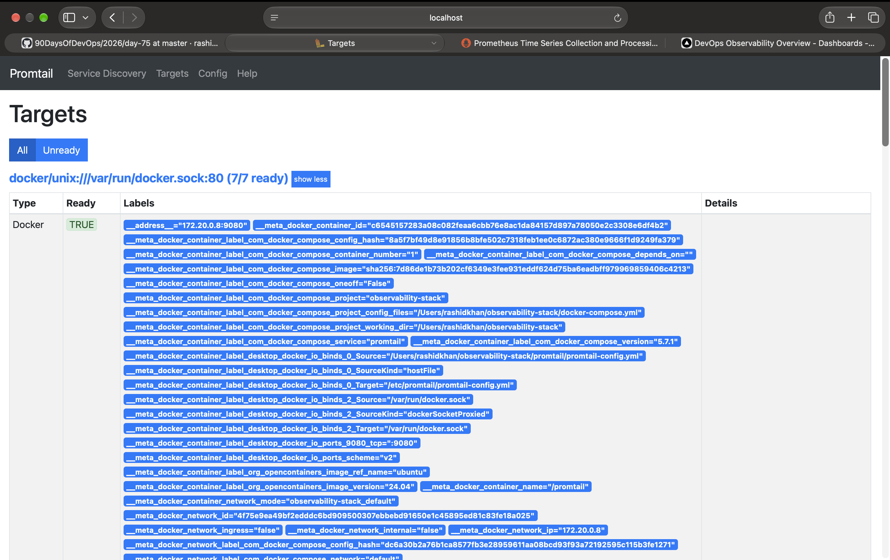
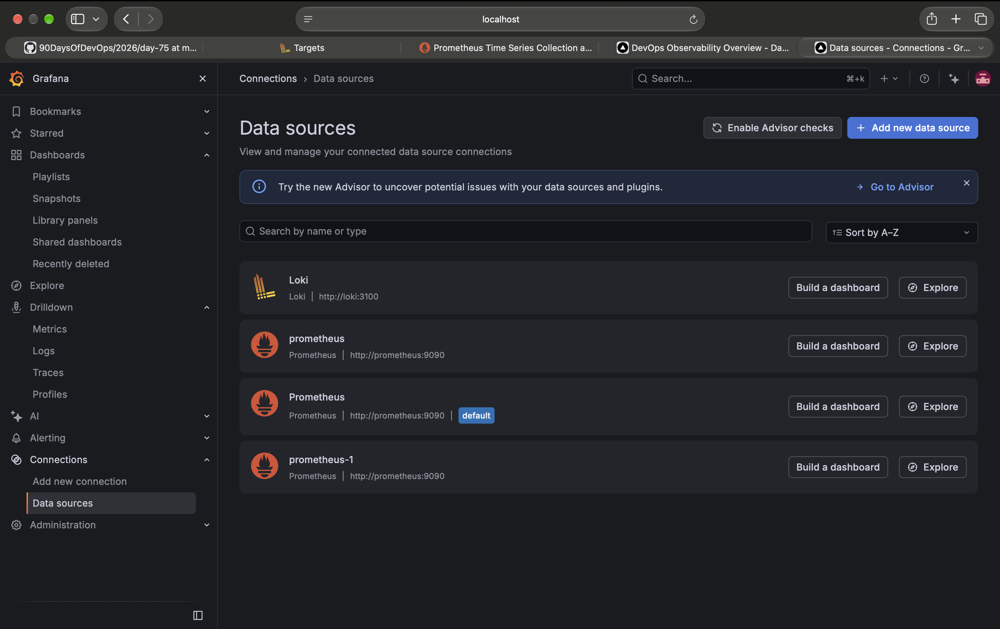
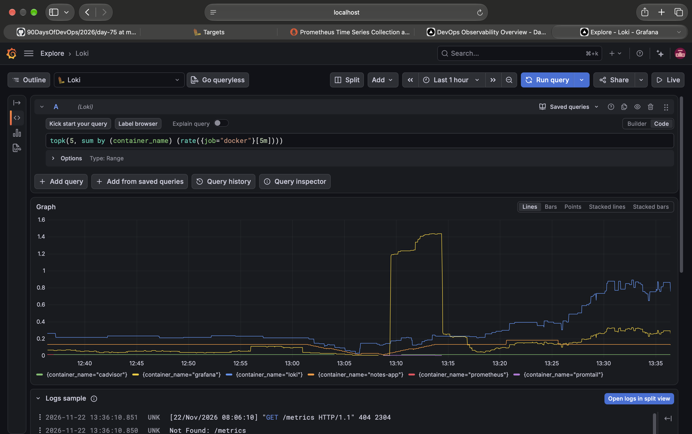
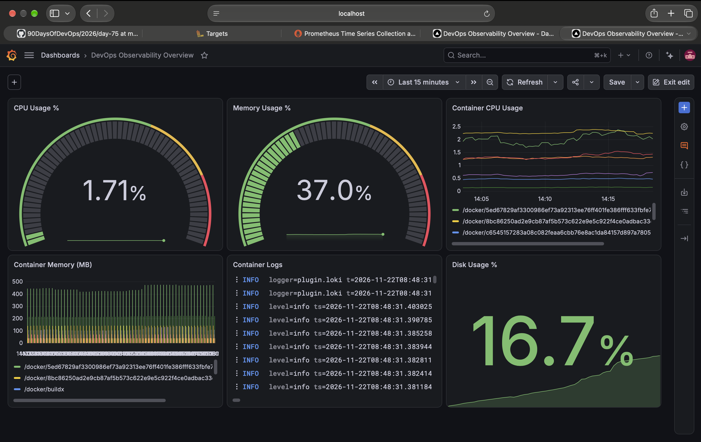
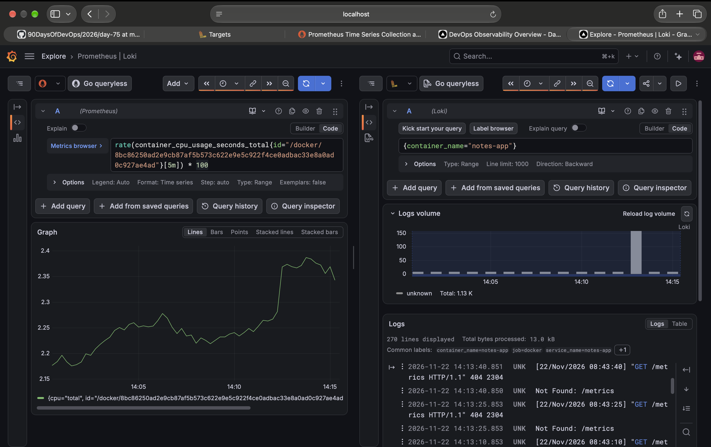

# Day 75: Log Management with Loki and Promtail

This document covers my complete hands-on execution of Day 75 of the #90DaysOfDevOps challenge. Today, I added the second pillar of observability (**Logs**) to my local stack by deploying **Grafana Loki** and **Promtail**, auto-provisioning Loki in Grafana via YAML, querying logs with **LogQL**, and correlating Prometheus metrics with Loki logs side by side.

---

## Task 1: Logging Pipeline Architecture & Loki vs ELK

### Logging Pipeline Architecture
```text
[Docker Containers (7 Services)]
       |
       |  (stdout / stderr streams managed by Docker Engine)
       v
   [Promtail]
       |
       |  (discovers containers via docker.sock, attaches labels, pushes to /loki/api/v1/push)
       v
     [Loki]
       |
       |  (indexes ONLY labels in TSDB, compresses raw log lines into chunks)
       v
    [Grafana]
       |
       |  (queries Loki with LogQL, correlates logs with Prometheus metrics)
       v
     [You]
```

### Why Does Loki Only Index Labels Instead of Full Text? What Is the Trade-off?
* **Why Label-Only Indexing:** Traditional full-text log systems create an inverted index of every word in every log line. At scale, this index can grow larger than the raw logs themselves, requiring massive RAM, CPU, and storage costs. Loki follows Prometheus's philosophy—it only indexes lightweight metadata labels (such as `job`, `container_name`, and `stream`) and stores the actual log lines in compressed chunks.
* **The Trade-off:**
  * **Advantage:** Dramatically lower storage footprint, minimal memory overhead, simpler operations, and seamless label consistency with Prometheus.
  * **Limitation:** Broad, unfiltered full-text searches across long time ranges are slower than Elasticsearch because Loki must decompress and scan chunks on the fly. Additionally, high-cardinality values (such as `user_id`, `request_id`, or IP addresses) must never be used as labels, or index performance will degrade.

### Comparison: Loki vs ELK Stack (When to Use Each)

| Aspect | Grafana Loki (+ Promtail) | ELK Stack (Elasticsearch, Logstash, Kibana) |
| :--- | :--- | :--- |
| **Indexing Model** | Indexes **labels only**; log content stored as compressed chunks | **Full-text inverted index** across all log content and fields |
| **Resource & Cost Footprint** | Lightweight, low RAM/CPU, cheap object storage (S3/filesystem) | Resource-intensive, requires high RAM/JVM tuning and larger storage |
| **Query Language** | **LogQL** (very similar to PromQL) | **KQL / Lucene / Elasticsearch DSL** |
| **Operational Complexity** | Simple to deploy and maintain alongside Prometheus & Grafana | Higher operational overhead (cluster sharding, index lifecycle management) |
| **When to Use** | Cloud-native/DevOps teams already using Prometheus + Grafana who want cost-effective log aggregation and fast metric-to-log correlation | Teams needing complex full-text search, advanced log analytics, SIEM/security auditing, or heavy unstructured search across massive historical datasets |

---

## Task 2: Add Loki to the Stack

Deployed `grafana/loki:latest` on port `3100` using Loki v3's `tsdb` index store (`schema: v13`) and local filesystem chunk storage persisted via a Docker volume (`loki_data`).

### `loki/loki-config.yml`
```yaml
auth_enabled: false

server:
  http_listen_port: 3100

common:
  ring:
    instance_addr: 127.0.0.1
    kvstore:
      store: inmemory
  replication_factor: 1
  path_prefix: /loki

schema_config:
  configs:
    - from: 2020-10-24
      store: tsdb
      object_store: filesystem
      schema: v13
      index:
        prefix: index_
        period: 24h

storage_config:
  filesystem:
    directory: /loki/chunks
```

**Configuration Breakdown:**
* `auth_enabled: false` — Runs Loki in single-tenant mode without requiring `X-Scope-OrgID` headers.
* `server.http_listen_port: 3100` — Exposes Loki's HTTP API for Promtail log pushes and Grafana queries.
* `common.ring` (`inmemory`) & `replication_factor: 1` — Configures a single-instance ring without external consensus stores (Consul/Memberlist).
* `schema_config` (`tsdb`, `schema: v13`, `period: 24h`) — Uses Loki's TSDB index format rotating tables every 24 hours.
* `storage_config.filesystem.directory: /loki/chunks` — Persists compressed log chunks inside `/loki/chunks` backed by the `loki_data` volume.

### Troubleshooting Note (Real Issue Fixed)
Loki initially entered a `Restarting (1)` loop and returned `curl: (7) Failed to connect to localhost port 3100`. Inspecting `docker logs loki --tail 30` revealed YAML unmarshal errors (`intance_addr` typo, `path_prefix` indentation under `ring`, and `storing_config` instead of `storage_config`). After fixing the YAML and recreating the container with `docker compose up -d --force-recreate loki`, Loki initialized (`Ingester not ready: waiting for 15s after being ready`) and returned `ready` at `http://localhost:3100/ready`.

**Task 2 Proof (Loki Ready & Running):**


---

## Task 3: Add Promtail to Collect Container Logs

### Pre-Flight Environment Catch (macOS Docker Desktop `local` Driver)
Running `docker info --format '{{.LoggingDriver}}'` showed my Docker Desktop environment uses the **`local`** logging driver rather than `json-file`. Because `local` does not write `*-json.log` files, a file-glob `static_configs` scrape would collect zero logs.

To solve this cleanly using official Promtail best practices, I configured **`docker_sd_configs`** over `/var/run/docker.sock`, which works regardless of logging driver and automatically extracts `container_name`, `stream`, and `job="docker"` labels.

### `promtail/promtail-config.yml`
```yaml
server:
  http_listen_port: 9080
  grpc_listen_port: 0

positions:
  filename: /tmp/positions.yaml

clients:
  - url: http://loki:3100/loki/api/v1/push

scrape_configs:
  - job_name: docker
    docker_sd_configs:
      - host: unix:///var/run/docker.sock
        refresh_interval: 5s
    relabel_configs:
      - source_labels: ['__meta_docker_container_name']
        regex: '/(.*)'
        target_label: 'container_name'
      - source_labels: ['__meta_docker_container_log_stream']
        target_label: 'stream'
      - source_labels: ['__meta_docker_container_name']
        regex: '.*'
        target_label: 'job'
        replacement: 'docker'
```

**Configuration Breakdown:**
* `server.http_listen_port: 9080` — Exposes Promtail's status and `/targets` inspection UI.
* `positions.filename: /tmp/positions.yaml` — Acts as a bookmark tracking read progress so Promtail avoids re-shipping duplicate logs on restart.
* `clients.url` — Pushes logs over Docker's internal network to `http://loki:3100/loki/api/v1/push`.
* `docker_sd_configs` — Discovers running Docker containers every 5 seconds via `unix:///var/run/docker.sock`.
* `relabel_configs` — Strips the leading `/` from container names (`/notes-app` -> `notes-app`), attaches the `stream` (`stdout`/`stderr`) label, and assigns `job="docker"`.

### Complete Updated `docker-compose.yml` (All 7 Services)
```yaml
services:
  prometheus:
    image: prom/prometheus:latest
    container_name: prometheus
    ports:
      - "9090:9090"
    volumes:
      - ./prometheus.yml:/etc/prometheus/prometheus.yml
      - prometheus_data:/prometheus
    command:
      - '--config.file=/etc/prometheus/prometheus.yml'
    restart: unless-stopped

  notes-app:
    image: trainwithshubham/notes-app:latest
    container_name: notes-app
    ports:
      - "8000:8000"
    restart: unless-stopped

  node-exporter:
    image: prom/node-exporter:latest
    container_name: node-exporter
    ports:
      - "9100:9100"
    volumes:
      - /proc:/host/proc:ro
      - /sys:/host/sys:ro
      - /:/rootfs:ro
    command:
      - '--path.procfs=/host/proc'
      - '--path.sysfs=/host/sys'
      - '--path.rootfs=/rootfs'
      - '--collector.filesystem.mount-points-exclude=^/(sys|proc|dev|host|etc)($$|/)'
    restart: unless-stopped

  cadvisor:
    image: gcr.io/cadvisor/cadvisor:latest
    container_name: cadvisor
    ports:
      - "8080:8080"
    volumes:
      - /var/run/docker.sock:/var/run/docker.sock:ro
      - /sys:/sys:ro
      - /var/lib/docker/:/var/lib/docker:ro
    restart: unless-stopped

  grafana:
    image: grafana/grafana-enterprise:latest
    container_name: grafana
    ports:
      - "3000:3000"
    volumes:
      - grafana_data:/var/lib/grafana
      - ./grafana/provisioning:/etc/grafana/provisioning
    environment:
      - GF_SECURITY_ADMIN_USER=admin
      - GF_SECURITY_ADMIN_PASSWORD=admin123
    restart: unless-stopped

  loki:
    image: grafana/loki:latest
    container_name: loki
    ports:
      - "3100:3100"
    volumes:
      - ./loki/loki-config.yml:/etc/loki/loki-config.yml
      - loki_data:/loki
    command: -config.file=/etc/loki/loki-config.yml
    restart: unless-stopped

  promtail:
    image: grafana/promtail:latest
    container_name: promtail
    ports:
      - "9080:9080"
    volumes:
      - ./promtail/promtail-config.yml:/etc/promtail/promtail-config.yml
      - /var/lib/docker/containers:/var/lib/docker/containers:ro
      - /var/run/docker.sock:/var/run/docker.sock:ro
    command: -config.file=/etc/promtail/promtail-config.yml
    restart: unless-stopped

volumes:
  prometheus_data:
  grafana_data:
  loki_data:
```

### Stack & Ingestion Verification
```bash
$ docker compose ps
NAME            IMAGE                               COMMAND                  SERVICE         CREATED              STATUS                  PORTS
cadvisor        gcr.io/cadvisor/cadvisor:latest     "/usr/bin/cadvisor -…"   cadvisor        10 hours ago         Up 10 hours (healthy)   0.0.0.0:8080->8080/tcp, [::]:8080->8080/tcp
grafana         grafana/grafana-enterprise:latest   "/run.sh"                grafana         10 hours ago         Up 10 hours             0.0.0.0:3000->3000/tcp, [::]:3000->3000/tcp
loki            grafana/loki:latest                 "/usr/bin/loki -conf…"   loki            9 hours ago          Up 9 hours              0.0.0.0:3100->3100/tcp, [::]:3100->3100/tcp
node-exporter   prom/node-exporter:latest           "/bin/node_exporter …"   node-exporter   10 hours ago         Up 10 hours             0.0.0.0:9100->9100/tcp, [::]:9100->9100/tcp
notes-app       trainwithshubham/notes-app:latest   "/bin/sh -c 'python …"   notes-app       10 hours ago         Up 10 hours             0.0.0.0:8000->8000/tcp, [::]:8000->8000/tcp
prometheus      prom/prometheus:latest              "/bin/prometheus --c…"   prometheus      10 hours ago         Up 10 hours             0.0.0.0:9090->9090/tcp, [::]:9090->9090/tcp
promtail        grafana/promtail:latest             "/usr/bin/promtail -…"   promtail        About a minute ago   Up About a minute       0.0.0.0:9080->9080/tcp, [::]:9080->9080/tcp

$ curl -s http://localhost:3100/loki/api/v1/label/container_name/values
{"status":"success","data":["cadvisor","grafana","loki","node-exporter","notes-app","prometheus","promtail"]}
```

**Task 3 Proof (Promtail Discovered Targets):**


---

## Task 4: Add Loki as a Grafana Datasource (YAML Provisioning)

Auto-provisioned Loki alongside Prometheus using Configuration as Code in `grafana/provisioning/datasources/datasources.yml`, then restarted Grafana (`docker compose restart grafana`).

### `grafana/provisioning/datasources/datasources.yml`
```yaml
apiVersion: 1

datasources:
  - name: Prometheus
    type: prometheus
    access: proxy
    url: http://prometheus:9090
    isDefault: true
    editable: false

  - name: Loki
    type: loki
    access: proxy
    url: http://loki:3100
    editable: false
```

**Task 4 Proof (Loki Auto-Provisioned in Grafana Data Sources):**


---

## Task 5: Query Logs with LogQL

Ran log stream selectors, line filters, regex filters, and log metric aggregations inside **Grafana > Explore** with the Loki datasource.

### Five LogQL Queries Executed & Actual Results

1. **Case-Insensitive Error Search across All Containers:**
   ```logql
   {job="docker"} |~ "(?i)error"
   ```
   * **What it returned:** Processed **`1.42 MB`** of log data across all containers. Matched Loki internal `INFO` logs containing the substring `drop __error__` (demonstrating how broad substring matching can surface false positives and scan larger chunk volumes).

2. **Regex Filter for HTTP 4xx/5xx Status Codes on `notes-app`:**
   ```logql
   {container_name="notes-app"} |~ " [45]\\d{2} "
   ```
   * **What it returned:** Displayed **`219` lines** while processing only **`20.0 kB`** (~70x less data scanned than `{job="docker"}`). Returned `"GET /metrics HTTP/1.1" 404 2304` repeating at exact **15-second intervals** (`13:41:10`, `13:41:25`, `13:41:40`, `13:41:55`)—directly matching Prometheus's `scrape_interval: 15s`.

3. **Top 5 Containers by Log Rate:**
   ```logql
   topk(5, sum by (container_name) (rate({job="docker"}[5m])))
   ```
   * **What it returned:** Plotted a time-series breakdown ranking the top 5 log-generating containers: `cadvisor`, `grafana`, `loki`, `notes-app`, and `promtail`.

4. **Negative Line Filter (Exclude Noise):**
   ```logql
   {job="docker"} != "health"
   ```
   * **What it returned:** Filtered out any lines containing `"health"` and returned live operational logs including Grafana `plugin.loki` requests (`statusCode=200`), Loki TSDB `table_manager.go` entries (`table=index_20779`), and `notes-app` 404 logs.

5. **Log Metric Aggregation (Errors per Minute from `notes-app`):**
   ```logql
   sum(count_over_time({container_name="notes-app"} |~ " [45]\\d{2} " [1m]))
   ```
   * **What it returned:** Aggregated the 1-minute rolling count of 4xx/5xx lines into a single time series (`{}`), confirming a steady rate of ~4 `404` lines per minute from Prometheus scraping `/metrics`.

### Task 5 Exercise Solutions
* **All error logs from `notes-app` in the last 1 hour (with Grafana time picker set to `Last 1 hour`):**
  ```logql
  {container_name="notes-app"} |~ "(?i)error"
  ```
* **Count error lines per minute from `notes-app`:**
  ```logql
  sum(count_over_time({container_name="notes-app"} |~ "(?i)error" [1m]))
  ```

**Task 5 Proof (Grafana Explore Showing Live Loki Logs & LogQL Results):**


---

## Task 6: Correlate Metrics and Logs in Grafana

### 1. Added Live Logs Panel to the Day 74 Dashboard
Updated the **DevOps Observability Overview** dashboard by adding a 6th panel (`Container Logs`, Visualization: `Logs`, Datasource: `Loki`, Query: `{job="docker"}`) directly alongside the host and container metric panels (`CPU Usage %`, `Memory Usage %`, `Container CPU Usage`, `Container Memory (MB)`, and `Disk Usage %`).

**Dashboard Proof (Metrics + Logs Together in One Dashboard):**


### 2. Explore Split View with Time Sync
Retrieved `notes-app`'s exact Docker container ID (`8bc86250ad2e9cb87af5b573c622e9e5c922f4ce0adbac33e8a0ad0c927ae4ad`) via `docker inspect --format='{{.Id}}' notes-app` (needed because cAdvisor on macOS Docker Desktop exposes `id` rather than `name`), then opened **Grafana Explore Split View** with **Time Sync** enabled:
* **Left Panel (Prometheus):**
  ```promql
  rate(container_cpu_usage_seconds_total{id="/docker/8bc86250ad2e9cb87af5b573c622e9e5c922f4ce0adbac33e8a0ad0c927ae4ad"}[5m]) * 100
  ```
* **Right Panel (Loki):**
  ```logql
  {container_name="notes-app"}
  ```
* **Observed Correlation:** After generating a burst of HTTP requests against `notes-app`, the Left Prometheus panel showed CPU usage jumping from ~2.22% to ~2.38% around `14:13`, while the Right Loki panel showed a matching spike in log volume (~140+ entries, `270 lines displayed`, `13.0 kB` processed) at the exact same timestamp.

**Task 6 Proof (Metrics & Logs Correlated Side-by-Side in Grafana Explore):**


### How Having Metrics and Logs in the Same Tool (Grafana) Helps During Incident Response
* **Eliminates Context Switching:** Engineers do not lose critical minutes jumping between separate monitoring dashboards, log search UIs, and SSH terminals during an outage.
* **Exact Time-Synced Root Cause Analysis:** With Explore Split View and Time Sync, zooming into a metric anomaly (such as a CPU or latency spike) automatically filters logs to that exact time window—avoiding manual timestamp alignment or UTC/local timezone mismatches.
* **Reduces MTTR (Mean Time to Resolution):** Metrics instantly signal **what** broke and **when**, while adjacent logs immediately explain **why** (exact HTTP status codes, failing endpoints, or stack traces), accelerating incident triage and recovery.