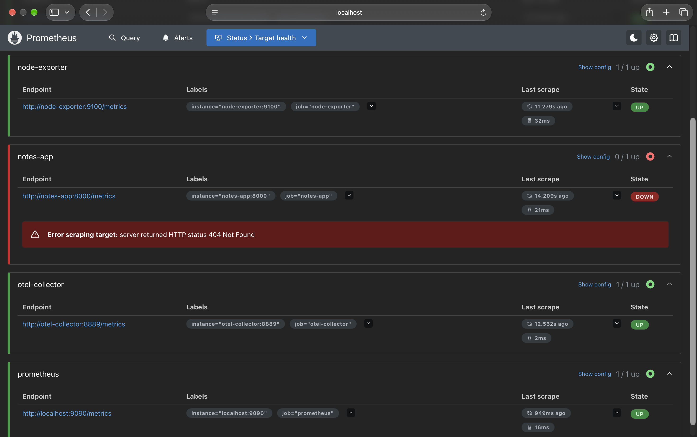
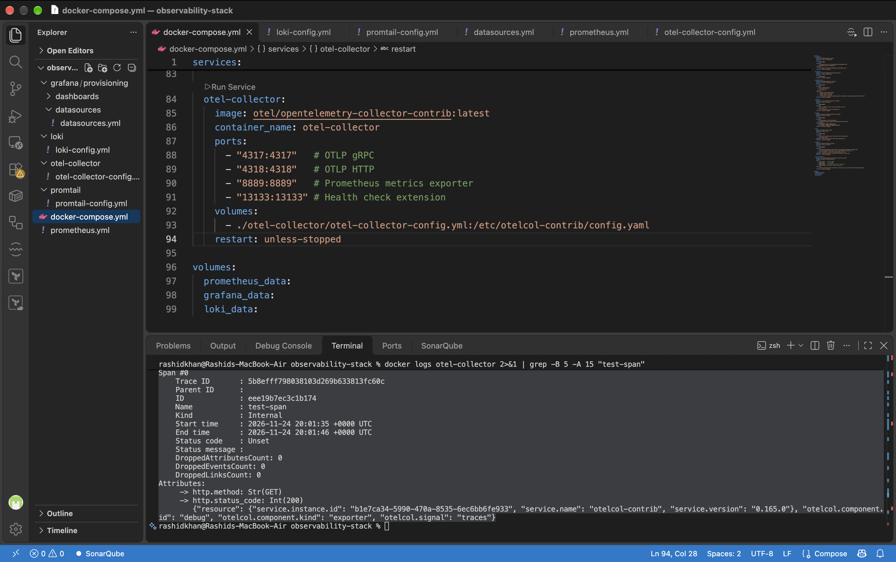
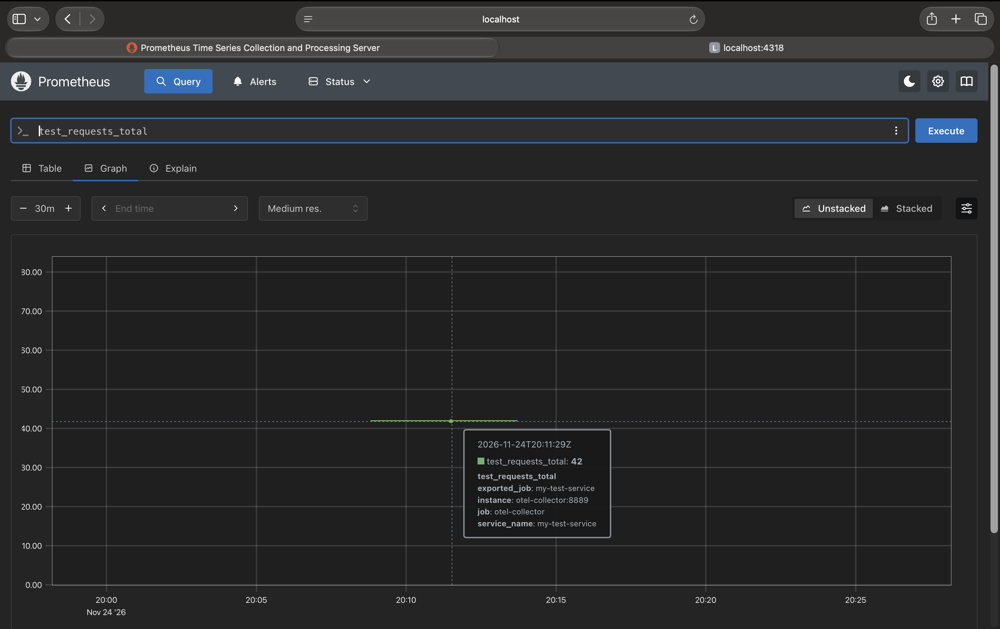
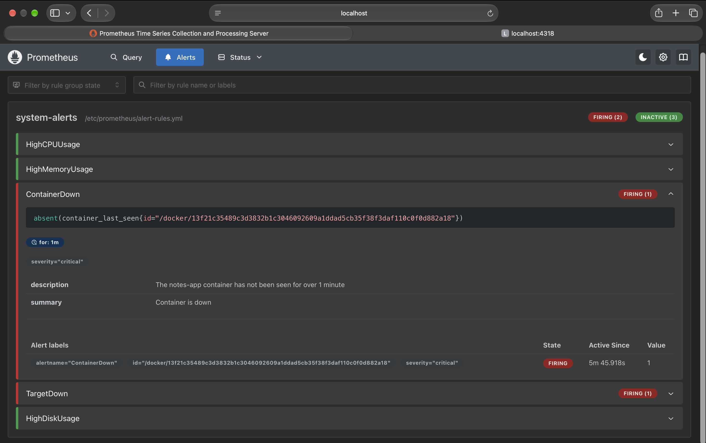
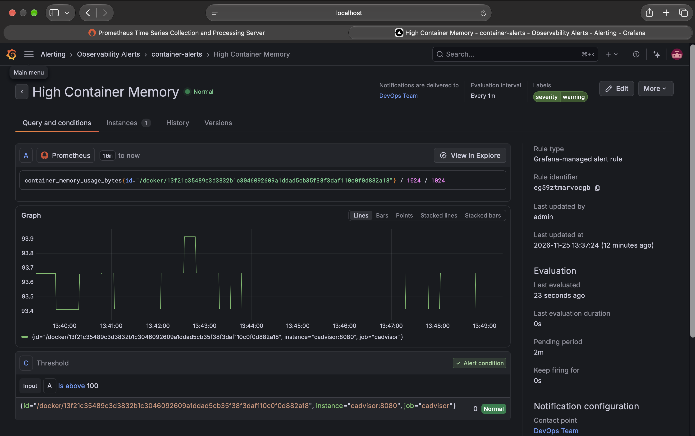
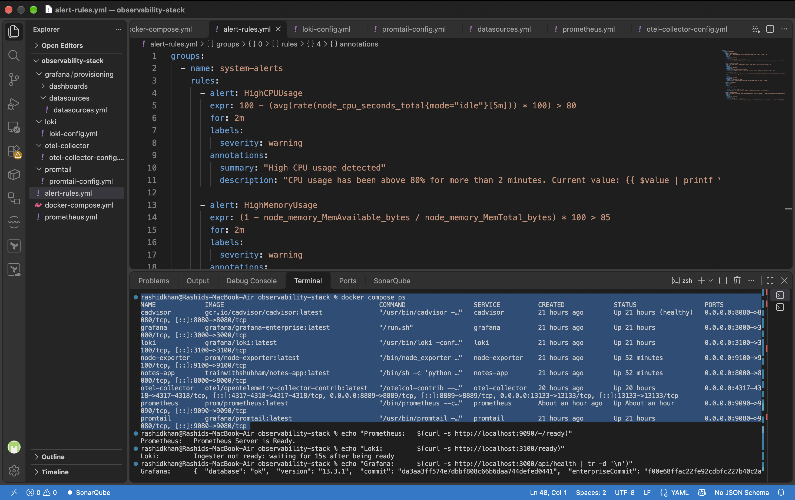

# Day 76: OpenTelemetry and Alerting

This document covers my hands-on execution of Day 76 of the #90DaysOfDevOps challenge. After building **Metrics** (Day 74) and **Logs** (Day 75), today I added the third pillar of observability — **Distributed Traces** — using the **OpenTelemetry (OTEL) Collector**, bridged OTLP metrics into Prometheus, configured **Prometheus alerting rules** with live failure testing, and set up **Grafana Unified Alerting** with contact points and notification routing policies.

---

## Task 1: Understand OpenTelemetry

### 1. What is OpenTelemetry (OTEL)?
* OpenTelemetry is a vendor-neutral, open-source CNCF framework (APIs, SDKs, and Collector) for generating, collecting, processing, and exporting all three telemetry signals: **metrics, logs, and traces**.
* **It is not a storage backend or UI.** It collects and standardizes telemetry data and ships it to backends such as Prometheus, Loki, Jaeger, Grafana Tempo, or Datadog — preventing vendor lock-in.

### 2. What is the OTEL Collector?
* A standalone service/proxy that sits between applications and observability backends to receive, transform, and export telemetry data.
* **Three core pipeline components:**
  ```text
  [Apps / OTLP] ---> [Receivers] ---> [Processors] ---> [Exporters] ---> [Backends]
  ```
  * **Receivers:** Accept incoming telemetry via push or pull (e.g., `otlp`, `prometheus`, `jaeger`).
  * **Processors:** Transform and protect the pipeline before exporting (e.g., `memory_limiter` to prevent OOM crashes, `batch` to group payloads and reduce network overhead).
  * **Exporters:** Format and send data to destination backends (e.g., `prometheus` exporter on port `8889`, `debug` console exporter, or `otlp` exporter to Tempo/Jaeger).

### 3. What is OTLP?
* **OpenTelemetry Protocol (OTLP)** is the standard wire protocol for transmitting telemetry signals.
* **Standard Ports:**
  * **Port `4317` (`OTLP/gRPC`):** High-throughput binary protocol over HTTP/2 + Protobuf (preferred for production microservices).
  * **Port `4318` (`OTLP/HTTP`):** HTTP/1.1 supporting Protobuf or JSON endpoints (`/v1/traces`, `/v1/metrics`, `/v1/logs`).

### 4. What are Distributed Traces?
* A **trace** follows a single user request end-to-end as it travels across multiple services.
* Each individual operation inside a trace is called a **span**, containing:
  * `traceId` (shared across the entire request)
  * `spanId` (unique ID for that step)
  * `parentSpanId` (links child operations to their caller)
  * `startTime`, `endTime` / duration (nanosecond precision)
  * `attributes` (key-value metadata like `http.method`, `http.status_code`, `service.name`)
* **Example Flow:**
  ```text
  User Request -> API Gateway (Span 1) -> Auth Service (Span 2) -> Database Query (Span 3)
  ```

---

## Task 2: Add the OpenTelemetry Collector

Deployed `otel/opentelemetry-collector-contrib:latest` (`v0.165.0`) with production-grade pipeline hardening: `memory_limiter` placed ahead of `batch`, the `health_check` extension on port `13133`, and `resource_to_telemetry_conversion` enabled on the Prometheus exporter so `service.name` maps directly to a Prometheus label.

### `otel-collector/otel-collector-config.yml`
```yaml
extensions:
  health_check:
    endpoint: 0.0.0.0:13133

receivers:
  otlp:
    protocols:
      grpc:
        endpoint: 0.0.0.0:4317
      http:
        endpoint: 0.0.0.0:4318

processors:
  memory_limiter:
    check_interval: 1s
    limit_mib: 400
    spike_limit_mib: 100
  batch:

exporters:
  prometheus:
    endpoint: "0.0.0.0:8889"
    resource_to_telemetry_conversion:
      enabled: true
  debug:
    verbosity: detailed

service:
  extensions: [health_check]
  pipelines:
    metrics:
      receivers: [otlp]
      processors: [memory_limiter, batch]
      exporters: [prometheus]
    traces:
      receivers: [otlp]
      processors: [memory_limiter, batch]
      exporters: [debug]
    logs:
      receivers: [otlp]
      processors: [memory_limiter, batch]
      exporters: [debug]
```

**Configuration Breakdown:**
* `extensions.health_check` (`0.0.0.0:13133`): Exposes a readiness/liveness HTTP endpoint for Docker/Kubernetes health probes.
* `receivers.otlp`: Listens on `0.0.0.0:4317` (gRPC) and `0.0.0.0:4318` (HTTP) for incoming traces, metrics, and logs.
* `processors.memory_limiter`: Checks memory every `1s` (`limit_mib: 400`, `spike_limit_mib: 100`) and runs first in every pipeline to prevent OOM crashes under burst traffic.
* `processors.batch`: Groups incoming telemetry before export to lower CPU and network overhead.
* `exporters.prometheus`: Exposes translated OTLP metrics at `http://otel-collector:8889/metrics` for Prometheus to scrape, converting OTEL resource attributes (`service.name`) into Prometheus labels.
* `exporters.debug`: Prints detailed trace and log payloads to container stdout for local verification (swappable with Grafana Tempo or Jaeger in production).

### Troubleshooting Note (Real Issue Fixed)
During startup, `docker logs otel-collector` reported strict YAML unmarshaling errors: `'otelcol.configSettings' has invalid keys: recievers` and `'service.pipelines[metrics/traces/logs]' has invalid keys: recievers`. Fixed the spelling typo (`recievers` -> `receivers`) across all 4 occurrences, validated the config using the Collector's built-in `validate` subcommand, and recreated the container.

### Verification Output
```bash
$ docker logs otel-collector 2>&1 | tail -3
2026-11-24T11:59:08.771Z  info  otlpreceiver@v0.165.0/otlp.go:197  Starting HTTP server  {"endpoint": "[::]:4318"}
2026-11-24T11:59:08.771Z  info  healthcheck/handler.go:131  Health Check state change  {"status": "ready"}
2026-11-24T11:59:08.772Z  info  service@v0.165.0/service.go:256  Everything is ready. Begin running and processing data.

$ curl -s http://localhost:13133
{"status":"Server available","upSince":"2026-11-24T11:59:08.771562845Z","uptime":"37.892061642s"}
```

**Task 2 Proof (OTEL Collector Target UP in Prometheus):**


---

## Task 3: Send Test Traces and Metrics to the Collector

Sent live-timestamped OTLP JSON payloads to `http://localhost:4318/v1/traces` and `http://localhost:4318/v1/metrics` using current Unix nanosecond timestamps (`START_NS` / `END_NS`) instead of stale hardcoded 2018 timestamps.

### 1. OTLP Trace Ingestion & Debug Output
Both trace and metric `curl` requests returned `HTTP/1.1 200 OK` with `{"partialSuccess":{}}`. Inspecting the Collector debug output confirmed the parsed span:

```bash
$ docker logs otel-collector 2>&1 | grep -B 5 -A 15 "test-span"
InstrumentationScope
Span #0
    Trace ID       : 5b8efff798038103d269b633813fc60c
    Parent ID      :
    ID             : eee19b7ec3c1b174
    Name           : test-span
    Kind           : Internal
    Start time     : 2026-11-24 20:01:35 +0000 UTC
    End time       : 2026-11-24 20:01:46 +0000 UTC
    Status code    : Unset
    Status message :
    DroppedAttributesCount: 0
    DroppedEventsCount: 0
    DroppedLinksCount: 0
Attributes:
     -> http.method: Str(GET)
     -> http.status_code: Int(200)
```

### 2. OTLP Metric Bridge to Prometheus
Verified that the OTLP cumulative counter (`test_requests_total = 42`) was translated into Prometheus exposition format on port `8889` with `service_name="my-test-service"` preserved as a label:

```bash
$ curl -s http://localhost:8889/metrics | grep "test_requests"
# HELP test_requests_total
# TYPE test_requests_total counter
test_requests_total{job="my-test-service",otel_scope_name="",otel_scope_schema_url="",otel_scope_version="",service_name="my-test-service"} 42
```

**Task 3 Proof (OTLP Trace in Collector Debug Logs):**


**Task 3 Proof (OTLP Metric Bridged to Prometheus):**


---

## Task 4: Set Up Prometheus Alerting Rules

Created `alert-rules.yml` with five system and container health alerts, validated syntax with `promtool check rules` before deployment, mounted the rules file read-only into Prometheus, and enabled `--web.enable-lifecycle` for zero-downtime config reloads.

> **macOS Docker Desktop Adjustments:** On macOS Docker Desktop, cAdvisor exposes containers by `id="/docker/<container-id>"` rather than `name`, and the Linux VM disk is mounted at `/var/lib/docker`. Both `ContainerDown` and `HighDiskUsage` were adapted accordingly so all rules evaluate accurately.

### `alert-rules.yml`
```yaml
groups:
  - name: system-alerts
    rules:
      - alert: HighCPUUsage
        expr: 100 - (avg(rate(node_cpu_seconds_total{mode="idle"}[5m])) * 100) > 80
        for: 2m
        labels:
          severity: warning
        annotations:
          summary: "High CPU usage detected"
          description: "CPU usage has been above 80% for more than 2 minutes. Current value: {{ $value | printf \"%.2f\" }}%"

      - alert: HighMemoryUsage
        expr: (1 - node_memory_MemAvailable_bytes / node_memory_MemTotal_bytes) * 100 > 85
        for: 2m
        labels:
          severity: warning
        annotations:
          summary: "High memory usage detected"
          description: "Memory usage is above 85%. Current value: {{ $value | printf \"%.2f\" }}%"

      - alert: ContainerDown
        expr: absent(container_last_seen{id="/docker/13f21c35489c3d3832b1c3046092609a1ddad5cb35f38f3daf110c0f0d882a18"})
        for: 1m
        labels:
          severity: critical
        annotations:
          summary: "Container is down"
          description: "The notes-app container has not been seen for over 1 minute"

      - alert: TargetDown
        expr: up == 0
        for: 1m
        labels:
          severity: critical
        annotations:
          summary: "Scrape target is down"
          description: "{{ $labels.job }} target {{ $labels.instance }} is unreachable"

      - alert: HighDiskUsage
        expr: (1 - node_filesystem_avail_bytes{mountpoint="/var/lib/docker"} / node_filesystem_size_bytes{mountpoint="/var/lib/docker"}) * 100 > 90
        for: 5m
        labels:
          severity: critical
        annotations:
          summary: "Disk space running low"
          description: "Docker host filesystem usage is above 90%. Current value: {{ $value | printf \"%.2f\" }}%"
```

### Alert Rule Explanations
* **`HighCPUUsage` (`warning`, `for: 2m`):** Calculates non-idle CPU percentage across cores over a 5-minute window and fires if sustained above 80% for 2 minutes.
* **`HighMemoryUsage` (`warning`, `for: 2m`):** Tracks consumed host memory (`1 - available/total`) and fires if sustained above 85% for 2 minutes.
* **`ContainerDown` (`critical`, `for: 1m`):** Uses PromQL `absent()` to detect when the `notes-app` container time series disappears completely for over 1 minute.
* **`TargetDown` (`critical`, `for: 1m`):** Fires whenever any Prometheus scrape target reports `up == 0` for more than 1 minute.
* **`HighDiskUsage` (`critical`, `for: 5m`):** Monitors Docker host filesystem usage (`/var/lib/docker`) and fires if disk utilization stays above 90% for 5 minutes.

### Troubleshooting Note (False Positive Resolved)
Initially, `TargetDown` fired falsely (`job="notes-app"`, `instance="notes-app:8000"`, `value: 0`) because `notes-app` was still listed in `prometheus.yml` scrape targets despite not exposing a `/metrics` endpoint (returning HTTP `404`). Updating `prometheus.yml` to scrape only the four real metrics endpoints (`prometheus`, `node-exporter`, `cadvisor`, `otel-collector`) resolved the false alert and brought all 5 rules to green `INACTIVE`.

### Live Controlled Outage Test (`Inactive -> Pending -> Firing -> Resolved`)
Stopped `notes-app` and `node-exporter` to verify both `ContainerDown` and `TargetDown` genuinely transition to `firing`, then restored both services:

```bash
$ docker compose stop notes-app node-exporter
[+] stop 2/2
 ✔ Container notes-app     Stopped
 ✔ Container node-exporter Stopped

$ curl -s http://localhost:9090/api/v1/alerts
{"status":"success","data":{"alerts":[
  {"labels":{"alertname":"ContainerDown","id":"/docker/13f21c35489c3d3832b1c3046092609a1ddad5cb35f38f3daf110c0f0d882a18","severity":"critical"},"annotations":{"description":"The notes-app container has not been seen for over 1 minute","summary":"Container is down"},"state":"firing","activeAt":"2026-11-25T07:27:54.795247931Z","value":"1e+00"},
  {"labels":{"alertname":"TargetDown","instance":"node-exporter:9100","job":"node-exporter","severity":"critical"},"annotations":{"description":"node-exporter target node-exporter:9100 is unreachable","summary":"Scrape target is down"},"state":"firing","activeAt":"2026-11-25T07:23:09.795247931Z","value":"0e+00"}
]}}

$ docker compose start notes-app node-exporter
[+] start 2/2
 ✔ Container notes-app     Started
 ✔ Container node-exporter Started
```

**Task 4 Proof (Prometheus Alerts Page Showing Firing & Inactive States):**


---

## Task 5: Set Up Grafana Alerts

Configured **Grafana Unified Alerting** (Grafana `v13.3.1`) with a contact point, a container memory alert rule, and severity-based notification routing:

1. **Contact Point (`Alerting > Notification configuration > Contact points`):**
   * Created **`DevOps Team`** with Email integration.
2. **Alert Rule (`Alerting > Alert rules`):**
   * **Name:** `High Container Memory`
   * **Query (Prometheus):**
     ```promql
     container_memory_usage_bytes{id="/docker/13f21c35489c3d3832b1c3046092609a1ddad5cb35f38f3daf110c0f0d882a18"} / 1024 / 1024
     ```
   * **Observed Live Value & Condition:** Live memory usage evaluated at **`93.91 MB`** against threshold **`IS ABOVE 100`** MB, keeping the rule in **`Normal`** state.
   * **Evaluation:** Group `container-alerts`, evaluated every `1m`, pending period `2m`.
   * **Routing:** Labeled `severity=warning` and linked to `DevOps Team`.
3. **Notification Policy (`Alerting > Notification configuration > Notification policies`):**
   * Set **Default policy** contact point to **`DevOps Team`**.
   * Added a nested route (`+ Add route`) matching **`severity = critical`** routed to **`DevOps Team`** with faster group wait (`10s`) and `1h` repeat interval.

### Prometheus Alerts vs Grafana Alerts (When to Use Each)

| Aspect | Prometheus Alerting (+ Alertmanager) | Grafana Unified Alerting |
| :--- | :--- | :--- |
| **Data Sources** | Prometheus metrics (PromQL) only | Multi-datasource: Prometheus, **Loki logs (LogQL)**, SQL, CloudWatch, Tempo, etc. |
| **Notification Engine** | Requires a separate **Alertmanager** service to send Slack/Email/PagerDuty alerts | Built-in Contact Points and Notification Policies — works out of the box |
| **Management Style** | GitOps YAML files (`alert-rules.yml`) validated via `promtool` in CI/CD | Visual UI with live preview, plus optional YAML/Terraform provisioning |
| **Best Use Case** | High-scale, metrics-focused infrastructure where pure GitOps YAML rules and Alertmanager HA clustering are preferred | Teams wanting quick built-in notifications, **log-based alerts** from Loki, or unified alerting across multiple backends |

**Task 5 Proof (Grafana Alerting Custom Alert Rule):**


---

## Task 6: Review the Full 3-Pillar Stack Architecture

### Full 3-Pillar Architecture Diagram
```text
====================================================================================================
                                    1. METRICS PIPELINE (PULL & PUSH)
====================================================================================================
[Node Exporter :9100] ----------------\
[cAdvisor :8080] ----------------------\
                                        +---> [Prometheus :9090] ---> [Grafana Dashboards :3000]
[App / curl] --(OTLP)--> [OTEL Collector]     (Scrapes every 15s)     [Prometheus Alert Rules]
                         (:4317/:4318 -> :8889)                         (Inactive -> Pending -> Firing)

====================================================================================================
                                       2. LOGS PIPELINE (PUSH)
====================================================================================================
[All 8 Docker Containers] ---> [Promtail :9080] ---> [Loki :3100] ---> [Grafana Explore & Panels]
(stdout / stderr streams)      (docker_sd_configs)   (TSDB + Chunks)    (LogQL + Time Sync)

====================================================================================================
                                      3. TRACES PIPELINE (OTLP)
====================================================================================================
[App / curl] --(OTLP gRPC/HTTP)--> [OTEL Collector (:4317 / :4318)]
                                          |
                                          +---> [memory_limiter -> batch]
                                          |
                                          +---> [Debug Exporter (stdout)]  (Local Verification)
                                          +---> [Future: Grafana Tempo / Jaeger] (Production Storage)

====================================================================================================
                                  4. UNIFIED ALERTING & ROUTING
====================================================================================================
[Prometheus Metrics / Loki Logs] ---> [Grafana Alert Rules (1m eval, 2m pending)]
                                                |
                                                v
                                      [Notification Policies]
                                       ├── severity=critical ---> Fast Route (DevOps Team)
                                       └── Default Policy ------> Standard Route (DevOps Team)
```

### Complete 8-Service Inventory

| Service | Container Name | Port(s) | Purpose |
| :--- | :--- | :--- | :--- |
| **Prometheus** | `prometheus` | `9090` | Metrics storage, PromQL querying, and alert rule evaluation |
| **Node Exporter** | `node-exporter` | `9100` | Host system metrics (CPU, RAM, disk, network) |
| **cAdvisor** | `cadvisor` | `8080` | Container-level resource metrics |
| **Grafana** | `grafana` | `3000` | Visualization dashboards (`v13.3.1`), LogQL/PromQL correlation, and Unified Alerting |
| **Loki** | `loki` | `3100` | Label-indexed log aggregation backend (`tsdb` schema v13) |
| **Promtail** | `promtail` | `9080` | Log shipper discovering Docker containers via `/var/run/docker.sock` |
| **OTEL Collector** | `otel-collector` | `4317`, `4318`, `8889`, `13133` | Vendor-neutral telemetry hub (`v0.165.0`): OTLP gRPC/HTTP, Prometheus metrics bridge, health check |
| **Notes App** | `notes-app` | `8000` | Monitored target web application (`HTTP 200`) |

### Full Stack Verification Output
```bash
$ docker compose ps
NAME             IMAGE                                         COMMAND                  SERVICE          CREATED             STATUS                  PORTS
cadvisor         gcr.io/cadvisor/cadvisor:latest               "/usr/bin/cadvisor -…"   cadvisor         21 hours ago        Up 21 hours (healthy)   0.0.0.0:8080->8080/tcp, [::]:8080->8080/tcp
grafana          grafana/grafana-enterprise:latest             "/run.sh"                grafana          21 hours ago        Up 21 hours             0.0.0.0:3000->3000/tcp, [::]:3000->3000/tcp
loki             grafana/loki:latest                           "/usr/bin/loki -conf…"   loki             21 hours ago        Up 21 hours             0.0.0.0:3100->3100/tcp, [::]:3100->3100/tcp
node-exporter    prom/node-exporter:latest                     "/bin/node_exporter …"   node-exporter    21 hours ago        Up 52 minutes           0.0.0.0:9100->9100/tcp, [::]:9100->9100/tcp
notes-app        trainwithshubham/notes-app:latest             "/bin/sh -c 'python …"   notes-app        21 hours ago        Up 52 minutes           0.0.0.0:8000->8000/tcp, [::]:8000->8000/tcp
otel-collector   otel/opentelemetry-collector-contrib:latest   "/otelcol-contrib --…"   otel-collector   20 hours ago        Up 20 hours             0.0.0.0:4317-4318->4317-4318/tcp, [::]:4317-4318->4317-4318/tcp, 0.0.0.0:8889->8889/tcp, [::]:8889->8889/tcp, 0.0.0.0:13133->13133/tcp
prometheus       prom/prometheus:latest                        "/bin/prometheus --c…"   prometheus       About an hour ago   Up About an hour        0.0.0.0:9090->9090/tcp, [::]:9090->9090/tcp
promtail         grafana/promtail:latest                       "/usr/bin/promtail -…"   promtail         21 hours ago        Up 21 hours             0.0.0.0:9080->9080/tcp, [::]:9080->9080/tcp

$ curl -s http://localhost:9090/-/ready
Prometheus Server is Ready.

$ curl -s http://localhost:3000/api/health
{"database": "ok", "version": "13.3.1"}

$ curl -s http://localhost:13133
{"status":"Server available","upSince":"2026-11-24T11:59:08.771562845Z","uptime":"3h22m37.023729246s"}

$ curl -s -o /dev/null -w '%{http_code}\n' http://localhost:8000
200
```

**Task 6 Proof (All 8 Containers Healthy and Running):**
